# Qi 无线充电器模块 - 软件需求规格说明书（SRS）

> **译文说明**：本文档为英文原版 `qi_charger_srs.md`（版本 1.3，日期 2026-09-22）的中文翻译。如有任何歧义或不一致之处，**以英文原版为准**。

| 字段 | 值 |
|------|-----|
| **文档编号** | LIME-QI-PERIPH-SRS-001 |
| **版本** | 1.3 |
| **日期** | 2026-09-22 |
| **作者** | Lime Firmware Team |
| **状态** | 草案 - 供应商评审 |
| **密级** | 机密 - 仅供供应商使用 |

## 修订历史

| 版本 | 日期 | 作者 | 说明 |
|------|------|------|------|
| 1.0 | 2026-05-11 | Lime FW Team | 初始供应商交付草案 |
| 1.1 | 2026-08-11 | Lime FW Team | 按 REF-1 将第 7.1 节标识类 DID 修正为 ISO 14229-1 对应槽位：Bootloader 版本 `0xF18D` → **`0xF180`**（`0xF18D` 为 `supportedFunctionalUnits`，即位编码能力记录），硬件版本 `0xF191` → **`0xF193`**（`0xF191` 是 Lime 分配的零件号，并非充电器自身修订号）。启动发现序列（第 5 节）和 TRACE-QI-002 同步更新为 `0xF193`。新增各标识符的 ISO 名称、32 字节定长规则，以及 `0x2011` 已废弃的说明——APP 固件版本为 `0xF195`。 |
| 1.1 | 2026-07-22 | Lime FW Team | 软件版本 DID `0xF189` → `0xF195`（值及 `22 F1 95` / `62 F1 95` 报文编码）；安全访问（SecurityAccess）（`0x27`）和安全启动签名由 Ed25519 迁移至 ECDSA P-256（REF-5 现为 FIPS 186-4，种子先经 SHA-256 哈希再签名，64 字节原始 R‖S），测试用例 TC-QI-SEC-002/003 及公钥配置相应更新 |
| 1.2 | 2026-09-17 | Lime FW Team | 冻结 APP OTA 集成契约：运行中的 APP 承载 UDS 下载会话，供应商交付一个槽位无关的固件制品，Qi 充电器负责非活动槽位选择、验证、试运行启动、确认和回滚，且不向 CCU 暴露其物理 Flash 布局。新增需求 QI-OTA-009–014 及相应验证证据。定义当前版本非安全启动的信任边界，分离安全访问与固件签名验证密钥，并规定跨试运行启动和回滚的确定性密钥行为。 |
| 1.3 | 2026-09-22 | Lime FW Team | 记录双 MCU 架构及其固件版本/更新契约。MCU1（UDS 服务器）保留 `0xF195` 和 `0xF180`；MCU2 按 REF-1 §8.5 通过新增公共 DID `0x2013` 和 `0x2014` 上报。固件类型 `0x04` 用于 MCU2 APP；`0x05` 以 NRC `0x31` 拒绝，因为 MCU2 唯一的 Bootloader 即编程器。新增第 12.6 节及需求 QI-OTA-015–021，覆盖 MCU2 版本上报、MCU1 保持可诊断、擦除单槽 MCU2 前先暂存并验证、锁存 `0x2112`=`0x09` 需重新烧写状态、MCU1×MCU2 兼容性，以及一次仅升级一个目标。OTA 状态新增 `0x08`/`0x09`；故障码 `0x01` 扩展至无效 MCU2 APP。新增第 7.1.1 节固定五个标识字符串——`QC_JYF_MCU1_FW_`、`QC_JYF_MCU1_BL_FW_`、`QC_JYF_MCU2_FW_`、`QC_JYF_MCU2_BL_FW_` 以及板卡的 `QC_JYF_HW_`（不含 MCU 或角色标记，少一个字段，客户端按 REF-1 §8.1 以最后一个 `_` 分割）——各自独立计数器，`0xF18C` 不在此格式内（QI-OTA-022、TC-QI-DID-014、TS-QI-FW-013、D-16）。第 12.1 节现枚举全部 256 种镜像类型：接受 `0x01`/`0x03`/`0x04`，其余返回 NRC `0x31`，并附类型 → Flash 目标 → 版本 DID 映射。QI-OTA-023 固定 `0x2010` 选择语义（复位值 `0x00`，无 NVM 持久化，无默认目标，选择前擦除返回 NRC `0x24`、下载返回 NRC `0x24`）。新增 TC-QI-OTA-014/015 及第 7.10 节十条否定响应行。 |

## 参考资料

| 编号 | 文档 | 说明 |
|------|------|------|
| REF-1 | `common_can_protocol_spec.md` | 公共 CAN、UDS、ISO-TP、安全、生命周期架构 |
| REF-2 | ISO 11898-1 | CAN 数据链路层 |
| REF-3 | ISO 15765-2 | ISO-TP 传输协议 |
| REF-4 | ISO 14229-1 | UDS 诊断服务 |
| REF-5 | FIPS 186-4 | ECDSA P-256 数字签名 |
| REF-6 | WPC Qi 规范 v1.3 | 无线充电联盟 Qi 标准，扩展功率配置（EPP） |

> **本文档阅读方式**：本 SRS 定义 Qi 模块固件*必须做什么*。配套的公共协议规范（REF-1，`common_can_protocol_spec.md`）定义共享的 CAN 协议架构、UDS 会话/安全模型和生命周期广播格式。本 SRS 仅定义 Qi 充电器专用需求：节点地址、充电器状态、充电器 DID、生命周期/状态广播载荷、安全行为、例程和验收准则。

---

## 1. 引言

### 1.1 目的

本软件需求规格说明定义了车载 Qi 无线充电器模块固件的供应商需求。它面向供应商，作为固件开发的主要输入，涵盖模块应用固件、Bootloader（引导程序）行为、诊断接口、配置接口、非易失存储行为以及产线/维修钩子。

Qi 充电器是由 CCU 控制的 CAN 外设。应使用 REF-1 中定义的公共 CAN 协议架构。

### 1.2 范围

| 范围内 | 范围外 |
|--------|--------|
| 无线充电启用/禁用控制 | Qi 线圈硬件设计和机械布置 |
| 充电状态机与状态上报 | 机械外壳、灌封、垫片和密封设计 |
| 夹臂霍尔传感器监测与夹紧状态上报 | CCU 侧驱动实现 |
| 设备检测与协商 | |
| 实时充电功率、输入电压/电流和温度上报 | 云/后端集成、仪表盘和告警呈现 |
| 异物检测（FOD）和保护 | 手机、手机操作系统或 Qi 接收端固件行为 |
| 热降额和热关断 | CAN 总线线束和平台特定连接器布线 |
| 对齐质量上报 | 平台特定装配工艺和包装设计 |
| 故障检测、锁存和清除 | WPC Qi 认证/标志批准 |
| 生命周期/状态广播 | UDS SID `0x19` ReadDTCInformation 及标准 DTC 存储 |
| UDS 诊断和固件升级（OTA） | |
| 产线测试和维修模式 | |

本 SRS 中描述 CCU 行为的语句（例如 DID 查询、OTA 验证或会话管理）是整车平台的**集成需求/假设**。Qi 模块供应商负责实现使这些 CCU 流程得以实现的模块侧行为和接口；CCU 侧驱动实现不在范围内。

### 1.3 规范性语言

| 术语 | 含义 |
|------|------|
| SHALL / SHALL NOT | 强制性要求。不合规需经 Lime 书面批准。 |
| SHOULD / SHOULD NOT | 强烈建议。偏离需提供书面技术论证。 |
| MAY | 可选或允许的行为。 |

### 1.4 术语定义

| 术语 | 定义 |
|------|------|
| CAN | 控制器局域网（Controller Area Network） |
| CCU | 中央控制单元——整车主控制器，UDS 客户端，地址 `0x03` |
| Cradle（托架） | 手机托架——与 Qi 充电器模块一体的机械支架。左右夹臂夹持手机，各含一个霍尔传感器。任一夹臂偏离静止位置（插入手机或掰开夹臂）时，托架上报夹紧打开状态 |
| DID | 数据标识符（Data Identifier）——UDS 可寻址的数据元素 |
| FOD | 异物检测（Foreign Object Detection） |
| GE | 组扩展（Group Extension）——J1939 风格广播地址组件 |
| ISO-TP | ISO 15765-2 传输协议，用于在 CAN 上承载 UDS |
| MCU1 | 主 MCU——模块唯一的 UDS 服务器；双槽 APP；上报 `0xF195` / `0xF180` |
| MCU2 | 次 MCU——无 CAN 地址，仅经 MCU1 访问；自有 Bootloader，单 APP 槽位，无回滚；上报 `0x2013` / `0x2014` |
| NRC | 否定响应码（Negative Response Code）——UDS 错误码 |
| NVM | 非易失存储器（Non-Volatile Memory） |
| OTA | 空中下载固件更新（Over-The-Air）；在本 SRS 中经 CAN / UDS 传输 |
| UDS | 统一诊断服务（Unified Diagnostic Services），ISO 14229-1 |
| 通用 APP 固件制品 | 无论槽位 A 还是槽位 B 处于活动状态均可接受的单一 APP 更新制品。不要求 CCU 选择目标槽位、物理 Flash 地址或槽位特定复位向量/链接地址 |
| 安全访问验证密钥 | Qi 充电器用于验证 CCU 对安全访问种子的 ECDSA 签名的公钥。对应私钥保留在 Qi 充电器之外 |
| 固件签名验证密钥 | 与安全访问验证密钥不同的公钥，用于在激活前验证通用 APP 固件制品的签名 |

### 1.5 需求优先级

| 优先级 | 定义 |
|--------|------|
| **P0** | 首发版本强制要求 |
| **P1** | 重要，应包含在首发版本中 |
| **P2** | 期望项，可延期 |

### 1.6 需求编号格式

`QI-<类别>-<编号>`，其中类别为：

| 类别 | 含义 |
|------|------|
| FUNC | 功能行为 |
| STATE | 状态机 |
| COM | 通信 |
| CFG | 配置 |
| FAULT | 故障处理 |
| SAFE | 安全与保护 |
| HW | 硬件接口 |
| WDG | 看门狗与鲁棒性 |
| UDS | UDS 行为 |
| ROUTINE | 例程控制 |
| BC | 广播 |
| OTA | 固件升级 |
| MODE | 工作模式 |
| PERF | 性能 |
| REL | 可靠性 |
| MAINT | 可维护性 |

---

## 2. 系统概述

### 2.1 架构

Qi 充电器模块是车载 CAN 总线上的自包含无线充电外设。模块固件负责 Qi 发射控制回路、保护响应、诊断、NVM 持久化、OTA 启动流程和本地安全行为。CCU 负责整车级策略、解锁/上锁时序和诊断主控。

模块包含**两个具有独立固件的 MCU**：

- **MCU1** 是 REF-1 §8.5 定义的主 MCU：CCU 可见的唯一 UDS 服务器。它运行诊断协议栈、充电状态机、故障管理、生命周期广播、NVM 持久化及其自身的双槽 APP OTA，并通过模块内部链路驱动 MCU2。
- **MCU2** 是次 MCU。它没有 CAN 节点地址，拥有自己的 Bootloader 和**单个**应用槽位，在运行该 Bootloader 期间通过 MCU1 更新（第 12.6 节）。

CCU 从不直接寻址 MCU2：每次 MCU2 版本读取和固件传输都是与 MCU1 的普通 UDS 事务。

```
┌────────────────────────────────────────────────────────────────────┐
│               Lime Vehicle Platform / CCU (0x03)                   │
│  Trip Manager / Cloud Interface / Qi Charger UDS Client            │
└───────────────┬────────────────────────────────────────────────────┘
                │ 12V, GND, CANH, CANL
                │ UDS over ISO-TP on CAN 250 kbps, 29-bit extended IDs
┌───────────────┴────────────────────────────────────────────────────┐
│               Qi Charger Module (0x0D assigned)                    │
│                                                                    │
│ ┌────────────────────────────────────────────────────────────────┐ │
│ │ MCU1 - primary, UDS server, dual-slot APP (0xF195 / 0xF180)    │ │
│ │ ┌──────────────┐ ┌──────────────┐ ┌──────────┐ ┌────────────┐  │ │
│ │ │ Charging     │ │ Safety /     │ │ OTA /    │ │ FOD /      │  │ │
│ │ │ State Machine│ │ Fault Mgr    │ │ Boot Mgr │ │ Thermal    │  │ │
│ │ └──────────────┘ └──────────────┘ └──────────┘ └────────────┘  │ │
│ │ ┌──────────────┐ ┌──────────────┐ ┌──────────────────────────┐ │ │
│ │ │ Telemetry    │ │ Diagnostics  │ │ MCU2 Link Master +       │ │ │
│ │ │ Engine       │ │ & Reporting  │ │ MCU2 Image Staging       │ │ │
│ │ └──────────────┘ └──────────────┘ └──────────────────────────┘ │ │
│ └───────────────────────────┬────────────────────────────────────┘ │
│                             │ module-internal link                 │
│                             │ (control, status, MCU2 programming)  │
│ ┌───────────────────────────┴────────────────────────────────────┐ │
│ │ MCU2 - secondary, own bootloader, SINGLE APP slot              │ │
│ │ (0x2013 / 0x2014, no CAN address, no rollback)                 │ │
│ └────────────────────────────────────────────────────────────────┘ │
│ ┌────────────────────────────────────────────────────────────────┐ │
│ │ Qi Transmitter HW Interface - Coil / Driver IC / Sensors       │ │
│ │ (MCU1 / MCU2 responsibility split is supplier-defined)         │ │
│ └────────────────────────────────────────────────────────────────┘ │
│                                                                    │
│ External inputs: temperature sensors, voltage/current sensing,     │
│ FOD detection, receiver communication, NVM/flash storage.          │
└────────────────────────────────────────────────────────────────────┘
                │ Qi magnetic field
                ▼
          Mobile phone / Qi receiver
```

充电、安全和传感功能在 MCU1 与 MCU2 之间的划分由供应商定义，并应在发布包中记录（交付物 D-20）。本 SRS 仅约束面向 CCU 的行为：哪个 MCU 响应 UDS、每个固件版本如何上报、每个固件如何更新。

### 2.2 模块边界与外部接口

| 接口/信号 | 方向 | 模块职责 | 集成职责 |
|-----------|------|----------|----------|
| 12V 输入和 GND | 车辆 → 模块 | 监测输入电压/电流，执行保护限值，管理功耗模式 | 提供平台功率预算、保险丝/保护、线束 |
| CANH / CANL（250 kbps） | 双向 | 实现 UDS 服务器、ISO-TP 传输、生命周期广播 | 提供 CCU UDS 客户端、CAN 路由 |
| Qi 线圈/驱动 IC | 模块 → 手机 | 控制发射功率路径、Qi 协议、协商功率 | 定义线圈几何、屏蔽、对齐窗口 |
| 温度传感器 | 传感器 → 模块 | 测量线圈和 PCB 温度，执行热限值 | 提供传感器精度和校准数据 |
| 电压/电流检测 | 传感器 → 模块 | 测量输入电压、输入电流、输出功率 | 提供传感器校准 |
| FOD 检测 | 传感器 → 模块 | 检测异物，确认后停止充电 | 提供 FOD 校准数据 |
| 托架霍尔传感器（左右夹臂） | 传感器 → 模块 | 轮询夹臂位置；仅当任一夹臂偏离（夹紧打开）时启动 Qi 数字 ping 以节能 | 提供传感器集成、安装和校准 |
| NVM / Flash 存储 | 内部 | 持久化配置、计数器、故障状态、OTA 元数据 | 提供 MCU 存储器映射和擦写寿命数据 |
| MCU1 ↔ MCU2 内部链路 | 内部 | MCU1 为主机：控制和状态交换、启动时 MCU2 版本读取、MCU2 固件编程；MCU1 检测并上报链路丢失 | 供应商定义的总线和协议；按交付物 D-20 记录。对 CCU 不可见 |

### 2.3 通信概述

所有 CCU ↔ Qi 模块通信均使用 CAN 上的 UDS（ISO 14229-1）经 ISO-TP（ISO 15765-2）承载。完整的共享协议定义见 REF-1。

| 主题 | 概述 |
|------|------|
| 数据链路 | 经典 CAN 2.0B，250 kbps，29 位扩展 ID（J1939 风格寻址） |
| UDS 角色 | CCU 是 UDS 客户端。MCU1 是模块唯一的 UDS 服务器；MCU2 永不被直接寻址。 |
| 诊断请求 | `0x18DA0D03`（CCU → Qi 充电器） |
| 诊断响应 | `0x18DA030D`（Qi 充电器 → CCU） |
| 生命周期/状态广播 | `0x18FF260D`（Qi 充电器 → 广播） |
| 会话与安全 | 受保护写和例程需扩展会话 + 安全访问级别 1。OTA 需编程会话 + 安全访问级别 1。 |

#### CAN 报文类型用法

```
┌──────────────────────────────────────────────────────────────────────────┐
│                        CAN Bus (250 kbps)                                │
│                                                                          │
│  ┌─────────────────────────────────────────────────────────────────────┐ │
│  │ UDS over ISO-TP  (Point-to-Point, Request/Response)                │ │
│  │ CAN ID format: 0x18DA{TA}{SA}  (ISO 15765-2 normal fixed addr.)   │ │
│  │                                                                     │ │
│  │  CCU (0x03) ──── 0x18DA0D03 ────> Qi Module (0x0D)                 │ │
│  │  CCU (0x03) <─── 0x18DA030D ───── Qi Module (0x0D)                 │ │
│  │                                                                     │ │
│  │  Used for:                                                          │ │
│  │    • DID read/write (0x22/0x2E)   — state, telemetry, config       │ │
│  │    • Session control (0x10)       — Default / Extended / Prog.     │ │
│  │    • SecurityAccess (0x27)        — ECDSA P-256 challenge-response │ │
│  │    • RoutineControl (0x31)        — clear faults, self-test, FOD   │ │
│  │    • Firmware download (0x34/36/37)                                 │ │
│  │    • CCUReset (0x11), TesterPresent (0x3E)                         │ │
│  └─────────────────────────────────────────────────────────────────────┘ │
│                                                                          │
│  ┌─────────────────────────────────────────────────────────────────────┐ │
│  │ J1939 PDU2 Broadcast  (One-way, Periodic / Event-driven)           │ │
│  │ CAN ID format: 0x18FF{GE}{SA}  (J1939 PDU2, PF=0xFF)              │ │
│  │                                                                     │ │
│  │  Qi Module (0x0D) ──── 0x18FF260D ────> All nodes on bus           │ │
│  │                                                                     │ │
│  │  Used for:                                                          │ │
│  │    • Lifecycle state broadcast    — BOOTUP / OPERATIONAL / etc.    │ │
│  │    • Charging status snapshot     — state, power, faults, temp.    │ │
│  │    • Periodic heartbeat           — 1 Hz default while active      │ │
│  │    • Event-driven update          — within 100 ms of state change  │ │
│  └─────────────────────────────────────────────────────────────────────┘ │
└──────────────────────────────────────────────────────────────────────────┘
```

### 2.4 假设

| 项目 | 假设 |
|------|------|
| 诊断主设备 | CCU，地址 `0x03` |
| Qi 充电器地址 | 本版本分配 `0x0D` |
| Qi 充电器生命周期/状态 GE | 本版本分配 `0x26` |
| Qi 标准 | Qi v1.3 扩展功率配置（EPP），15 W 级（REF-6）。这是 Lime 内部产品；不需要 WPC 认证。 |
| Qi 鉴权 | 不需要。模块未经 WPC 认证；Qi 鉴权（X.509/ECDSA）可省略。若接收端因缺少鉴权将功率限制为 BPP（5 W），模块应上报实际协商功率。 |
| Qi 工作频率 | 按 REF-6，EPP 典型 80–145 kHz。供应商应记录实际工作频率范围。 |
| 最大充电功率 | 15 W 标称，可配置三档：5 W、10 W、15 W |
| 默认功率限值 | 10 W（DID `0x210D` = `0x02`），直至 CCU 写入其他值 |
| 复位后默认充电器启用 | DID `0x2101` 复位为禁用；持久化的工作模式（DID `0x210F`）在复位后重新应用 |
| 工作输入电压 | 10.0 V 至 15.0 V 标称 |
| CAN 收发器 | 符合 ISO 11898-2，3.3 V 或 5 V I/O |
| 模块 MCU 数量 | 两个具有独立固件的 MCU。MCU1 为主/面向 UDS 的 MCU；MCU2 为次 MCU，仅经 MCU1 访问（REF-1 §8.5） |
| MCU1 固件布局 | 双 APP 槽位（A/B），支持试运行启动和回滚，外加独立 Bootloader |
| MCU2 固件布局 | 自有 Bootloader 加**单个** APP 槽位。MCU2 在运行其 Bootloader 期间被编程，因此 MCU2 APP 更新不具回滚能力 |
| MCU2 镜像暂存 | MCU1 提供足够容纳一个完整 MCU2 镜像的暂存区，使 MCU2 仅在镜像完全验证后才被擦除（QI-OTA-018） |

分配的 Qi 充电器源地址（`0x0D`）和生命周期/状态组扩展（`0x26`）在本版本中已冻结。任何变更需新的 SRS 修订版，且所有派生 CAN ID 应一致更新。

### 2.5 CCU 可见状态摘要

CCU 通过 DID `0x2102`（充电状态）观察模块状态。完整状态值表见第 6.1 节，状态图见第 6.2 节。

### 2.6 运行概念

1. **上电与启动**：模块由车辆 12V 电源供电。Bootloader 选择活动固件槽位、执行验证并启动应用。模块将充电器启用（DID `0x2101`）复位为禁用，应用持久化的工作模式（DID `0x210F`），并保持输出功率关闭。
2. **默认就绪**：正常模式下启动后，模块进入 UDS 默认会话，上报充电状态 = DISABLED，并响应 UDS 诊断请求。充电器保持禁用，直至 CCU 显式启用。
3. **CCU 启用流程**：CCU 进入扩展会话，解锁安全访问级别 1，可选配置功率限值和心跳周期，清除所有锁存故障，写入充电器启用 = `0x01`。模块转换到 STANDBY。
4. **设备检测与充电**：STANDBY 期间，模块轮询左右夹臂的托架霍尔传感器。当任一夹臂偏离静止位置（夹紧打开——用户掰开夹臂或手机撑开夹臂）时，模块启动 Qi 数字 ping 以检测兼容接收端。检测到接收端并完成去抖后，模块进入 DEVICE_DETECTED，然后 NEGOTIATING。协商成功后，模块进入 CHARGING 并在配置限值内供电。当两个夹臂均处于静止位置（夹紧关闭、无手机）时，模块抑制 Qi 数字 ping 以节能。
5. **监测与上报**：模块发布周期性生命周期/状态广播，携带充电状态、充电功率、温度、FOD 状态、对齐和故障码。CCU 也可按需查询单个 DID 获取更多细节。
6. **充电完成**：接收端指示充电完成或零功率请求时，模块进入 CHARGE_COMPLETE。移除接收端后，模块返回 STANDBY。
7. **CCU 禁用流程**：CCU 写入充电器启用 = `0x00`。模块在 200 ms 内停止功率传输。若无阻断故障活动，模块进入 DISABLED。若阻断故障活动，禁用写仍成功，充电器启用变为 `0x00`，模块保持在适用的安全状态直至故障清除。
8. **故障处理**：安全故障停止充电并转换到 SUSPENDED_THERMAL、SUSPENDED_FOD 或 FAULT。恢复需故障条件消除且 CCU 运行清除故障例程。
9. **MCU1 固件更新**：运行中的 MCU1 APP 承载 UDS 编程会话并从 CCU 接收一个完整通用 APP 固件制品。Qi 充电器选择并写入其非活动槽位，不向 CCU 暴露物理槽位或 Flash 地址，验证制品、记录待激活镜像并复位。Bootloader 执行试运行激活和回滚，新 APP 确认启动成功。CCU 认证会话、传输制品、请求复位并观察结果；不管理模块的 A/B 布局。
10. **MCU2 固件更新**：CCU 选择固件类型 `0x04` 并经相同的 UDS 序列将 MCU2 镜像传输到 MCU1。MCU1 暂存完整镜像、验证 CRC32 和签名，然后命令 MCU2 进入其 Bootloader 并编程其单个 APP 槽位。MCU2 无回滚，因此编程失败会使其失去有效 APP：MCU1 锁存 OTA 状态 `0x2112`=`0x09`、上报故障 `0x01`、保持充电禁用、保持可诊断，并在不断电的情况下接受重复下载（第 12.6 节）。

---

## 3. 产品功能

### 3.1 功能范围

Qi 充电器模块包括无线充电控制器、发射线圈驱动、输入功率监测、温度传感、异物检测、（若硬件支持的）非易失配置存储，以及运行这些功能所需的 Bootloader/应用固件。

Qi 充电器供应商应实现本 SRS 描述的完整模块行为。CCU 控制整车级策略，而 Qi 充电器执行本地实时充电控制和安全保护。

### 3.2 CCU 控制模型

`[QI-FUNC-001]` **[P0]** 充电器应在复位后保持无线功率输出禁用，直至 CCU 启用充电。

- **输入**：上电复位、看门狗复位、UDS CCUReset（`0x11 0x01`）或 OTA 激活复位。
- **输出**：DID `0x2101` = `0x00`；DID `0x2104` = `0x0000`（0 W）；输出功率关闭。若持久化 DID `0x210F` 为正常模式，DID `0x2102` = `0x00`（DISABLED）且广播充电状态 = DISABLED。若持久化 DID `0x210F` 为非正常模式，适用第 7.5 节模式行为。

`[QI-FUNC-002]` **[P0]** 当 CCU 禁用充电时，充电器应停止无线功率传输，无论接收端状态如何。

- **输入**：CCU 在扩展会话中以安全访问级别 1（非编程会话）写入 DID `0x2101` = `0x00`。
- **输出**：UDS 肯定响应 `6E 21 01`；DID `0x2101` = `0x00`；200 ms 内输出功率关闭；DID `0x2104` = `0x0000`；100 ms 内广播更新。若无阻断故障活动，DID `0x2102` = `0x00`（DISABLED）。若阻断故障活动，DID `0x2102` 保持在适用安全状态（SUSPENDED_THERMAL、SUSPENDED_FOD 或 FAULT），直至故障条件消除且清除故障成功。

`[QI-FUNC-003]` **[P0]** 对于本地安全故障，充电器应自主停止或暂停充电，无需等待 CCU 命令。

- **输入**：任何阻断安全条件——热暂停阈值超出（DID `0x2107` 或 `0x2108`）、FOD 确认、输入过压/欠压（DID `0x2105`）、硬件故障或传感器无效。
- **输出**：500 ms 内输出功率关闭；DID `0x2102` 按故障类型转换到 SUSPENDED_THERMAL（`0x06`）、SUSPENDED_FOD（`0x07`）或 FAULT（`0x08`）；DID `0x210B` 更新故障码；100 ms 内广播更新。

`[QI-FUNC-004]` **[P0]** 充电器在禁用、暂停或故障状态下应继续上报状态、故障和遥测数据。

- **输入**：当 DID `0x2102` 为 DISABLED、SUSPENDED_THERMAL、SUSPENDED_FOD 或 FAULT 时，UDS 按标识符读取数据（ReadDataByIdentifier）（`0x22`）读取任何支持的 DID。
- **输出**：UDS 肯定响应返回当前 DID 值；周期性广播按配置速率（DID `0x210E`）继续。不因模块状态对读取返回 NRC。

`[QI-FUNC-005]` **[P0]** 充电器应拒绝违反本地安全限值的控制请求。

- **输入**：当 DID `0x210B` 中任何阻断故障活动时，CCU 写入 DID `0x2101` = `0x01`（启用）；CCU 写入 DID `0x210D` 为 `0x01`、`0x02` 或 `0x03` 以外的值。
- **输出**：阻断故障期间启用返回 NRC `0x22`（conditionsNotCorrect）；不支持的功率限值代码返回 NRC `0x31`（requestOutOfRange）。充电状态和输出功率不变。按 QI-FAULT-004，阻断故障期间禁用写（`0x2101=0x00`）应保持接受。

`[QI-FUNC-006]` **[P0]** 充电器应将 CCU 命令视为请求目标；实际充电状态应由启用状态、接收端存在、Qi 协商和安全条件决定。

- **输入**：CCU 写入 DID `0x2101` = `0x01`（启用）。
- **输出**：DID `0x2102` 反映实际状态——无接收端为 STANDBY（`0x01`），有接收端为 DEVICE_DETECTED（`0x02`），协商成功后才为 CHARGING（`0x04`），阻断故障持续为 FAULT（`0x08`）。即使充电器未立即进入 CHARGING，启用写也返回肯定响应 `6E 21 01`。

### 3.3 无线充电功能行为

`[QI-FUNC-007]` **[P0]** 充电器应在开始功率传输前检测兼容的 Qi 接收端。

- **输入**：当 DID `0x2101` = `0x01` 且 DID `0x2102` = STANDBY（`0x01`）且夹紧打开（DID `0x2118` = `0x01`）时，来自发射硬件的 Qi 接收端检测信号。
- **输出**：去抖后 DID `0x2103` = `0x01`（设备存在）；DID `0x2102` = DEVICE_DETECTED（`0x02`）；广播设备存在标志置位。协商完成前输出功率保持关闭。

`[QI-FUNC-016]` **[P0]** 在 STANDBY 期间，充电器应轮询左右夹臂霍尔传感器，且仅当夹紧打开（任一夹臂偏离静止位置）时启动 Qi 数字 ping。

- **输入**：DID `0x2102` = STANDBY（`0x01`）时左右夹臂的霍尔传感器状态。
- **输出（夹紧打开——任一夹臂偏离）**：DID `0x2118` = `0x01`；Qi 数字 ping 启用；接收端检测正常进行。
- **输出（夹紧关闭——两个夹臂静止，无手机）**：DID `0x2118` = `0x00`；Qi 数字 ping 抑制以降低功耗；DID `0x2103` = `0x00`；广播夹紧打开标志（字节 3 位 7）= 0。
- **注**：夹紧状态仅在 STANDBY 中用作 Qi ping 的预筛门。一旦充电器转换到 STANDBY 之后的状态（DEVICE_DETECTED、NEGOTIATING、CHARGING、CHARGE_COMPLETE），Qi 协议通信决定接收端存在；霍尔传感器不用于充电状态决策。

`[QI-FUNC-008]` **[P0]** 充电器应对接收端接入和移除事件进行去抖，避免短暂接触变化引起状态振荡。

- **输入**：短于去抖窗口（按 QI-STATE-014 为 50–500 ms）的瞬态接收端检测信号翻转。
- **输出**：去抖期间 DID `0x2103` 和 DID `0x2102` 保持不变；仅当信号在整个去抖期内稳定后才进行状态转换。

`[QI-FUNC-009]` **[P0]** 充电器应在进入主动充电前执行 Qi 协商。

- **输入**：DID `0x2102` = DEVICE_DETECTED（`0x02`），接收端已验证。
- **输出**：协商期间 DID `0x2102` = NEGOTIATING（`0x03`）；成功后 DID `0x2102` = CHARGING（`0x04`）且输出功率启用；失败后 DID `0x2102` 返回 DEVICE_DETECTED（`0x02`）重试，或超过重试上限后 FAULT（`0x08`）（QI-STATE-013）。

`[QI-FUNC-010]` **[P0]** 充电器应执行硬件最大功率、CCU 配置功率限值、接收端请求功率和热降额限值中的最低值。

- **输入**：硬件最大值（DID `0x2100` 字节 1）、CCU 功率限值（DID `0x210D`）、Qi 接收端请求功率、热降额等级（DID `0x210C`）。
- **输出**：实际充电功率（DID `0x2104`）<= min（硬件最大值、CCU 功率限值、接收端请求、降额限值）。CCU 功率限值代码映射 `0x01` 为 5 W、`0x02` 为 10 W、`0x03` 为 15 W。充电通过 DID `0x2101` 禁用，而非通过 DID `0x210D`。

`[QI-FUNC-011]` **[P0]** 只要无线功率传输未激活，充电器应将充电功率上报为零。

- **输入**：DID `0x2102` 为 DISABLED（`0x00`）、STANDBY（`0x01`）、SUSPENDED_THERMAL（`0x06`）、SUSPENDED_FOD（`0x07`）、FAULT（`0x08`）、SERVICE_MODE（`0x09`）、LOW_POWER（`0x0A`）之一。
- **输出**：DID `0x2104` = `0x0000`（0 W）；广播充电功率字节 = `0x0000`。

`[QI-FUNC-012]` **[P0]** 当接收端移除且无阻断故障残留时，充电器应返回 STANDBY。

- **输入**：当 DID `0x2101` = `0x01` 且 DID `0x210B` = `0x00`（无故障）时，从 DEVICE_DETECTED、NEGOTIATING、CHARGING 或 CHARGE_COMPLETE 状态，接收端检测信号丢失并稳定（已去抖）。
- **输出**：输出功率关闭；DID `0x2103` = `0x00`；DID `0x2102` = STANDBY（`0x01`）；100 ms 内广播更新。

`[QI-FUNC-013]` **[P0]** 充电器应识别充电完成或无功率请求的接收端行为并上报 CHARGE_COMPLETE。

- **输入**：当 DID `0x2102` = CHARGING（`0x04`）时，Qi 接收端报告充电完成或零功率请求。
- **输出**：输出功率关闭或仅维持功率；DID `0x2102` = CHARGE_COMPLETE（`0x05`）；DID `0x2104` = `0x0000`（或维持功率值）；DID `0x2103` = `0x01`（设备仍存在）；100 ms 内广播更新。

`[QI-FUNC-014]` **[P0]** 充电器仅当接收端再次请求功率或移除后重新接入时才应从 CHARGE_COMPLETE 恢复。

- **输入（恢复）**：当 DID `0x2102` = CHARGE_COMPLETE（`0x05`）时，接收端请求充电功率。
- **输出（恢复）**：DID `0x2102` = NEGOTIATING（`0x03`）；重新开始 Qi 协商。
- **输入（移除）**：当 DID `0x2102` = CHARGE_COMPLETE（`0x05`）时，接收端移除（已去抖）。
- **输出（移除）**：输出功率关闭；DID `0x2103` = `0x00`；DID `0x2102` = STANDBY（`0x01`）。

`[QI-FUNC-015]` **[P0]** 当充电器启用（DID `0x2101`）从 `0x00` 转换到 `0x01` 时，充电器应将已输送电量计数器（DID `0x2111`）复位为零。

- **输入**：当当前值为 `0x00` 时 CCU 写入 DID `0x2101` = `0x01`，且写入被接受（无阻断故障）。
- **输出**：DID `0x2111` = `0x00000000`；新充电会话的电量累计从零重新开始。

### 3.4 配置行为

`[QI-CFG-001]` **[P0]** 充电器应支持 CCU 通过本 SRS 中的 DID 配置启用状态、功率限值、心跳周期和工作模式。

- **输入**：UDS 按标识符写数据（WriteDataByIdentifier）（`0x2E`）以有效值写入 DID `0x2101`、`0x210D`、`0x210E`、`0x210F` 或 `0x2117`，在扩展会话中以安全访问级别 1（对于受保护 DID）。
- **输出**：UDS 肯定响应（`6E <DID>`）；后续按标识符读取数据返回写入值；模块行为反映新配置。

`[QI-CFG-002]` **[P0]** 充电器应在接受所有配置值前进行验证。

- **输入**：对任何可配置 DID 的 UDS 按标识符写数据。
- **输出（有效）**：UDS 肯定响应；DID 更新。
- **输出（无效）**：值超出定义范围返回 NRC `0x31`（requestOutOfRange）；载荷长度错误返回 NRC `0x13`（incorrectMessageLengthOrInvalidFormat）。DID 值不变。

`[QI-CFG-003]` **[P0]** 充电器应以否定响应拒绝不支持或超出范围的配置值。

- **输入**：DID `0x2101` 值 > `0x01`；DID `0x210D` 值非 `0x01`、`0x02` 或 `0x03`；DID `0x210E` 值超出 `0x0064-0x2710`（`0x0000` 除外）；DID `0x210F` 值 > `0x03`；DID `0x2117` 值 > `0x003C`。
- **输出**：NRC `0x31`；DID 值不变；充电状态不变。

`[QI-CFG-004]` **[P0]** 充电器应在非易失存储器中跨复位持久化功率限值（`0x210D`）、心跳周期（`0x210E`）、工作模式（`0x210F`）和空闲超时（`0x2117`）。

- **输入**：对 DID `0x210D`、`0x210E`、`0x210F` 或 `0x2117` 的任何被接受写入。
- **输出**：写入值在上电复位、看门狗复位、UDS CCUReset 和 OTA 激活复位后保留；复位后按标识符读取数据返回最后写入值。

工作模式持久化适用于所有有效 DID `0x210F` 值（`0x00-0x03`）。复位或断电重启不得隐式将 DID `0x210F` 改回正常模式。要退出持久化的非正常模式，CCU/服务工具应在所需会话和安全访问条件下写入 DID `0x210F=0x00`，或经批准的产线/维修退出机制将持久化的 DID `0x210F` 值更新为 `0x00`。

`[QI-CFG-005]` **[P0]** 充电器启用 DID `0x2101` 应为易失性，不得跨复位持久化。

- **输入**：上电复位、看门狗复位、UDS CCUReset（`0x11 0x01`）、OTA 激活复位、欠压复位或任何其他模块复位。
- **输出**：DID `0x2101` = `0x00`；无线功率输出关闭。当持久化 DID `0x210F` 为正常模式时，DID `0x2102` = DISABLED（`0x00`）。当持久化 DID `0x210F` 为非正常模式时，适用第 7.5 节的模式行为。DID `0x2101` 的先前值不得从 NVM 恢复。

---

## 4. 通信

### 4.1 CAN 与 ISO-TP

`[QI-COM-001]` **[P0]** Qi 充电器应符合 REF-1（`common_can_protocol_spec.md`），包括 CAN 物理层（§4）、ISO-TP 传输（§6）、UDS 服务（§7）、生命周期广播（§10，字节 0 取值见第 11 节）和总线关闭恢复（§12）。

`[QI-COM-002]` **[P0]** Qi 充电器应在 `0x18DA0D03` 上接受 UDS 请求。

`[QI-COM-003]` **[P0]** Qi 充电器应在 `0x18DA030D` 上发送 UDS 响应。

### 4.2 UDS 服务

Qi 充电器应支持 REF-1 §7 中定义的所有公共 UDS 服务。受保护写 DID、受保护例程和固件下载应要求安全访问级别 1。

SID `0x19`（ReadDTCInformation）不在本版本范围内；若收到 SID `0x19`，充电器应返回 NRC `0x11`（serviceNotSupported）。

---

## 5. 供应商实现序列

以下序列在 UDS 载荷层面定义了 CCU 到 Qi 充电器的预期行为。除非明确标注为可选，否则它们是规范性的。

### 5.1 启动发现与默认配置

此序列在 CCU 检测到 Qi 充电器 BOOTUP/OPERATIONAL 后或 CCU 启动后执行。

| # | 方向 | 步骤 | UDS 载荷 | 预期结果 |
|---|------|------|----------|----------|
| 1 | TX | 进入默认会话 | `10 01` | 请求被接受 |
|   | RX | 肯定响应 | `50 01 ...` | 默认会话激活 |
| 2 | TX | 读取软件版本 | `22 F1 95` | 返回 MCU1 APP 版本字符串 |
|   | RX | 肯定响应 | `62 F1 95 ...` | 按第 7.1.1 节返回 `QC_JYF_MCU1_FW_1.1.x` |
| 3 | TX | 读取序列号 | `22 F1 8C` | 返回序列字符串 |
|   | RX | 肯定响应 | `62 F1 8C ...` | 有效 UTF-8 序列号；非 `QC_JYF_…` 版本字符串 |
| 4 | TX | 读取硬件版本 | `22 F1 93` | 返回板卡硬件字符串 |
|   | RX | 肯定响应 | `62 F1 93 ...` | 按第 7.1.1 节返回 `QC_JYF_HW_1.1.x` |
| 5 | TX | 读取 MCU2 软件版本 | `22 20 13` | 返回 MCU2 APP 版本字符串 |
|   | RX | 肯定响应 | `62 20 13 ...` | `QC_JYF_MCU2_FW_1.1.x`；NRC `0x22` 表示 MCU2 无有效 APP——检查步骤 8 |
| 6 | TX | 读取 MCU2 Bootloader 版本 | `22 20 14` | 返回 MCU2 Bootloader 版本字符串 |
|   | RX | 肯定响应 | `62 20 14 ...` | 按第 7.1.1 节返回 `QC_JYF_MCU2_BL_FW_1.1.x` |
| 7 | TX | 读取能力 | `22 21 00` | 返回能力 |
|   | RX | 肯定响应 | `62 21 00 <4 字节>` | 能力位有效 |
| 8 | TX | 读取 OTA 状态 | `22 21 12` | 返回 OTA 状态 |
|   | RX | 肯定响应 | `62 21 12 <status>` | 无意外 OTA 活动；`0x09` 表示需要重新烧写 MCU2 |
| 9 | TX | 读取活动槽位 | `22 21 13` | 返回活动 MCU1 槽位 |
|   | RX | 肯定响应 | `62 21 13 <slot>` | 槽位值有效 |
| 10 | TX | 读取充电状态 | `22 21 02` | 返回状态 |
|   | RX | 肯定响应 | `62 21 02 00` | 正常模式下复位后为 DISABLED |
| 11 | TX | 进入扩展会话 | `10 03` | 受保护配置所需 |
|   | RX | 肯定响应 | `50 03 ...` | 扩展会话激活 |
| 12 | TX/RX | 安全访问级别 1 | `27 01`，然后 `27 02 <signature>` | 安全解锁 |
| 13 | TX | 设置功率限值 15 W | `2E 21 0D 03` | 功率限值已存储 |
|   | RX | 确认 | `6E 21 0D` | 写入被接受 |
| 14 | TX | 设置心跳 1000 ms | `2E 21 0E E8 03` | 心跳周期已存储 |
|   | RX | 确认 | `6E 21 0E` | 写入被接受 |
| 15 | TX | 设置正常模式 | `2E 21 0F 00` | 正常模式已存储 |
|   | RX | 确认 | `6E 21 0F` | 写入被接受 |
| 16 | TX | 确保禁用 | `2E 21 01 00` | 充电器保持禁用 |
|   | RX | 确认 | `6E 21 01` | 写入被接受 |

步骤 2–6 读取模块完整固件清单——MCU1 APP（`0xF195`）、MCU1 Bootloader（`0xF180`）、MCU2 APP（`0x2013`）、MCU2 Bootloader（`0x2014`）——各自返回第 7.1.1 节的独立版本字符串。CCU 应将步骤 5 的 NRC `0x22` 视为"MCU2 无有效应用"而非通信错误，并应随后读取 `0x2112` 确认是否需要重新下载 MCU2。步骤 5 和 6 按 QI-OTA-015 从 MCU1 启动缓存应答，因此不增加内部链路延迟。

供应商应在非易失存储器中跨复位持久化功率限值（`0x210D`）、心跳周期（`0x210E`）、工作模式（`0x210F`）和空闲超时（`0x2117`）。充电器启用（`0x2101`）应永不持久化，并应按 QI-CFG-005 始终复位为禁用。

### 5.2 启用充电

| # | 方向 | 步骤 | UDS 载荷 | 预期结果 |
|---|------|------|----------|----------|
| 1 | TX | 进入扩展会话 | `10 03` | 扩展会话激活 |
|   | RX | 肯定响应 | `50 03 ...` |  |
| 2 | TX/RX | 安全访问级别 1 | `27 01`，然后 `27 02 <signature>` | 安全解锁 |
| 3 | TX | 清除故障 | `31 01 21 00` | 若安全则清除锁存故障 |
|   | RX | 肯定响应 | `71 01 21 00 00` | 状态 `0x00=成功` |
| 4 | TX | 启用充电器 | `2E 21 01 01` | 充电器启用 |
|   | RX | 确认 | `6E 21 01` | 写入被接受 |
| 5 | TX | 读取充电状态 | `22 21 02` | 返回状态 |
|   | RX | 响应 | `62 21 02 01` 或后续活动状态 | STANDBY 或后续有效状态 |

启用后，充电器应根据接收端存在和 Qi 协商进展到 DEVICE_DETECTED、NEGOTIATING 和 CHARGING。若阻断故障活动，充电器不得进入 CHARGING。

### 5.3 禁用充电

假设扩展会话和安全访问级别 1 已激活（见 §5.2 步骤 1–2）。

| # | 方向 | 步骤 | UDS 载荷 | 预期结果 |
|---|------|------|----------|----------|
| 1 | TX | 禁用充电器 | `2E 21 01 00` | 充电禁用 |
|   | RX | 确认 | `6E 21 01` | 写入被接受 |
| 2 | TX | 读取充电状态 | `22 21 02` | 返回状态 |
|   | RX | 响应 | `62 21 02 00` | DISABLED |
| 3 | TX | 读取实时充电功率 | `22 21 04` | 返回功率 |
|   | RX | 响应 | `62 21 04 00 00` | 0.0 W |

充电器应在接受禁用命令后 200 ms 内停止功率传输。

### 5.4 运行时状态查询

运行时状态主要通过第 11 节定义的周期性广播传送。CCU 也可按需读取以下 DID 获取更多细节或诊断信息。

| # | 方向 | 步骤 | UDS 载荷 | 预期结果 |
|---|------|------|----------|----------|
| 1 | TX | 读取充电状态 | `22 21 02` | 返回状态 |
| 2 | TX | 读取设备存在 | `22 21 03` | 返回存在状态 |
| 3 | TX | 读取实时充电功率 | `22 21 04` | 返回功率 |
| 4 | TX | 读取线圈温度 | `22 21 07` | 返回温度 |
| 5 | TX | 读取 FOD 状态 | `22 21 09` | 返回 FOD 状态 |
| 6 | TX | 读取对齐状态 | `22 21 0A` | 返回对齐状态 |
| 7 | TX | 读取故障码 | `22 21 0B` | 返回故障码 |

供应商应确保读取这些 DID 不会中断充电或导致可见的功率不稳定。

### 5.5 故障处理与恢复

| # | 方向 | 步骤 | UDS 载荷 | 预期结果 |
|---|------|------|----------|----------|
| 1 | TX | 读取故障码 | `22 21 0B` | 返回活动故障 |
|   | RX | 响应 | `62 21 0B <fault>` | 故障码有效 |
| 2 | TX | 读取最后故障详情 | `22 21 10` | 返回详情 |
|   | RX | 响应 | `62 21 10 <4 字节>` | 诊断上下文有效 |
| 3 | TX | 进入扩展会话 | `10 03` | 安全访问和受保护例程所需 |
|   | RX | 肯定响应 | `50 03 ...` | 扩展会话激活 |
| 4 | TX/RX | 安全访问级别 1 | `27 01`，然后 `27 02 <signature>` | 安全解锁 |
| 5 | TX | 清除故障 | `31 01 21 00` | 请求清除例程 |
|   | RX | 成功 | `71 01 21 00 00` | 故障已清除 |
|   | RX | 失败 | `7F 31 22` | 条件仍然存在 |
| 6 | TX | 读取故障码 | `22 21 0B` | 确认状态 |
|   | RX | 响应 | `62 21 0B 00` | 若清除成功则无活动故障 |

### 5.6 自检

| # | 方向 | 步骤 | UDS 载荷 | 预期结果 |
|---|------|------|----------|----------|
| 1 | TX | 进入扩展会话 | `10 03` | 安全访问和受保护例程所需 |
|   | RX | 肯定响应 | `50 03 ...` | 扩展会话激活 |
| 2 | TX/RX | 安全访问级别 1 | `27 01`，然后 `27 02 <signature>` | 安全解锁 |
| 3 | TX | 启动自检 | `31 01 21 01` | 自检启动 |
|   | RX | 肯定响应 | `71 01 21 01 00` | 已接受 |
| 4 | TX | 请求自检结果 | `31 03 21 01` | 请求结果 |
|   | RX | 肯定响应 | `71 03 21 01 <status>` | `0x00=通过`，非零=失败 |

除非充电器处于产线测试模式且测试命令显式要求功率输出，否则自检不得启用输出功率。

---

## 6. 充电状态机

### 6.1 状态值

| 状态 | 值 | 描述 |
|-------|:-----:|-------------|
| DISABLED | 0x00 | 充电被 CCU 命令禁用，或为正常模式复位默认值 |
| STANDBY | 0x01 | 充电器已启用；轮询夹臂霍尔传感器，且仅当夹紧打开时启动 Qi 数字 ping |
| DEVICE_DETECTED | 0x02 | 检测到兼容设备 |
| NEGOTIATING | 0x03 | 充电器正在协商功率传输 |
| CHARGING | 0x04 | 功率传输激活 |
| CHARGE_COMPLETE | 0x05 | 接收端指示充电完成或无功率请求 |
| SUSPENDED_THERMAL | 0x06 | 因热状态暂停充电 |
| SUSPENDED_FOD | 0x07 | 因异物检测（FOD）暂停充电 |
| FAULT | 0x08 | 因锁存故障停止充电 |
| SERVICE_MODE | 0x09 | 充电器处于诊断/维修模式 |
| LOW_POWER | 0x0A | 长时间空闲后 MCU 进入休眠；CAN 收发器处于唤醒模式 |

### 6.2 状态图

```mermaid
stateDiagram-v2
    [*] --> DISABLED: Power-on/reset with persisted Normal mode
    [*] --> SERVICE_MODE: Power-on/reset with persisted Service/Manufacturing mode

    state "DISABLED (0x00)" as DISABLED
    state "STANDBY (0x01)" as STANDBY
    state "DEVICE_DETECTED (0x02)" as DEVICE_DETECTED
    state "NEGOTIATING (0x03)" as NEGOTIATING
    state "CHARGING (0x04)" as CHARGING
    state "CHARGE_COMPLETE (0x05)" as CHARGE_COMPLETE
    state "SUSPENDED_THERMAL (0x06)" as SUSPENDED_THERMAL
    state "SUSPENDED_FOD (0x07)" as SUSPENDED_FOD
    state "FAULT (0x08)" as FAULT
    state "SERVICE_MODE (0x09)" as SERVICE_MODE
    state "LOW_POWER (0x0A)" as LOW_POWER

    DISABLED --> STANDBY: CCU enable (0x2101=0x01), no fault
    STANDBY --> DEVICE_DETECTED: Clamp open + receiver detected + debounce
    DEVICE_DETECTED --> NEGOTIATING: Receiver validated
    NEGOTIATING --> CHARGING: Negotiation succeeds
    NEGOTIATING --> DEVICE_DETECTED: Negotiation fails, retry
    NEGOTIATING --> FAULT: Retry limit exceeded

    STANDBY --> DISABLED: CCU disable (0x2101=0x00)
    DEVICE_DETECTED --> DISABLED: CCU disable (0x2101=0x00)
    NEGOTIATING --> DISABLED: CCU disable (0x2101=0x00)
    CHARGING --> DISABLED: CCU disable (0x2101=0x00)
    CHARGE_COMPLETE --> DISABLED: CCU disable (0x2101=0x00)

    DEVICE_DETECTED --> STANDBY: Receiver removed
    NEGOTIATING --> STANDBY: Receiver removed
    CHARGING --> CHARGE_COMPLETE: Charge complete / zero power
    CHARGING --> STANDBY: Receiver removed
    CHARGE_COMPLETE --> NEGOTIATING: Receiver requests power
    CHARGE_COMPLETE --> STANDBY: Receiver removed

    CHARGING --> SUSPENDED_THERMAL: Thermal suspend threshold
    NEGOTIATING --> SUSPENDED_THERMAL: Thermal suspend threshold
    SUSPENDED_THERMAL --> DISABLED: Temp below resume, enable=0x00
    SUSPENDED_THERMAL --> STANDBY: Temp below resume, enable=0x01, receiver absent
    SUSPENDED_THERMAL --> NEGOTIATING: Temp below resume, enable=0x01, receiver present

    CHARGING --> SUSPENDED_FOD: FOD confirmed
    NEGOTIATING --> SUSPENDED_FOD: FOD confirmed
    DEVICE_DETECTED --> SUSPENDED_FOD: FOD confirmed
    SUSPENDED_FOD --> DISABLED: FOD clears + Clear Faults, enable=0x00
    SUSPENDED_FOD --> STANDBY: FOD clears + Clear Faults, enable=0x01

    SUSPENDED_THERMAL --> FAULT: Additional blocking fault
    SUSPENDED_FOD --> FAULT: Additional blocking fault

    STANDBY --> FAULT: Blocking fault
    DEVICE_DETECTED --> FAULT: Blocking fault
    NEGOTIATING --> FAULT: Blocking fault
    CHARGING --> FAULT: Blocking fault
    FAULT --> DISABLED: Fault clears + Clear Faults, enable=0x00
    FAULT --> STANDBY: Fault clears + Clear Faults, enable=0x01

    STANDBY --> DISABLED: Programming Session (0x10 0x02)
    CHARGING --> DISABLED: Programming Session (0x10 0x02)
    DEVICE_DETECTED --> DISABLED: Programming Session (0x10 0x02)
    NEGOTIATING --> DISABLED: Programming Session (0x10 0x02)
    CHARGE_COMPLETE --> DISABLED: Programming Session (0x10 0x02)
    SUSPENDED_THERMAL --> DISABLED: Programming Session (0x10 0x02)
    SUSPENDED_FOD --> DISABLED: Programming Session (0x10 0x02)
    FAULT --> DISABLED: Programming Session (0x10 0x02)
    SERVICE_MODE --> DISABLED: Programming Session (0x10 0x02)

    DISABLED --> SERVICE_MODE: Service mode + SecurityAccess
    STANDBY --> SERVICE_MODE: Service mode + SecurityAccess
    SERVICE_MODE --> DISABLED: Normal mode command

    DISABLED --> LOW_POWER: Configured idle timeout (0x2117 > 0)
    LOW_POWER --> DISABLED: CAN frame addressed to module

```



持久化的出货/存储模式（DID `0x210F=0x03`）由第 7.5 节处理。由于该模式下 CAN 发送可能被禁用，本图未将其建模为正常可外部观察的充电状态转换。

### 6.3 状态输出规则

| 状态 | 无线功率输出 | 必须上报 |
|-------|-----------------------|--------------------|
| DISABLED | 关闭 | `0x2101=00`，充电功率 `0.0 W`，无主动充电 |
| STANDBY | 关闭 | 已启用，轮询夹紧传感器；仅当夹紧打开时 Qi ping 激活；尚未检测到接收端 |
| DEVICE_DETECTED | 关闭或仅检测功率 | 接收端在位，尚未协商功率传输 |
| NEGOTIATING | 受 Qi 协商限制 | 掶收端在位，协商进行中 |
| CHARGING | 开启 | 除非接收端请求零功率，否则充电功率非零 |
| CHARGE_COMPLETE | 关闭或仅维持功率 | 接收端在位，无充电功率请求 |
| SUSPENDED_THERMAL | 关闭 | 热暂停条件激活，仅在迟滞阈值后恢复 |
| SUSPENDED_FOD | 关闭 | FOD 条件激活或已锁存 |
| FAULT | 关闭 | 已上报活动阻断故障码 |
| SERVICE_MODE | 默认关闭 | 诊断模式激活；仅对经批准的测试例程允许输出功率 |
| LOW_POWER | 关闭 | MCU 休眠；CAN 收发器监视总线以待唤醒；无周期性广播 |

### 6.4 状态转换规则

供应商应实现以下状态机。状态转换可以包含短暂的内部子状态，但外部上报的 DID `0x2102` 应仅使用第 6.1 节定义的状态。

| 当前状态 | 触发条件 | 动作 | 下一状态 |
|---------------|---------|--------|------------|
| 任意状态 | 上电或复位 | 关闭输出，初始化诊断，将 DID `0x2101` 复位为 `0x00`，并应用持久化的工作模式（DID `0x210F`） | DID `0x210F=0x00` 时为 DISABLED；DID `0x210F=0x01` 或 `0x02` 时为 SERVICE_MODE；DID `0x210F=0x03` 时为出货/存储行为 |
| DISABLED | CCU 写入充电器启用 `0x01`，且无阻断故障 | 启动充电器就绪，保持输出关闭 | STANDBY |
| STANDBY | 夹紧打开（任一夹臂偏离）且检测到兼容接收端且去抖通过 | 开始接收端验证 | DEVICE_DETECTED |
| DEVICE_DETECTED | 接收端验证通过 | 开始 Qi 协商 | NEGOTIATING |
| NEGOTIATING | 协商成功 | 在允许限值内启用功率传输 | CHARGING |
| NEGOTIATING | 协商失败但重试次数仍有剩余 | 停止输出，并在供应商定义的延时后重试 | DEVICE_DETECTED |
| NEGOTIATING | 接收端仍在位时协商重试次数超限 | 停止输出并上报协商故障 `0x09` | FAULT |
| DEVICE_DETECTED | 接收端移除（已去抖） | 停止接收端验证 | STANDBY |
| NEGOTIATING | 接收端移除（已去抖） | 停止协商和输出 | STANDBY |
| CHARGING | 接收端移除 | 停止输出 | STANDBY |
| CHARGING | 接收端上报充电完成或零功率请求 | 停止或降低输出 | CHARGE_COMPLETE |
| CHARGE_COMPLETE | 接收端再次请求充电功率 | 重新开始协商 | NEGOTIATING |
| CHARGE_COMPLETE | 接收端移除 | 停止输出 | STANDBY |
| CHARGING 或 NEGOTIATING | 达到热降额阈值 | 降低功率限值并上报降额等级 | CHARGING 或 NEGOTIATING |
| CHARGING 或 NEGOTIATING | 达到热暂停阈值 | 停止输出 | SUSPENDED_THERMAL |
| SUSPENDED_THERMAL | 温度降至恢复阈值以下，充电器启用为 `0x00` | 保持输出关闭 | DISABLED |
| SUSPENDED_THERMAL | 温度降至恢复阈值以下，充电器启用为 `0x01`，接收端不在位 | 保持输出关闭 | STANDBY |
| SUSPENDED_THERMAL | 温度降至恢复阈值以下，充电器启用为 `0x01`，接收端在位 | 重新开始充电路径 | NEGOTIATING |
| CHARGING、NEGOTIATING 或 DEVICE_DETECTED | 检测到确认的 FOD | 停止输出并上报 FOD | SUSPENDED_FOD |
| SUSPENDED_FOD | FOD 清除且清除故障例程成功，充电器启用为 `0x00` | 保持输出关闭 | DISABLED |
| SUSPENDED_FOD | FOD 清除且清除故障例程成功，充电器启用为 `0x01` | 保持输出关闭直至正常充电路径重新启动 | STANDBY |
| SUSPENDED_THERMAL 或 SUSPENDED_FOD | 暂停期间出现额外阻断故障（如输入过压、硬件故障） | 锁存更高优先级的故障 | FAULT |
| 任意运行状态 | 阻断性硬件、校准、固件或传感器故障 | 停止输出并锁存故障 | FAULT |
| FAULT | 故障条件清除，清除故障例程成功，充电器启用为 `0x00` | 保持输出关闭 | DISABLED |
| FAULT | 故障条件清除，清除故障例程成功，充电器启用为 `0x01` | 保持输出关闭直至正常充电路径重新启动 | STANDBY |
| 任意非编程状态且无活动阻断故障 | CCU 写入充电器启用 `0x00` | 将 DID `0x2101=0x00` 并停止输出 | DISABLED |
| SUSPENDED_THERMAL、SUSPENDED_FOD 或 FAULT | 阻断故障活动期间 CCU 写入充电器启用 `0x00` | 接受写入，将 DID `0x2101=0x00`，保持输出关闭，并保留活动安全/故障上报 | 保持当前状态直至故障清除且清除故障成功 |
| 任意非编程状态 | 阻断故障活动期间 CCU 写入充电器启用 `0x01` | 以 NRC `0x22` 拒绝；启用值和状态不变 | 当前状态 |
| 任意非编程状态 | 诊断会话控制切换到编程会话（`0x10 0x02`） | 200 ms 内停止输出，将 DID `0x2101` 设为 `0x00`，停止周期性广播 | DISABLED |
| DISABLED 或 STANDBY | CCU 经安全访问（SecurityAccess）选择维修模式 | 保持输出关闭并暴露维修例程 | SERVICE_MODE |
| SERVICE_MODE | CCU 选择正常模式 | 停止输出，持久化 DID `0x210F=0x00`，并退出维修诊断 | DISABLED |
| DISABLED | 在配置的非零空闲超时（DID `0x2117`）内未收到任何寻址到本模块的 CAN 帧，且充电器处于禁用 | 发送最终 SLEEP 广播，挂起 MCU，CAN 收发器进入唤醒模式 | LOW_POWER |
| LOW_POWER | CAN 收发器收到任何寻址到本模块的 CAN 帧 | 唤醒 MCU，初始化为 DISABLED，先发送 BOOTUP 再发送 OPERATIONAL 广播 | DISABLED |

### 6.5 状态需求

`[QI-STATE-001]` **[P0]** 复位时，充电器应将充电器启用（DID `0x2101`）复位为禁用，并保持无线功率输出关闭。若持久化的工作模式（DID `0x210F`）为正常模式，充电器应进入 DISABLED。若持久化的 DID `0x210F` 为非正常模式，适用第 7.5 节的模式行为。

`[QI-STATE-002]` **[P0]** 当 DID `0x2101` 设为启用时，若无故障活动，充电器应进入 STANDBY。

`[QI-STATE-003]` **[P0]** 充电器应仅在检测到设备且充电协商成功后进入 CHARGING。

`[QI-STATE-004]` **[P0]** 检测到确认的 FOD 时，充电器应进入 SUSPENDED_FOD。

`[QI-STATE-005]` **[P0]** 达到热暂停阈值时，充电器应进入 SUSPENDED_THERMAL。

`[QI-STATE-006]` **[P0]** 对于需要维修或显式清除的硬件、固件或安全故障，充电器应进入 FAULT。

`[QI-STATE-007]` **[P0]** 状态变化应在 100 ms 内反映到 DID `0x2102` 和状态广播中。

`[QI-STATE-008]` **[P0]** 充电器在 DISABLED、FAULT 或 SUSPENDED_FOD 状态下不得给发射线圈上电。

`[QI-STATE-009]` **[P0]** 充电器应在上报 DISABLED、SUSPENDED_FOD、SUSPENDED_THERMAL 或 FAULT 之前停止输出。

`[QI-STATE-010]` **[P0]** 接收端接入、移除、充电完成、FOD 和热状态转换应能通过 DID `0x2102` 和状态广播两者观察到。

`[QI-STATE-011]` **[P0]** 未经 Lime 批准，供应商定义的内部状态不得改变外部状态值。

`[QI-STATE-012]` **[P0]** 供应商应在发布包中提供最终的重试次数、去抖时间和转换时间值。

`[QI-STATE-013]` **[P0]** 协商重试次数应介于 2 到 5（含）之间。

`[QI-STATE-014]` **[P0]** 接收端接入/移除去抖时间应介于 50 ms 到 500 ms 之间。

`[QI-STATE-015]` **[P0]** 从 STANDBY 到 CHARGING 的时间（接收端在位、无故障）不得超过 5 s。

`[QI-STATE-016]` **[P0]** 当充电器在配置的非零空闲超时（DID `0x2117`）内持续处于 DISABLED 且未收到任何寻址到本模块的 CAN 帧时，应进入 LOW_POWER。若 DID `0x2117=0x0000`，应禁用自动进入 LOW_POWER。充电器不得从 DISABLED 以外的任何状态进入 LOW_POWER（例如不得从 FAULT、STANDBY 或任何活动充电状态进入）。

`[QI-STATE-017]` **[P0]** 进入 LOW_POWER 之前，充电器应发送最终的 SLEEP 生命周期广播。

`[QI-STATE-018]` **[P0]** 在 LOW_POWER 中，两个 MCU 均应处于休眠或停止模式；仅 CAN 收发器应保持上电并处于唤醒模式。

`[QI-STATE-019]` **[P0]** 收到任何寻址到本模块的 CAN 帧（`0x18DA0D03` 上的诊断请求，或任何匹配本模块 CAN 过滤器的其他帧）后，充电器应立即从 LOW_POWER 唤醒。

`[QI-STATE-020]` **[P0]** 从 LOW_POWER 唤醒后，充电器应在 100 ms 内转换到 DISABLED，并先发送 BOOTUP 再发送 OPERATIONAL 广播。

`[QI-STATE-021]` **[P0]** DISABLED 状态下收到的任何寻址到本模块的 CAN 帧应复位已配置的空闲定时器。若 DID `0x2117=0x0000`，则无 LOW_POWER 空闲定时器活动。

`[QI-STATE-022]` **[P0]** 进入 LOW_POWER 前的空闲超时应可通过 DID `0x2117`（空闲超时）在 0-60 分钟范围内配置。DID `0x2117=0x0000` 应禁用自动进入 LOW_POWER；默认值为 `0x000A`（10 分钟）。

`[QI-STATE-023]` **[P0]** 当诊断会话控制（DiagnosticSessionControl）切换到编程会话（`0x10 0x02`）时，充电器应在 200 ms 内立即停止无线功率输出，将 DID `0x2101` 设为 `0x00`，将 DID `0x2102` 转换到 DISABLED（`0x00`），并停止周期性状态广播。无论当前充电状态如何，此要求均适用。

---

## 7. 数据标识符

### 7.1 通用 DID

Qi 充电器应实现 REF-1 定义的所有通用标识和固件管理 DID。

| DID | ISO 14229-1 名称 | 名称 | MCU |
|-----|------------------|------|-----|
| 0xF195 | systemSupplierECUSoftwareVersionNumber | 软件版本——*即* MCU1 APP 固件版本 | MCU1 |
| 0xF18C | ECUSerialNumber | 序列号 | 模块 |
| 0xF180 | bootSoftwareIdentification | Bootloader 版本 | MCU1 |
| 0xF193 | systemSupplierECUHardwareVersionNumber | 硬件版本 | 模块 |
| 0x2010 | —（厂商自定义范围） | 固件类型——镜像类型；选择更新目标。完整枚举见第 12.1 节 | MCU1（选择目标） |
| 0x2013 | —（厂商自定义范围） | MCU2 软件版本——MCU2 APP 固件版本 | MCU2 |
| 0x2014 | —（厂商自定义范围） | MCU2 Bootloader 版本 | MCU2 |

每个标识值按 REF-1 为定长 32 字节的填充 ASCII 字段。
每个版本 DID 按 REF-1 §8.1 返回带前缀的版本字符串；各 DID 的确切
字符串定义见第 7.1.1 节。

本模块有两个 MCU（第 2.1 节），因此版本 DID 按归属划分：

- `0xF195` 和 `0xF180` 描述 **MCU1**，即应答 UDS 请求的 MCU，
  这正是这些标识符的 ISO 14229-1 含义。`0xF195` 仍是
  `[QI-OTA-014]` 的 OTA 密钥映射所依据的版本。
- `0x2013` 和 `0x2014` 描述 **MCU2**，从 MCU1 的启动缓存读取
  （REF-1 §8.5）。MCU2 不是总线上的独立 ECU，因此 ISO 未给它分配
  标识符。
- `0xF18C` 和 `0xF193` 描述整个模块，而非单个 MCU。

没有单独的 MCU1 APP 固件版本 DID：`0x2011` 已**废弃并保留**，充电器
应像对待任何不支持的标识符一样以 NRC `0x31` 拒绝它——参见
`[QI-OTA-001]`。

当 MCU2 无有效 APP 或内部链路断开时，`0x2013` 应返回 NRC `0x22`
（conditionsNotCorrect），且不得返回占位版本字符串——参见
`[QI-OTA-015]`。

#### 7.1.1 版本字符串

本模块携带四个独立版本化的固件镜像和一个板卡硬件修订版。每个均按
REF-1 §8.1 的形式 `<前缀>_<MAJOR.MINOR.PATCH>` 上报，在 32 字节字段中
以空字符结尾的 UTF-8 表示。本节定义本模块的前缀；REF-1 未定义任何
前缀：

| DID | 标识对象 | 版本字符串 |
|-----|--------------------|----------------|
| 0xF195 | MCU1 APP 固件 | `QC_JYF_MCU1_FW_1.1.x` |
| 0xF180 | MCU1 Bootloader | `QC_JYF_MCU1_BL_FW_1.1.x` |
| 0x2013 | MCU2 APP 固件 | `QC_JYF_MCU2_FW_1.1.x` |
| 0x2014 | MCU2 Bootloader | `QC_JYF_MCU2_BL_FW_1.1.x` |
| 0xF193 | 板卡硬件修订版 | `QC_JYF_HW_1.1.x` |
| 0xF18C | 模块序列号 | 非版本字符串；为供应商自有格式的序列号，**不在** `QC_JYF_…` 格式内 |

`QC_JYF` 是固定设备标记，在全部五个字符串和每次构建中均应相同。
`1.1` 是分配给本项目的大版本.次版本对，更改它需要 Lime 批准；`x` 是
补丁号，是供应商在正常开发过程中唯一递增的字段。

- 五个计数器是**相互独立**的。`0xF195` = `QC_JYF_MCU1_FW_1.1.7` 而
  `0x2013` = `QC_JYF_MCU2_FW_1.1.2` 是正常状态，CCU 不得跨角色比较
  补丁号。
- `QC_JYF_HW_` **不含 MCU 和角色标记**——硬件版本属于板卡——因此它比
  固件字符串少一个字段。客户端应按 REF-1 §8.1 以最后一个 `_` 分割，
  而不是读取固定偏移。
- 长度预算：最长的前缀是两个 Bootloader 字符串的 18 字节，32 字节
  字段中剩余空间可容纳最多九位数的补丁号。供应商不得截断这些字符串
  中的任何一个。
- 供应商应在发布说明（交付物 D-16）中为每个交付构建上报全部五个
  字符串。

### 7.2 Qi 充电器专用 DID

Qi 充电器专用 DID 使用 `0x2100-0x21FF` 范围。

读写访问规则分别列出。`读会话`和`读安全`适用于按标识符读取数据
（ReadDataByIdentifier）（`0x22`）。`写会话`和`写安全`适用于按标识符
写数据（WriteDataByIdentifier）（`0x2E`）。`N/A` 表示该 DID 为只读，
应以 NRC `0x31` 拒绝写入。

| DID | 名称 | 读会话 | 读安全 | 写会话 | 写安全 | 长度 | 格式 | 有效范围 |
|-----|------|--------------|---------------|---------------|----------------|--------|--------|-------------|
| 0x2100 | 充电器能力 | 默认 | 无 | N/A | N/A | 4 字节 | 位域 | 见第 7.9.1 节 |
| 0x2101 | 充电器启用 | 默认 | 无 | 扩展 | 级别 1 | 1 字节 | `0x00=禁用`，`0x01=启用` | `0x00-0x01`；易失，复位为 `0x00` |
| 0x2102 | 充电状态 | 默认 | 无 | N/A | N/A | 1 字节 | 见第 6.1 节 | `0x00-0x0A` |
| 0x2103 | 设备存在 | 默认 | 无 | N/A | N/A | 1 字节 | `0x00=无`，`0x01=有` | `0x00-0x01` |
| 0x2104 | 实时充电功率 | 默认 | 无 | N/A | N/A | 2 字节 | `uint16`，mW，小端 | `0x0000-0xFFFF`（0-65.535 W） |
| 0x2105 | 输入电压 | 默认 | 无 | N/A | N/A | 2 字节 | `uint16`，0.01 V | `0x0000-0x1388`（0-50.00 V） |
| 0x2106 | 输入电流 | 默认 | 无 | N/A | N/A | 2 字节 | `uint16`，mA | `0x0000-0x2710`（0-10000 mA） |
| 0x2107 | 线圈温度 | 默认 | 无 | N/A | N/A | 1 字节 | `uint8`，摄氏度，偏移 -50（实际值 = 字段值 - 50） | `0x00-0xFF`（-50 至 205 摄氏度） |
| 0x2108 | PCB 温度 | 默认 | 无 | N/A | N/A | 1 字节 | `uint8`，摄氏度，偏移 -50（实际值 = 字段值 - 50） | `0x00-0xFF`（-50 至 205 摄氏度） |
| 0x2109 | FOD 状态 | 默认 | 无 | N/A | N/A | 1 字节 | 见第 7.3 节 | `0x00-0x03` |
| 0x210A | 对齐状态 | 默认 | 无 | N/A | N/A | 1 字节 | 见第 7.4 节 | `0x00-0x03` |
| 0x210B | 故障码 | 默认 | 无 | N/A | N/A | 1 字节 | 见第 8 节 | `0x00-0x0B`、`0xFF` |
| 0x210C | 热降额等级 | 默认 | 无 | N/A | N/A | 1 字节 | 0-100 百分比；充电未激活或无降额时为 `0x64`（100%） | `0x00-0x64` |
| 0x210D | 功率限值 | 默认 | 无 | 扩展 | 级别 1 | 1 字节 | 功率限值代码：`0x01` = 5 W，`0x02` = 10 W，`0x03` = 15 W | `0x01-0x03`；持久化，默认 `0x02`（10 W） |
| 0x210E | 心跳周期 | 默认 | 无 | 扩展 | 级别 1 | 2 字节 | `uint16`，毫秒 | `100-10000` ms；`0x0000` 禁用周期性广播 |
| 0x210F | 工作模式 | 默认 | 无 | 扩展 | 级别 1 | 1 字节 | 见第 7.5 节 | `0x00-0x03`；持久化，复位后重新应用 |
| 0x2110 | 最后故障详情 | 默认 | 无 | N/A | N/A | 4 字节 | 供应商定义的诊断详情 | 见第 7.9.2 节 |
| 0x2111 | 输送能量 | 默认 | 无 | N/A | N/A | 4 字节 | `uint32`，0.1 Wh；DID `0x2101` 从 `0x00` 转换到 `0x01` 时复位为 0 | `0x00000000-0xFFFFFFFF` |
| 0x2112 | OTA 状态 | 默认 | 无 | N/A | N/A | 1 字节 | 见第 7.6 节 | `0x00-0x09` |
| 0x2113 | 当前固件槽位 | 默认 | 无 | N/A | N/A | 1 字节 | 见第 7.7 节 | `0x00-0x01`、`0xFF` |
| 0x2114 | 待激活固件槽位 | 默认 | 无 | N/A | N/A | 1 字节 | 见第 7.7 节 | `0x00-0x01`、`0xFE`、`0xFF` |
| 0x2115 | 上次启动原因 | 默认 | 无 | N/A | N/A | 1 字节 | 见第 7.8 节 | `0x00-0x05`、`0xFF` |
| 0x2116 | 回滚计数器 | 默认 | 无 | N/A | N/A | 1 字节 | 自制造或上次经批准的复位以来的 OTA 回滚次数 | `0x00-0xFF` |
| 0x2117 | 空闲超时 | 默认 | 无 | 扩展 | 级别 1 | 2 字节 | `uint16`，分钟；`0x0000` 禁用进入 LOW_POWER | `0x0000-0x003C`（0-60 分钟）；默认 `0x000A`（10 分钟） |
| 0x2118 | 夹具状态 | 默认 | 无 | N/A | N/A | 1 字节 | `0x00=关闭`（两夹臂静止，无手机），`0x01=打开`（任一夹臂偏离） | `0x00-0x01` |

REF-1 定义的 DID `0x2012`（资源包版本）在本版本中不要求。若请求该
DID，充电器应返回 NRC `0x31`。

### 7.3 FOD 状态值

| 值 | 含义 |
|-------|---------|
| 0x00 | 未检测到异物 |
| 0x01 | 疑似 FOD |
| 0x02 | 确认 FOD |
| 0x03 | FOD 传感器/校准故障 |

### 7.4 对齐状态值

| 值 | 含义 |
|-------|---------|
| 0x00 | 未知或无设备 |
| 0x01 | 对齐不良 |
| 0x02 | 对齐可接受 |
| 0x03 | 对齐良好 |

### 7.5 工作模式值

| 值 | 含义 |
|-------|---------|
| 0x00 | 正常模式 |
| 0x01 | 维修模式 |
| 0x02 | 产线测试模式 |
| 0x03 | 出货/存储模式 |

产线测试模式和维修模式应要求安全访问级别 1。

#### 工作模式行为

| 模式 | CAN 通信 | 充电 | 功耗 | 进入 | 退出 |
|------|-------------------|----------|--------------------|-------|------|
| 正常 | 激活 | 启用时允许 | 正常 | 复位后持久化的 DID `0x210F=0x00`，或 CCU 命令 | CCU 选择其他模式 |
| 维修 | 激活 | 除非经批准的测试例程，否则禁用 | 正常 | CCU 经安全访问写入 `0x01`，或复位后持久化的 DID `0x210F=0x01` | CCU 写入 `0x00`，或经批准的工厂/维修退出机制清除持久化模式 |
| 产线测试 | 激活 | 仅由测试例程控制 | 正常 | CCU 经安全访问写入 `0x02`，或复位后持久化的 DID `0x210F=0x02` | CCU 写入 `0x00`，或经批准的工厂/维修退出机制清除持久化模式 |
| 出货/存储 | 确认后禁用 | 禁用 | 最低，供应商定义的低功耗目标 | CCU 经安全访问写入 `0x03`，或复位后持久化的 DID `0x210F=0x03` | 供应商定义的唤醒/维修流程后由 CCU 写入 `0x00`，或经批准的工厂/维修退出机制清除持久化模式 |

DID `0x210F` 对所有有效模式值在复位和断电重启下均持久化。复位和断电
重启不得隐式将充电器恢复正常模式。充电器启用（DID `0x2101`）保持
易失，无论持久化的工作模式如何，均应复位为禁用。

`[QI-MODE-001]` **[P0]** 在出货/存储模式下，充电器应在发送肯定写响应和一次最终 SLEEP 广播后禁用 CAN 发送。

若充电器以持久化的 DID `0x210F=0x03` 启动，它应保持充电禁用并重新
进入出货/存储低功耗行为，无需新的 CCU 命令。不得仅因复位或断电重启
而恢复正常运行。

`[QI-MODE-002]` **[P0]** 在出货/存储模式下，充电器应进入硬件支持的最低功耗状态。

`[QI-MODE-003]` **[P0]** 充电器应仅在以下情况下退出出货/存储模式：经供应商定义的唤醒/维修流程后，由经过认证的 CCU/维修命令将持久化的工作模式改为正常（`0x210F=0x00`），或由清除持久化模式的经批准的工厂/维修退出机制触发。仅断电重启不得清除出货/存储模式。

`[QI-MODE-004]` **[P0]** 供应商应在发布包中记录出货/存储模式的功耗和唤醒/退出机制。

### 7.6 OTA 状态值

| 值 | 含义 | 目标 |
|-------|---------|--------|
| 0x00 | 空闲，无 OTA 操作活动 | — |
| 0x01 | 正在下载到非活动槽位 | MCU1 |
| 0x02 | 正在验证已下载镜像 | MCU1 |
| 0x03 | 验证成功后待激活 | MCU1 |
| 0x04 | 新激活镜像的试运行启动 | MCU1 |
| 0x05 | 新镜像已确认 | MCU1 |
| 0x06 | 已回滚到先前镜像 | MCU1 |
| 0x07 | OTA 失败；先前有效镜像已保留 | MCU1 |
| 0x08 | MCU2 更新进行中：暂存、验证或编程 MCU2 | MCU2 |
| 0x09 | MCU2 更新失败；MCU2 无有效 APP，需重新下载 | MCU2 |

DID `0x2112` 上报任一目标的当前或最近一次 OTA 操作。按
`[QI-OTA-021]`，一次只能有一个 OTA 目标进行中，且最近一次操作的目标
可从写入 DID `0x2010` 的最后一个值识别。

值 `0x09` 应在非易失存储器中锁存，且应跨复位和断电重启保留。仅当后续
MCU2 下载成功完成且 MCU2 上报有效 APP 时才应清除它——参见
`[QI-OTA-019]`。

### 7.7 固件槽位值

| 值 | 含义 |
|-------|---------|
| 0x00 | 槽位 A |
| 0x01 | 槽位 B |
| 0xFE | 无待激活槽位 |
| 0xFF | 无效或未知槽位 |

DID `0x2113`、`0x2114` 和 `0x2116` 仅描述 **MCU1**。MCU2 为单槽且无
回滚，因此没有槽位或回滚计数器表示；MCU2 状态通过 `0x2013`、
`0x2014` 和 `0x2112` 的 `0x08`/`0x09` 值上报。

### 7.8 启动原因值

| 值 | 含义 |
|-------|---------|
| 0x00 | 上电复位 |
| 0x01 | UDS ECU 复位（CCUReset） |
| 0x02 | 看门狗复位 |
| 0x03 | OTA 激活复位 |
| 0x04 | OTA 回滚复位 |
| 0x05 | 掉电或电源复位 |
| 0xFF | 未知复位原因 |

### 7.9 DID 载荷编码

除非另有明确说明，所有多字节 DID 值应使用小端字节序。

#### 7.9.1 充电器能力 DID `0x2100`

长度：4 字节。

| 字节 | 字段 | 编码 |
|------|-------|----------|
| 0 | 功能标志 | 见下方位定义 |
| 1 | 最大功率 | `uint8`，每位 0.5 W（注意：DID `0x2104` 以 mW 为单位；DID `0x210D` 是功率限值代码，而非功率值） |
| 2 | 支持的模式 | 位域 |
| 3 | 保留 | `0x00` |

功能标志，字节 0：

| 位 | 含义 |
|-----|---------|
| 0 | 支持充电器启用控制 |
| 1 | 支持功率限值控制 |
| 2 | 支持异物检测 |
| 3 | 支持对齐上报 |
| 4 | 支持热降额 |
| 5 | 支持固件升级 |
| 6 | 支持自检例程 |
| 7 | 保留 |

支持的模式，字节 2：

| 位 | 含义 |
|-----|---------|
| 0 | 正常模式 |
| 1 | 维修模式 |
| 2 | 产线测试模式 |
| 3 | 出货/存储模式 |
| 4-7 | 保留 |

示例：

```text
DID 0x2100 response data: 7F 1E 0F 00

0x7F = enable, power limit, FOD, alignment, thermal derating, firmware upgrade,
       and self-test supported
0x1E = 30 * 0.5 W = 15 W maximum power
0x0F = normal, service, manufacturing test, and shipping/storage modes supported
0x00 = reserved
```

#### 7.9.2 控制与遥测 DID 编码

| DID | 名称 | 数据示例 | 含义 |
|-----|------|--------------|---------|
| 0x2101 | 充电器启用 | `00` | 禁用充电 |
| 0x2101 | 充电器启用 | `01` | 启用充电 |
| 0x2102 | 充电状态 | `04` | CHARGING |
| 0x2103 | 设备存在 | `01` | 检测到兼容接收端 |
| 0x2104 | 实时充电功率 | `34 21` | 8.5 W（8500 mW = `0x2134`） |
| 0x2105 | 输入电压 | `CE 04` | 12.30 V |
| 0x2106 | 输入电流 | `20 03` | 800 mA |
| 0x2107 | 线圈温度 | `5F` | 45 摄氏度（0x5F=95，95-50=45） |
| 0x2108 | PCB 温度 | `5C` | 42 摄氏度（0x5C=92，92-50=42） |
| 0x2109 | FOD 状态 | `02` | 确认 FOD |
| 0x210A | 对齐状态 | `03` | 对齐良好 |
| 0x210B | 故障码 | `00` | 无故障 |
| 0x210C | 热降额等级 | `50` | 可用功率 80% |
| 0x210D | 功率限值 | `03` | 15 W（功率限值代码 `0x03`） |
| 0x210E | 心跳周期 | `E8 03` | 1000 ms |
| 0x210F | 工作模式 | `00` | 正常模式 |
| 0x2110 | 最后故障详情 | `06 02 04 00` | FOD 故障，供应商子码 0x02，CHARGING 状态 |
| 0x2111 | 输送能量 | `7B 00 00 00` | 自 DID `0x2101` 上次从 `0x00` 转换到 `0x01` 以来输送 12.3 Wh |
| 0x2112 | OTA 状态 | `00` | 空闲 |
| 0x2113 | 当前固件槽位 | `00` | 槽位 A 活动 |
| 0x2114 | 待激活固件槽位 | `FE` | 无待激活 |
| 0x2115 | 上次启动原因 | `00` | 上电复位 |
| 0x2116 | 回滚计数器 | `00` | 无回滚记录 |
| 0x2117 | 空闲超时 | `0A 00` | 10 分钟 |
| 0x2118 | 夹具状态 | `01` | 夹具打开（插入手机或掰开夹臂） |

`0x2110` 最后故障详情格式：

| 字节 | 字段 |
|------|-------|
| 0 | 故障码 |
| 1 | 供应商定义的子码 |
| 2 | 故障发生时的充电状态 |
| 3 | 保留，置 `0x00` |

### 7.10 UDS 否定响应示例

按标识符读取数据（ReadDataByIdentifier）和按标识符写数据
（WriteDataByIdentifier）的载荷示例见第 5 节的供应商实现序列。下表定义
所要求的否定响应行为。

| 条件 | 请求 | 预期响应 |
|-----------|---------|-------------------|
| 不支持的 DID | `22 21 FF` | `7F 22 31` |
| 无效的启用值 | `2E 21 01 02` | `7F 2E 31` |
| 无效的功率限值代码 | `2E 21 0D 04` | `7F 2E 31` |
| 阻断故障活动期间启用 | `2E 21 01 01` | `7F 2E 22` |
| 安全访问前的受保护写 | `2E 21 0D 03` | `7F 2E 33` |
| 载荷长度不正确 | `2E 21 0D` | `7F 2E 13` |
| 已废弃的 DID | `22 20 11` | `7F 22 31` |
| MCU2 无有效 APP 或内部链路断开时读取 MCU2 APP 版本 | `22 20 13` | `7F 22 22` |
| 选择 MCU2 Bootloader 镜像类型 | `2E 20 10 05` | `7F 2E 31` |
| 写入无目标镜像类型 | `2E 20 10 00` | `7F 2E 31` |
| 选择资源包镜像类型 | `2E 20 10 02` | `7F 2E 31` |
| 选择保留镜像类型 | `2E 20 10 06` | `7F 2E 31` |
| 选择镜像类型前请求擦除（`0x2010` = `0x00`） | `31 01 FF 00` | `7F 31 24` |
| 选择镜像类型前请求下载（`0x2010` = `0x00`） | `34 00 44 ...` | `7F 34 24` |
| MCU1 镜像待激活或处于试运行启动期间请求 MCU2 更新 | `2E 20 10 04` | `7F 2E 22` |
| MCU2 更新进行中请求 MCU1 APP 更新 | `2E 20 10 01` | `7F 2E 22` |

阻断故障活动期间的禁用不属于否定响应情形。请求 `2E 21 01 00` 应返回
肯定响应 `6E 21 01`，将 DID `0x2101=0x00`，并保持上报活动安全/故障
状态，直至故障条件清除且清除故障成功。

---

## 8. 故障码与保护

### 8.1 故障码表

故障码按优先级顺序列出。代码值的分配使得较低的代码表示较高的优先级。
当多个故障同时活动时，DID `0x210B` 应上报代码值最低的故障。"阻断"列表示
该故障是否阻止充电被启用或恢复。

| 优先级 | 代码 | 故障 | 阻断 | 要求的行为 |
|----------|------|-------|----------|-------------------|
| — | 0x00 | 无故障 | 否 | 允许正常运行 |
| 1 | 0x01 | 固件验证故障——MCU1 镜像验证失败，**或 MCU2 无有效 APP / MCU1-MCU2 链路断开** | 是 | 进入 FAULT 或安全启动模式 |
| 2 | 0x02 | 校准无效 | 是 | 进入 FAULT |
| 3 | 0x03 | 充电器硬件故障 | 是 | 进入 FAULT |
| 4 | 0x04 | 输入过压 | 是 | 暂停充电 |
| 5 | 0x05 | 输入欠压 | 是 | 暂停充电 |
| 6 | 0x06 | 检测到异物 | 是 | 停止充电并锁存故障或暂停 |
| 7 | 0x07 | 线圈过温 | 是 | 暂停充电 |
| 8 | 0x08 | PCB 过温 | 是 | 暂停充电 |
| 9 | 0x09 | 设备协商失败 | 是 | 接收端仍在位时重试超限后进入 FAULT |
| 10 | 0x0A | 输入过流 | 是 | 暂停充电 |
| 11 | 0x0B | Qi 接收端通信超时 | 是 | 停止充电 |
| — | 0xFF | 未知故障 | 是 | 进入 FAULT |

任一 MCU 上的固件问题均上报同一代码 `0x01`。供应商应在 DID `0x2110`
字节 1 中为至少 MCU1 镜像验证失败、MCU2 APP 无效和 MCU1-MCU2 链路丢失
分配不同的子码，并在交付物 D-5 中记录它们。当代码 `0x01` 由无效的
MCU2 APP 引起时，DID `0x2112` 额外上报 `0x09`，以便 CCU 知道恢复措施是
重新下载 MCU2。

### 8.2 故障需求

`[QI-FAULT-001]` **[P0]** 故障码 DID `0x210B` 应按第 8.1 节的优先级顺序上报活动的最高优先级故障。

- **输入**：一个或多个故障条件同时活动。
- **输出**：DID `0x210B` 按第 8.1 节表格返回代码值最低（最高优先级）的故障码；广播字节 2 与 DID `0x210B` 一致。

`[QI-FAULT-002]` **[P0]** 最后故障详情 DID `0x2110` 应提供供应商定义的诊断上下文。

- **输入**：任何故障条件置位或更新最后故障上下文。
- **输出**：DID `0x2110` 返回 4 字节：字节 0 = 故障码，字节 1 = 供应商子码，字节 2 = 故障时的充电状态，字节 3 = `0x00`。

`[QI-FAULT-003]` **[P0]** 锁存的 FAULT 应保持活动，直至条件清除且 CCU 运行清除故障例程。

- **输入**：DID `0x2102` = FAULT（`0x08`）；故障条件持续存在，或未执行清除故障例程 `0x2100`。
- **输出**：DID `0x2102` 保持 FAULT；DID `0x210B` 不变；输出功率关闭。条件持续存在时执行清除故障返回 NRC `0x22`。

`[QI-FAULT-004]` **[P0]** 任何阻断故障活动期间，充电器应以 NRC `0x22` 拒绝对 DID `0x2101`（`0x01`）的启用写，但在阻断故障活动期间应接受对 DID `0x2101`（`0x00`）的禁用写。

- **输入（启用）**：DID `0x210B` 报告任何阻断故障码（见第 8.1 节）时，UDS 按标识符写数据（WriteDataByIdentifier）`2E 21 01 01`。
- **输出（启用）**：NRC `0x22`（conditionsNotCorrect）；DID `0x2101` 和 DID `0x2102` 不变。
- **输入（禁用）**：DID `0x210B` 报告任何阻断故障码时，UDS 按标识符写数据（WriteDataByIdentifier）`2E 21 01 00`。
- **输出（禁用）**：肯定响应 `6E 21 01`；DID `0x2101` 变为 `0x00`；输出功率保持关闭；DID `0x2102` 和 DID `0x210B` 继续上报活动安全/故障状态，直至故障条件清除且清除故障成功。清除故障成功后，由于 DID `0x2101=0x00`，模块转换到 DISABLED。

---

## 9. 安全与保护需求

### 9.1 安全需求

`[QI-SAFE-001]` **[P0]** 充电器应在充电前和充电过程中实现异物检测（FOD）。

- **输入**：FOD 传感器/算法结果和校准数据；在 DID `0x2102` 处于 STANDBY 至 CHARGING 期间持续评估。
- **输出**：更新 DID `0x2109`：`0x00`（正常）、`0x01`（疑似）、`0x02`（确认）或 `0x03`（传感器故障）；更新广播 FOD 状态位。

`[QI-SAFE-002]` **[P0]** 确认的 FOD 应在 500 ms 内停止功率传输。

- **输入**：输出功率活动期间，FOD 算法将 DID `0x2109` 从 `0x01`（疑似）转换到 `0x02`（确认）。
- **输出**：500 ms 内输出功率关闭；DID `0x2102` = SUSPENDED_FOD（`0x07`）；DID `0x210B` = `0x06`；DID `0x2104` = `0x0000`；100 ms 内更新广播。

`[QI-SAFE-003]` **[P0]** 充电器应监测线圈温度和 PCB 温度。

- **输入**：持续采样的温度传感器读数。
- **输出**：DID `0x2107`（线圈温度）和 DID `0x2108`（PCB 温度）以 >= 1 Hz 更新；广播字节 6 以偏移 -50 的 `uint8` 反映线圈温度（实际值 = 字段值 - 50）。

`[QI-SAFE-004]` **[P0]** 充电器应在热关断前对充电功率降额。

- **输入**：充电期间 DID `0x2107` 或 DID `0x2108` 超过降额起始阈值（默认：线圈 70 °C，PCB 75 °C）。
- **输出**：DID `0x210C` 降至 `0x64`（100%）以下；实际充电功率（DID `0x2104`）被钳制到降额限值；广播热降额标志（字节 3 位 6）= 1。

充电未激活或未施加热降额时，DID `0x210C` 应上报 `0x64`（100%）。

`[QI-SAFE-005]` **[P0]** 达到热关断阈值时，充电器应暂停充电。

- **输入**：DID `0x2107` 超过线圈暂停阈值（默认 80 °C），或 DID `0x2108` 超过 PCB 暂停阈值（默认 85 °C）。
- **输出**：500 ms 内输出功率关闭；DID `0x2102` = SUSPENDED_THERMAL（`0x06`）；DID `0x2104` = `0x0000`；100 ms 内更新广播。仅在温度降至恢复阈值以下（默认：线圈 65 °C，PCB 70 °C）并带迟滞后才恢复。

`[QI-SAFE-006]` **[P0]** 传感器值无效或不可用时，充电器应失效安全。

- **输入**：温度传感器（DID `0x2107` 或 `0x2108`）、电压传感器（DID `0x2105`）、电流传感器（DID `0x2106`）或 FOD 传感器返回无效/超范围/超时值。
- **输出**：500 ms 内输出功率关闭；按供应商安全分析，DID `0x2102` 转换到 FAULT（`0x08`）或 SUSPENDED_THERMAL（`0x06`）；更新 DID `0x2110`，故障详情标识失效的传感器。

`[QI-SAFE-007]` **[P0]** 主动充电期间，若 1.5 s 内未从接收端收到任何有效的 Qi 通信报文，充电器应停止功率传输。

- **输入**：Qi 带内通信超时——DID `0x2102` 为 CHARGING（`0x04`）期间 1.5 s 内未收到有效控制误差（CE）或其他接收端报文。
- **输出**：500 ms 内输出功率关闭；DID `0x2102` 转换到 FAULT（`0x08`）；更新 DID `0x210B`；100 ms 内更新广播。

`[QI-SAFE-008]` **[P0]** 充电器应监测输入电流，若输入电流超过供应商定义的过流阈值则停止充电。

- **输入**：充电期间 DID `0x2106` 超过硬件过流阈值。
- **输出**：500 ms 内输出功率关闭；DID `0x2102` 转换到 FAULT（`0x08`）；以故障码更新 DID `0x210B`；以故障详情更新 DID `0x2110`。

`[QI-SAFE-009]` **[P0]** 充电器应通过输入功率（DID `0x2105` * DID `0x2106`）与充电功率（DID `0x2104`）的关系上报充电效率。供应商应在 5 W 和 15 W 输出下记录预期的最低效率。

- **输入**：不适用（文档与上报需求）。
- **输出**：供应商发布文档包含使用标准 Qi 测试接收端在 5 W 和 15 W 输出下的效率测量。

### 9.2 默认校准目标

默认校准目标，须经 Lime 批准：

| 参数 | 默认目标 |
|-----------|----------------|
| 标称最大功率 | 15 W |
| 线圈热降额起始 | 70 摄氏度 |
| 线圈热暂停 | 80 摄氏度 |
| 线圈热恢复 | 65 摄氏度 |
| PCB 热降额起始 | 75 摄氏度 |
| PCB 热暂停 | 85 摄氏度 |
| PCB 热恢复 | 70 摄氏度 |
| 输入欠压 | 9.0 V |
| 输入过压 | 16.0 V |
| 输入过流 | 供应商定义，随发布文档提供 |
| Qi 接收端通信超时 | 1.5 s（按 REF-6） |

充电器应对线圈温度和 PCB 温度独立施加热保护。应施加两者中较低的降额
等级。任一传感器超过其暂停阈值均应触发 SUSPENDED_THERMAL。

供应商应在发布包中提供最终校准阈值。

### 9.3 固件硬件约束

`[QI-HW-001]` **[P0]** 充电器应在 10.0 V 至 15.0 V 的直流输入电压下工作。

`[QI-HW-002]` **[P0]** 充电器应能在 500 ms 内承受高达 18.0 V 的输入电压瞬变而不永久损坏。

`[QI-HW-003]` **[P0]** 充电器应使用符合 ISO 11898-2 的 CAN 收发器。

`[QI-HW-004]` **[P0]** 充电器模块应在 -20 摄氏度至 +60 摄氏度的环境温度范围内工作。

`[QI-HW-005]` **[P0]** 供应商应在发布包中记录待机功耗（充电禁用、CAN 活动）和最大充电功耗。

`[QI-HW-006]` **[P0]** 供应商应在单独的硬件规格书中记录连接器引脚定义、机械尺寸和安装要求。

### 9.4 看门狗与鲁棒性

`[QI-WDG-001]` **[P0]** 充电器应实现硬件或软件看门狗定时器。

`[QI-WDG-002]` **[P0]** 看门狗超时应介于 500 ms 到 2000 ms 之间。

`[QI-WDG-003]` **[P0]** 若应用未能喂狗，充电器应复位并上报上次启动原因 `0x02`。

`[QI-WDG-004]` **[P0]** 看门狗复位后，充电器应将 DID `0x2101` 复位为禁用，保持输出功率关闭，保留并重新应用持久化的 DID `0x210F`，并上报上次启动原因 `0x02`。

---

## 10. 例程

Qi 充电器专用例程控制（RoutineControl）ID：

| 例程 ID | 名称 | 安全 | 描述 |
|------------|------|----------|-------------|
| 0xFF00 | 擦除内存 | 级别 1 | 通用固件升级擦除例程 |
| 0x2100 | 清除故障 | 级别 1 | 若条件安全则清除锁存的充电器故障 |
| 0x2101 | 自检 | 级别 1 | 运行充电器自检并返回状态 |
| 0x2102 | FOD 校准检查 | 级别 1 | 验证 FOD 校准数据 |

`[QI-ROUTINE-001]` **[P0]** 若故障条件仍然存在，清除故障应以 NRC `0x22` 失败。

- **输入**：故障条件持续存在时，在扩展会话中以安全访问级别 1 执行例程控制启动 `31 01 21 00`。
- **输出（条件存在）**：NRC `0x22`（conditionsNotCorrect）；DID `0x210B` 不变；DID `0x2102` 不变。
- **输出（条件已清除）**：肯定响应 `71 01 21 00 00`；DID `0x210B` = `0x00`（或下一个活动故障）；按启用状态，DID `0x2102` 转换到 DISABLED 或 STANDBY。

`[QI-ROUTINE-002]` **[P0]** 除非测试模式显式允许，自检不得启用输出功率。

- **输入**：在扩展会话中以安全访问级别 1 执行例程控制启动 `31 01 21 01`；DID `0x210F` = 正常（`0x00`）或维修（`0x01`）。
- **输出（正常/维修模式）**：肯定响应 `71 01 21 01 00`；自检在不给线圈上电的情况下执行；通过 `31 03 21 01` 的结果返回 `71 03 21 01 <status>`，其中 `0x00` = 通过。
- **输出（产线模式）**：若测试命令显式要求，测试可给线圈上电；供应商应记录哪些子测试需要功率。

`[QI-ROUTINE-003]` **[P0]** FOD 校准检查应在例程结果中上报通过/失败状态。

- **输入**：在扩展会话中以安全访问级别 1 执行例程控制启动 `31 01 21 02`；FOD 传感器和校准数据可用。
- **输出（通过）**：肯定响应 `71 01 21 02 00`；检查期间充电保持禁用。
- **输出（失败）**：肯定响应 `71 01 21 02 <非零>`；以校准故障详情更新 DID `0x2110`；若校准无效可置位故障 `0x02`。

---

## 11. 生命周期与状态广播

Qi 充电器应在 CAN ID `0x18FF260D` 上广播状态。

载荷：

| 字节 | 字段 | 格式 |
|------|-------|--------|
| 0 | 生命周期状态 | 见下方生命周期状态值 |
| 1 | 充电状态 | 见第 6.1 节 |
| 2 | 故障码 | 见第 8.1 节 |
| 3 | 状态标志 | 见下文 |
| 4-5 | 实时充电功率 | `uint16`，mW，小端；与 DID `0x2104` 编码相同 |
| 6 | 线圈温度 | `uint8`，摄氏度，偏移 -50（实际值 = 字段值 - 50；与 DID `0x2107` 编码相同） |
| 7 | 保留 | `0x00` |

生命周期状态值，字节 0：

| 值 | 状态 | 含义 |
|-------|-------|---------|
| `0x01` | BOOTUP | 上电或复位 |
| `0x02` | OPERATIONAL | 初始化完成，准备正常运行 |
| `0x03` | WAKEUP | 保留。充电器不得发送它。 |
| `0x04` | SLEEP | 即将进入 LOW_POWER |

按 `[QI-BC-003]`，仅发送 `0x01`、`0x02` 和 `0x04`。

状态标志，字节 3：

| 位 | 含义 |
|-----|---------|
| 0 | 设备存在 |
| 1 | 充电器已启用 |
| 2-3 | 对齐状态 |
| 4-5 | FOD 状态 |
| 6 | 热降额活动 |
| 7 | 夹具打开 |

状态标志编码：

```text
bit0       = device_present
bit1       = charger_enabled
bits[3:2]  = alignment_status
bits[5:4]  = fod_status
bit6       = thermal_derating_active
bit7       = clamp_open
```

示例：

| 状态 | CAN ID | 载荷 | 含义 |
|-------|--------|---------|---------|
| 启动 | `0x18FF260D` | `01 00 00 00 00 00 32 00` | BOOTUP，禁用，无故障，0 摄氏度（0x32=50，50-50=0） |
| 就绪 | `0x18FF260D` | `02 01 00 02 00 00 4B 00` | OPERATIONAL，STANDBY，启用，25 摄氏度（0x4B=75，75-50=25） |
| 充电 | `0x18FF260D` | `02 04 00 8F 34 21 5F 00` | OPERATIONAL，CHARGING，设备存在，对齐良好，夹具打开，8.5 W（8500 mW = `0x2134`），45 摄氏度（0x5F=95，95-50=45） |
| FOD 暂停 | `0x18FF260D` | `02 07 06 A3 00 00 60 00` | OPERATIONAL，SUSPENDED_FOD，FOD 故障，夹具打开，充电功率 0 W，46 摄氏度（0x60=96，96-50=46） |

充电器应遵守 REF-1 §10 的通用生命周期广播时序（BOOTUP < 100 ms，初始化时
OPERATIONAL，默认周期性 1 Hz）。对本模块而言，上表的字节 0 值优先于
REF-1 §10 的生命周期状态值。

`[QI-BC-001]` **[P0]** 生命周期、充电状态或故障状态变化后，充电器应在 100 ms 内发送状态广播。

- **输入**：以下任一变化：生命周期状态（字节 0）、充电状态 DID `0x2102`（字节 1）、故障码 DID `0x210B`（字节 2）或状态标志（字节 3）。
- **输出**：触发变化后 100 ms 内发送载荷已更新的 CAN 帧 `0x18FF260D`。

`[QI-BC-002]` **[P0]** 保留字节 7 应为 `0x00`。

- **输入**：任何广播发送。
- **输出**：`0x18FF260D` 载荷的字节 7 = `0x00`。

`[QI-BC-003]` **[P0]** 充电器在字节 0 中应仅发送生命周期状态值 `0x01`、`0x02` 和 `0x04`。

- **输入**：任何广播发送。
- **输出**：`0x18FF260D` 载荷的字节 0 为 `0x01`、`0x02` 或 `0x04`。保留值 `0x03` 及任何其他值永不发送。

---

## 12. 固件升级（OTA）

### 12.1 通用 OTA 架构

Qi 充电器应实现 REF-1 §9 定义的通用 UDS 下载流程、验证要求和掉电恢复。

**镜像类型**是 DID `0x2010`（固件类型）的值，也是选择下载目标固件镜像的
唯一依据；面向 CCU 的字节序列对每个目标都相同。REF-1 §9.1 流程中步骤 3
之后的每一步都仅适用于所选镜像类型，不适用于其他任何目标。

完整枚举。未标记为接受的每个值都应被拒绝，充电器不得静默替换为其他
目标：

| 值 | 镜像类型 | 目标 | 接受 | 优先级 | 描述 |
|-------|-----------|--------|----------|----------|-------------|
| 0x00 | 未选择目标 | — | 只读 | P0 | `0x2010` 的复位值。写入 `0x00` 以 NRC `0x31` 拒绝；`0x2010` = `0x00` 时下载以 NRC `0x24` 拒绝——参见 `[QI-OTA-023]` |
| 0x01 | APP | MCU1 | 是 | P0（必需） | MCU1 应用固件；双槽，支持试运行启动和回滚（第 12.2 节） |
| 0x02 | 资源包 | — | 否 — NRC `0x31` | — | 本模块不附带可单独更新的资源、镜像或字体数据；`0x2012` 同样不支持 |
| 0x03 | Bootloader | MCU1 | 是 | P1（可选） | MCU1 Bootloader；需要次级加载器或 APP 侧烧写例程来安全写入 Bootloader 区域 |
| 0x04 | MCU2 APP | MCU2 | 是 | P0（必需） | MCU2 应用固件，经 MCU1 传输并由 MCU2 Bootloader 编程；单槽，无回滚（第 12.6 节） |
| 0x05 | MCU2 Bootloader | MCU2 | 否 — NRC `0x31` | — | MCU2 唯一的 Bootloader 是 MCU2 APP 的编程器，无法覆盖自身。未来的更新路径是开放项（第 17 节） |
| 0x06-0xFF | 保留 | — | 否 — NRC `0x31` | — | 保留给 REF-1 中 Lime 分配；外设不得为这些值赋予私有含义 |

每个被接受的镜像类型映射到一个 Flash 目标和一个版本 DID，因此 CCU 可
通过重新读取本应改变的字符串来确认更新：

| 镜像类型 | 写入位置 | 变化的版本 DID | 版本字符串（第 7.1.1 节） |
|------------|-----------|--------------------------|--------------------------------|
| 0x01 | 模块选定的非活动 MCU1 APP 槽位 | `0xF195` | `QC_JYF_MCU1_FW_1.1.x` |
| 0x03 | MCU1 Bootloader 区域 | `0xF180` | `QC_JYF_MCU1_BL_FW_1.1.x` |
| 0x04 | 先写入 MCU1 暂存区，再写入 MCU2 单个 APP 槽位 | `0x2013` | `QC_JYF_MCU2_FW_1.1.x` |
| —（`0x05` 被拒绝） | 本版本不可更新 | `0x2014` | `QC_JYF_MCU2_BL_FW_1.1.x` |

`0xF193`（`QC_JYF_HW_1.1.x`）没有镜像类型：它是板卡修订版，下载不得
改变它。

按 `[QI-OTA-021]`，一次只能有一个镜像类型在传输中。

### 12.2 双槽与试运行启动

MCU1 应按 REF-1 §9.4 和 §9.5 实现带试运行启动和自动回滚的双槽固件布局。
本节仅适用于 MCU1；MCU2 为单槽，由第 12.6 节覆盖。

| Flash 区域 | MCU | 要求 |
|--------------|-----|-------------|
| Bootloader | MCU1 | 独立的 Bootloader 区域，不会被正常 APP OTA 覆写 |
| APP 槽位 A | MCU1 | 一个完整的应用镜像 |
| APP 槽位 B | MCU1 | 一个完整的应用镜像 |
| 启动元数据 | MCU1 | 当前槽位、待激活槽位、镜像有效性、试运行启动状态、回滚计数器 |
| MCU2 镜像暂存区 | MCU1 | 按 QI-OTA-018 在 MCU2 更新期间保存一个完整的 MCU2 镜像。可在更新之间重复使用，但不得与已确认的活动 APP 槽位、Bootloader 或校准/配置区域重叠 |
| Bootloader | MCU2 | MCU2 自有的 Bootloader；MCU2 APP 槽位的编程器。本版本不可更新 |
| APP 槽位 | MCU2 | 唯一的 MCU2 应用镜像，外加 MCU2 Bootloader 在每次启动时可评估的有效性标记 |
| 校准/配置 | — | 除非经 Lime 显式批准，否则在 APP OTA 中保留 |

默认 OTA 确认目标，须结合供应商实现细节：

| 参数 | 默认目标 |
|-----------|----------------|
| 试运行启动确认超时 | 应用启动后 10 s |
| 试运行启动重试上限 | 3 次失败启动 |
| 试运行启动期间的功率输出 | 应用达到正常状态前禁用 |

供应商应在发布包（交付物 D-7）中提供最终的 Flash 存储器映射、槽位大小、
最大 APP 镜像大小、元数据布局、确认超时和重试上限值。同一交付物还应
覆盖 MCU2：MCU2 Bootloader 和 APP 区域大小、最大 MCU2 镜像大小、MCU2
有效性标记，以及 MCU2 镜像暂存区在 MCU1 中的位置和容量。

### 12.3 Qi 专用 OTA 需求

`[QI-OTA-001]` **[P0]** 充电器应通过 DID `0xF195`（软件版本）上报活动的 MCU1 APP 固件版本。

- **输入**：UDS 按标识符读取数据（ReadDataByIdentifier）`22 F1 95`。
- **输出**：肯定响应 `62 F1 95 <version>`，其中版本为第 7.1.1 节的 `QC_JYF_MCU1_FW_1.1.x`，取自活动槽位元数据。
- MCU2 固件版本按 `[QI-OTA-015]` 通过 DID `0x2013` 和 `0x2014` 单独上报。`0xF195` 不得是两个 MCU 的合并或聚合版本。

`[QI-OTA-002]` **[P0]** 充电器应通过 DID `0x2112-0x2116` 上报当前槽位、待激活槽位、OTA 状态、上次启动原因和回滚计数器。

- **输入**：对 `0x2112`、`0x2113`、`0x2114`、`0x2115`、`0x2116` 中任意一个的 UDS 按标识符读取数据（ReadDataByIdentifier）。
- **输出**：按第 7.6-7.8 节返回当前值的肯定响应；值反映最新的 OTA 操作状态。
- `0x2113`、`0x2114`、`0x2115` 和 `0x2116` 仅描述 MCU1。`0x2112` 覆盖两个目标，并按第 7.6 节为 MCU2 增加值 `0x08`/`0x09`。

`[QI-OTA-003]` **[P0]** 编程会话期间和 OTA 激活复位期间，充电器应保持无线功率输出禁用并停止周期性状态广播。

- **输入**：诊断会话控制（DiagnosticSessionControl）`10 02`（编程会话）被接受；或用于 OTA 激活的 ECU 复位 `11 01`。
- **输出**：输出功率关闭；DID `0x2104` = `0x0000`；线圈驱动去能；编程会话期间及整个复位/启动周期内停止 `0x18FF260D` 上的周期性广播。

`[QI-OTA-004]` **[P0]** 供应商应测试 REF-1 §9.6 所列各 OTA 阶段的掉电情况并提供证据。

- **输入**：不适用（测试需求）。
- **输出**：交付物 D-9 包含各阶段掉电的测试结果，展示恢复后的 DID 值和启动行为。

`[QI-OTA-022]` **[P0]** 每个版本 DID 应返回第 7.1.1 节分配给它的带前缀版本字符串。

- **输入**：默认会话下、无安全访问时对 `0xF195`、`0xF180`、`0xF193`、`0x2013` 或 `0x2014` 的 UDS 按标识符读取数据（ReadDataByIdentifier）。
- **输出**：第 7.1.1 节的对应字符串——`QC_JYF_MCU1_FW_1.1.x`、`QC_JYF_MCU1_BL_FW_1.1.x`、`QC_JYF_HW_1.1.x`、`QC_JYF_MCU2_FW_1.1.x`、`QC_JYF_MCU2_BL_FW_1.1.x`——在 32 字节字段中以空字符结尾，各构建之间仅补丁字段不同。
- 虽然板卡修订版不是 OTA 目标，`0xF193` 仍包含在内：全部五个字符串共享同一方案，CCU 因此只需一个解析器。
- 每个固件版本应仅在其自身镜像被重新烧写时递增。重新烧写 MCU1 不得改变 `0x2013` 或 `0x2014`，重新烧写 MCU2 不得改变 `0xF195` 或 `0xF180`。
- `0xF18C`（序列号）不得使用此格式；它标识物理单元，而非构建。

`[QI-OTA-023]` **[P0]** DID `0x2010` 应仅接受第 12.1 节中标记为接受的镜像类型，应复位为 `0x00`（未选择目标），且不得跨复位持久化。

- **输入**：编程会话中安全访问级别 1 已解锁时的按标识符写数据（WriteDataByIdentifier）`2E 20 10 <type>`。
- **输出**：对 `0x01`、`0x03` 和 `0x04` 返回肯定响应 `6E 20 10`。对 `0x00`、`0x02`、`0x05` 和 `0x06`-`0xFF` 返回 NRC `0x31`（requestOutOfRange）。按 REF-1 §8.2，安全未解锁时返回 NRC `0x33`，编程会话之外返回 NRC `0x22`。
- 被拒绝的写应保持先前的选择不变。充电器不得回退到默认目标，也不得将不支持的类型视为 `0x01`。
- 每次复位、断电重启和返回默认会话后，`0x2010` 应读回为 `0x00`，且不得存储在非易失存储器中。跨复位存活的选择会让跳过 REF-1 §9.1 流程步骤 3 的 CCU 擦除在先前行驶周期中已锁定的目标。
- 当 `0x2010` = `0x00` 时，擦除例程 `31 01 FF 00` 和请求下载 `0x34` 应以 NRC `0x24`（requestSequenceError）拒绝。
- `0x2010` 应在任何会话中无需安全访问即可读取，以便 CCU 在擦除前确认已锁定的目标。

---

### 12.4 安全启动

本版本不要求硬件支持的认证启动链，也不宣称安全启动保护。在镜像被标记为
待激活之前，运行中的 APP 应按第 12.1 节和 REF-1 §9 的要求验证其长度、
格式、CRC32 和 ECDSA P-256 签名。Bootloader 应仅启动由掉电容错的有效性
和待激活元数据选定的槽位；本版本不要求在每次启动时再次认证镜像签名。

下载时认证不等同于安全启动：它不能防止在定义的 OTA 路径之外对执行中的
APP、Bootloader 或启动元数据的未授权修改。供应商应记录 MCU 可用的安全
启动能力、实际应用于 Bootloader 和元数据的保护措施、跳转到 APP 前执行的
所有检查，以及本版本接受的残余限制（交付物 D-19）。

QI-OTA-005–008 仍是未来安全启动实现的 P2 需求，对当前平台不构成发布
阻塞。

`[QI-OTA-005]` **[P2]** 若 MCU 支持硬件安全启动，其 Bootloader 宜在每次启动执行应用镜像之前验证其密码学签名。

- **输入**：MCU 硬件安全启动能力；ECDSA P-256 或 MCU 厂商支持的签名算法；存储在 OTP 或只读 Flash 中的公钥。
- **输出**：仅执行由 Lime 授权密钥签名的镜像；未签名或被篡改的镜像被拒绝，Bootloader 保持安全状态或启动另一个有效槽位。

`[QI-OTA-006]` **[P2]** 实现安全启动时，Bootloader 自身宜受保护防止被修改（例如写保护的 Flash 区域或 OTP 锁定的引导区域）。

- **输入**：MCU Flash 保护机制（写保护位、OTP 锁、TrustZone 或等效机制）。
- **输出**：正常 APP OTA 或运行时代码无法覆写 Bootloader Flash 区域；修改需要物理访问或 Lime 授权的工厂流程。

`[QI-OTA-007]` **[P2]** 实现安全启动时，启动链宜从 Bootloader 到应用验证完整性：Bootloader 在跳转到应用槽位之前验证其签名。

- **输入**：任何复位类型之后的启动序列。
- **输出**：若签名验证失败，Bootloader 尝试另一个槽位；若两个槽位都失败，Bootloader 保持在能够接受新 OTA 下载的安全诊断模式。

`[QI-OTA-008]` **[P2]** 供应商宜记录安全启动实现，包括：支持的 MCU 安全启动特性、密钥配置流程、启动链验证步骤，以及验证失败时的恢复行为。

- **输入**：不适用（文档需求）。
- **输出**：交付物 D-19 包含安全启动架构、密钥管理和验证流程。

### 12.5 应用承载的 APP OTA 集成契约

APP OTA 边界应向 CCU 隐藏 Qi 充电器的物理 Flash 布局。UDS 下载服务运行
在 Qi 充电器应用中，供应商交付一个不编码目标 A/B 槽位的通用 APP 固件
制品，Qi 充电器负责非活动槽位选择、镜像验证、试运行启动、确认和回滚。
CCU 仅认证会话并传输完整的固件制品。

此架构消除了 CCU 对供应商特定 Flash 布局的依赖，使 OTA 安全和协议行为
可通过正常 APP 更新演进从而保留未来的密码学灵活性，并为后续生产 OTA
管理建立更清晰的接口。

`[QI-OTA-009]` **[P0]** 运行中的 APP 应实现 APP 固件下载的 UDS 服务器。

- **输入**：CCU 发送 `10 02`，完成安全访问级别 1，用 `2E 20 10 01` 选择 APP 固件，然后继续 `31 01 FF 00`、`34`、`36` 和 `37`。
- **输出**：同一个运行中的 APP 处理整个序列直至最终的 `0x37` 响应。接受 `10 02` 不得复位模块、跳转到 Bootloader，或要求 CCU 重连或重复安全访问。模块仅在接受随后的激活请求 `11 01` 后才复位。
- APP 实现应拥有 UDS 安全访问和 APP 下载协议行为，以便正常的 APP 更新可在后续版本中更改这些机制。实现 QI-OTA-005–008 时，安全启动验证仍是独立的 Bootloader 职责。

`[QI-OTA-010]` **[P0]** 供应商应提供一个在任一 APP 槽位活动时均可安装的通用 APP 固件制品。

- **输入**：CCU 传输相同格式的制品，不选择槽位 A 或槽位 B，也不重写其内容。
- **输出**：模块为内部选定的非活动槽位接受该制品。制品不得要求 CCU 选定的物理目标地址或槽位特定的复位向量/链接地址。MCU1 所需的任何重定位、向量重映射或其他依赖槽位的变换均应在 Qi 充电器内部完成，并由供应商记录。

`[QI-OTA-011]` **[P0]** Qi 充电器应在无需 CCU 参与的情况下选择、锁定、擦除并编程非活动 APP 槽位。

- **输入**：固件类型 `0x01`，擦除内存 `31 01 FF 00`，随后请求下载 `34 00 44 08 00 00 00 <image-size>`。
- **输出**：模块选择与当前已确认活动槽位相对的槽位，在整个传输期间锁定该选择，且仅擦除/编程该目标。对 APP 固件而言，`0x08000000` 的请求下载地址是必需的协议占位符，不得选择或标识物理槽位；模块应遵守镜像大小字段。下载期间，已确认的活动槽位、Bootloader、校准和配置区域保持不变。

`[QI-OTA-012]` **[P0]** Qi 充电器应拥有完整的 A/B 镜像生命周期。

- **输入**：收到完整的通用制品且传输退出 `0x37` 成功，随后是激活复位 `11 01`。
- **输出**：模块负责镜像验证、原子待激活元数据、Bootloader 试运行选择、新 APP 确认、重试上限和自动回滚。CCU 无需知道 Flash 映射或目标槽位；它仅认证 UDS 会话、传输每个制品字节、请求激活，并读取版本和 OTA 状态 DID。确认之前的任何失败都保留先前已确认的 APP。

`[QI-OTA-013]` **[P0]** Qi 充电器应对安全访问级别 1 和 APP 制品认证使用不同的验证密钥，且两个密钥均应可通过正常 APP 更新替换。

- **输入**：一个通用 APP 制品，由当前运行 APP 信任的固件签名密钥签名，携带新的 APP 版本，并可携带新的安全访问验证密钥、新的固件签名验证密钥，或两者兼有。
- **输出**：激活前，运行中的 APP 用其安全访问验证密钥独立验证 UDS 安全访问交换，用其固件签名验证密钥验证制品签名。不得将同一密钥对用于两种用途。
- 两个公钥可包含在 APP 镜像中，但在正常运行时应不可变，且不得通过 DID、例程控制（RoutineControl）操作或通用 NVM 写路径写入。它们仅可通过在当前受信任固件签名密钥下验证、然后经 QI-OTA-009–012 激活的完整制品更改。
- 对当前非安全启动版本，两个验证密钥均不得仅放置在 OTP、不可变的 Bootloader 区域或其他阻止通过正常 APP 更新轮换的位置。未来的安全启动信任根是单独的密钥，可按 QI-OTA-005 和 QI-OTA-006 保留在 OTP 或受保护的只读存储中。

`[QI-OTA-014]` **[P0]** 活动的密码学验证密钥集应随活动 APP 槽位和 APP 版本一起，贯穿试运行启动、确认和回滚。

- **输入**：一次 APP 更新更改一个或两个验证密钥并进入试运行启动、被确认或被回滚。
- **输出**：新 APP 运行期间（包括试运行启动期间），它使用该 APP 携带的密钥集。若 Bootloader 回滚，先前已确认的 APP 及其先前的密钥集一起变为活动。回滚不得留下恢复的 APP 无法使用的密钥集。
- 供应商应提供从软件版本 DID `0xF195` 到每个可发布或可回滚 APP 版本的安全访问和固件签名密钥标识符的映射。由于 `0xF195` 可在安全访问前读取，CCU 或 OTA 管理系统可选择匹配的认证凭据，而无需试探失败的密钥。
- Lime 应保留对回滚窗口内可保持活动或可恢复的每个 APP 版本进行认证的能力。当需要某密钥的 APP 仍具备回滚能力时，不得从 OTA 管理中退役该密钥。
- 供应商应在交付物 D-8 和 D-10 中记录密钥存储、轮换、试运行启动、确认和回滚行为。

### 12.6 MCU2 固件版本上报与更新

本模块有两个具有独立固件的 MCU（第 2.1 节）。MCU1 是 UDS 服务器；MCU2
有自己的 Bootloader、单个 APP 槽位且无 CAN 地址。MCU2 不是第二个诊断
节点——它是同一 UDS 接口后面的另一个固件目标，由固件类型 `0x04` 选择。

MCU2 的两个特性决定了以下需求：它是**单槽**的，因此 MCU2 APP 更新无法
回滚；并且它在**运行自身 Bootloader 期间**被编程，因此旧 APP 在新 APP
存在之前就被擦除。因此 MCU2 APP 在每次更新期间都会缺失一段时间；以下
需求使该窗口保持短暂、可观察，并可通过重复相同下载来恢复。

`[QI-OTA-015]` **[P0]** 充电器应通过 DID `0x2013` 上报 MCU2 APP 固件版本，通过 DID `0x2014` 上报 MCU2 Bootloader 版本。

- **输入**：默认会话下、无安全访问时的 UDS 按标识符读取数据（ReadDataByIdentifier）`22 20 13` 或 `22 20 14`。
- **输出**：肯定响应 `62 20 13 <version>` 或 `62 20 14 <version>`，按第 7.1.1 节分别返回 `QC_JYF_MCU2_FW_1.1.x` 和 `QC_JYF_MCU2_BL_FW_1.1.x`，位于 REF-1 §8.1 的 32 字节填充字段中。
- MCU1 应在启动期间从 MCU2 读取这两个值并缓存，使每次读取都能在 P2 内由本地数据应答。若 MCU1 改为按需查询 MCU2 且内部交换无法在 P2 内完成，MCU1 应发送 NRC `0x78`。
- 当 MCU2 无有效 APP 或内部链路断开时，`0x2013` 应返回 NRC `0x22`。不得返回 `0.0.0` 之类的占位符——下游无法将其与真实版本区分。
- 只要 MCU2 Bootloader 在内部链路上应答，`0x2014` 就应保持可读，包括 MCU2 无有效 APP 时：它是更新中断后唯一可用的 MCU2 标识。
- 每次完成 MCU2 更新后，MCU1 应刷新缓存值，使 `0x2013` 反映新编程的 APP，而无需复位。

`[QI-OTA-016]` **[P0]** 无论 MCU2 状态如何，MCU1 应保持为功能完整的 UDS 服务器。

- **输入**：MCU2 无有效 APP、无响应，或 MCU1-MCU2 内部链路断开。
- **输出**：MCU1 继续应答所有通用 DID、所有它可在本地评估的 Qi 专用 DID、安全访问、例程控制，以及固件类型 `0x01` 和 `0x04` 两者的完整固件下载流程。MCU1 继续其生命周期和状态广播。模块不得因 MCU2 故障而变得不可诊断或不可更新。
- MCU1 应通过第 8.1 节带 MCU2 子码的故障码 `0x01` 上报该情况，保持充电禁用，保持 DID `0x2101` 为 `0x00`，并保持输出功率关闭。
- 恢复不得要求断电重启、跳线、维修引脚、仅测试人员模式或物理访问。

`[QI-OTA-017]` **[P0]** MCU2 APP 更新应使用固件类型 `0x04` 的通用 UDS 下载流程，传输到 MCU1。

- **输入**：`10 02`，安全访问级别 1，`2E 20 10 04`，`31 01 FF 00`，`34`，重复的 `36`，然后 `37`；若恢复正常运行需要复位，随后是 `11 01`。
- **输出**：MCU1 接受与其自身 APP 相同的面向 CCU 的序列。CCU 不得需要不同的服务或例程、目标选择地址，或任何关于内部链路的知识。如 `[QI-OTA-011]`，请求下载地址是协议占位符；MCU1 应遵守镜像大小字段。
- 按 `[QI-OTA-003]`，暂存、验证和 MCU2 编程期间，MCU1 应将 DID `0x2112` 设为 `0x08`，并全程保持输出功率关闭和充电禁用。
- 按 `[QI-OTA-018]`，MCU1 应仅在验证成功后才命令 MCU2 进入其 Bootloader，之后应将 MCU2 返回其应用，而无需模块断电重启。
- 供应商应在交付物 D-20 中记录用于 MCU2 编程的内部链路协议，包括其自身的完整性校验。

`[QI-OTA-018]` **[P0]** MCU1 应在擦除 MCU2 APP 槽位之前暂存并完整验证整个 MCU2 镜像。

- **输入**：以固件类型 `0x04` 传输 MCU2 镜像并收到 `0x37`。
- **输出**：MCU1 将每个收到的块写入其 MCU2 暂存区，然后使用其固件签名验证密钥验证镜像长度、CRC32 和 ECDSA P-256 签名。仅当所有检查通过后，MCU1 才命令 MCU2 进入其 Bootloader、擦除 MCU2 APP 槽位并编程。若任何检查失败，MCU1 应拒绝该镜像，保持 MCU2 不动并继续运行，将 DID `0x2112` 设为 `0x07`，并返回适用的 NRC。
- 不得实现将收到的块直接流式写入 MCU2：那会把无有效 APP 的窗口从内部编程时间拉长到整个 CAN 传输时间，且没有回滚可用。
- MCU1-MCU2 内部链路不得被视为可信通道。MCU2 Bootloader 应运行其自身的独立完整性检查，并仅在通过后才设置 MCU2 有效性标记。
- MCU2 编程开始之前的掉电或 CAN 丢失应使先前的 MCU2 APP 保持有效并运行，暂存的镜像被丢弃。

`[QI-OTA-019]` **[P0]** 失败或中断的 MCU2 编程操作应锁存持久、可观察的需重新烧写状态，重复下载可清除该状态。

- **输入**：MCU2 APP 槽位被擦除之后、MCU2 上报有效 APP 之前，发生掉电、复位、内部链路丢失或编程错误。
- **输出**：MCU1 应在非易失存储器中锁存 DID `0x2112` = `0x09`，跨复位和断电重启保留。DID `0x2013` 应返回 NRC `0x22`，DID `0x2014` 应保持可读，DID `0x210B` 应以 MCU2 子码上报 `0x01`，DID `0x2102` 应上报 FAULT，充电应保持禁用，输出功率应保持关闭。
- CCU 应能够通过重复相同的固件类型 `0x04` 下载来恢复，无需额外步骤。当 `0x2112` = `0x09` 时，MCU1 应接受该下载。
- MCU1 应仅在后续 MCU2 下载完成且 MCU2 上报有效 APP 后才清除 `0x2112` = `0x09`。随后按 `[QI-FAULT-003]`，一旦清除故障成功，模块应返回 DISABLED。
- 供应商不得依赖 MCU1 回滚来恢复 MCU2 更新：MCU2 是单槽的，因此回滚的 MCU1 APP 不会恢复先前的 MCU2 APP。

`[QI-OTA-020]` **[P0]** MCU1 应拒绝与运行中的 MCU1 APP 不兼容的 MCU2 镜像。

- **输入**：传输一个其声明的兼容性不包括运行中 MCU1 APP 版本的 MCU2 镜像。
- **输出**：MCU1 在能检测到不匹配的最早时刻——在 `2E 20 10 04`、在 `34` 或在 `37`——以 NRC `0x22` 拒绝该镜像，保持 MCU2 不动，并将 DID `0x2112` 设为 `0x07`。拒绝应发生在 MCU2 APP 槽位被擦除之前。
- MCU2 镜像应携带 MCU1 评估的机器可读兼容性声明；仅文档性的兼容性说明不够。
- 供应商应在交付物 D-20 中提供 MCU1 x MCU2 固件兼容性矩阵，覆盖回滚窗口内可保持活动或可恢复的每个 MCU1 APP 版本。

`[QI-OTA-021]` **[P0]** 一次应只能更新一个固件目标。

- **输入**：CCU 在 MCU1 镜像待激活或处于试运行启动期间尝试 `2E 20 10 04`，或在 MCU2 更新进行中（`0x2112` = `0x08`）尝试 `2E 20 10 01`。
- **输出**：NRC `0x22`（conditionsNotCorrect）。进行中的操作不受影响。
- 之所以需要串行化，是因为 MCU2 更新之后的 MCU1 回滚会将旧的 MCU1 APP 与新的 MCU2 APP 配对，而 `[QI-OTA-020]` 从未针对该 MCU1 版本评估过这对组合。
- 一旦 MCU1 APP 被确认（`0x2112` = `0x05`）或无 MCU1 OTA 在进行中（`0x2112` = `0x00`），可请求 MCU2 更新。
- `0x2112` = `0x09` 不得阻塞 MCU1 APP 更新，以便损坏的 MCU2 无法阻止 MCU1 被更新到能修复它的版本。

---

## 13. 非功能需求

| 需求 ID | 需求 | 目标 |
|----------------|-------------|--------|
| `[QI-PERF-001]` **[P0]** | UDS 响应时间（P2） | 按 REF-1 <= 50 ms；若超时，发送 NRC `0x78` 以延长到 P2*（5000 ms） |
| `[QI-PERF-002]` **[P0]** | 启用/禁用命令生效时间 | <200 ms |
| `[QI-PERF-003]` **[P0]** | 状态变化后的状态广播 | <100 ms |
| `[QI-PERF-004]` **[P0]** | 充电遥测刷新 | >=1 Hz |
| `[QI-PERF-005]` **[P0]** | FOD 关断反应 | <500 ms |
| `[QI-PERF-006]` **[P0]** | 热关断反应 | <500 ms |
| `[QI-REL-001]` **[P0]** | 连续 CAN 运行 | 24 小时无崩溃 |
| `[QI-REL-002]` **[P0]** | 断电重启鲁棒性 | 1000 次循环无无效状态 |
| `[QI-REL-003]` **[P0]** | OTA 中断鲁棒性 | 任何 OTA 阶段均不丢失最后确认的镜像 |
| `[QI-PERF-007]` **[P0]** | 启动到 OPERATIONAL | 从上电到 OPERATIONAL 广播 < 2 s |
| `[QI-MAINT-001]` **[P0]** | 诊断日志 | 供应商应提供故障和固件升级的调试日志 |

---

## 14. 时序汇总

| 事件 | 需求 | 来源 |
|-------|-------------|--------|
| 启用/禁用命令生效 | < 200 ms | QI-PERF-002 |
| 状态变化后的状态广播 | < 100 ms | QI-BC-001 |
| UDS 响应时间（P2） | <= 50 ms；NRC `0x78` 延长到 P2*（5000 ms） | QI-PERF-001 |
| 上电后 BOOTUP 广播 | < 100 ms | REF-1 §10 |
| 启动到 OPERATIONAL | < 2 s | QI-PERF-007 |
| FOD 关断反应 | < 500 ms | QI-SAFE-002 |
| 热关断反应 | < 500 ms | QI-PERF-006 |
| STANDBY 到 CHARGING（无故障） | < 5 s | QI-STATE-015 |
| 接收端去抖 | 50-500 ms | QI-STATE-014 |
| 看门狗超时 | 500-2000 ms | QI-WDG-002 |
| 充电遥测刷新 | >= 1 Hz | QI-PERF-004 |
| 连续 CAN 运行 | 24 小时 | QI-REL-001 |
| DISABLED 空闲到 LOW_POWER | 默认 10 分钟；可通过 DID `0x2117` 配置 0-60 分钟；`0x0000` 禁用进入 | QI-STATE-016 / QI-STATE-022 |
| LOW_POWER 唤醒到 DISABLED | < 100 ms | QI-STATE-020 |
| MCU2 版本读取（`0x2013`、`0x2014`） | <= 50 ms，由 MCU1 启动缓存应答；若按需查询且无法满足 P2 则返回 NRC `0x78` | QI-OTA-015 |
| MCU2 擦除 + 编程窗口（MCU2 无有效 APP） | 供应商定义；应记录并最小化。NRC `0x78` 保持会话存活；按 QI-OTA-018，此窗口是 MCU2 唯一不可避免的暴露 | QI-OTA-017 / QI-OTA-018 |

---

## 15. 验证

### 15.1 单元测试

| 测试 ID | 描述 |
|---------|-------------|
| TC-QI-DID-001 | 读取所有通用 DID |
| TC-QI-DID-002 | 读取所有 Qi 充电器专用 DID |
| TC-QI-DID-003 | 写入充电器启用并验证状态转换 |
| TC-QI-DID-004 | 分别写入功率限值代码 `0x01`、`0x02` 和 `0x03`，并验证输出分别限值为 5 W、10 W 和 15 W |
| TC-QI-DID-005 | 写入 `0x01`-`0x03` 以外的功率限值，验证 NRC `0x31` |
| TC-QI-DID-006 | 写入超出范围的心跳周期，验证 NRC `0x31` |
| TC-QI-DID-007 | 写入无效的充电器启用值（`0x02`），验证 NRC `0x31` |
| TC-QI-DID-008 | 阻断故障活动期间写入充电器启用 `0x01`，验证 NRC `0x22`；阻断故障活动期间写入充电器启用 `0x00`，验证肯定响应 `6E 21 01`、DID `0x2101=0x00` 且故障状态仍被上报 |
| TC-QI-DID-009 | 读取不支持的 DID `0x2012`，验证 NRC `0x31` |
| TC-QI-DID-010 | 在单个请求中多 DID 读取 `0x2102`、`0x2103`、`0x2104` |
| TC-QI-DID-011 | 验证版本 DID `0xF195`、`0xF180`、`0xF193`、`0x2013` 和 `0x2014` 按第 7.1.1 节分别精确返回 `QC_JYF_MCU1_FW_1.1.x`、`QC_JYF_MCU1_BL_FW_1.1.x`、`QC_JYF_HW_1.1.x`、`QC_JYF_MCU2_FW_1.1.x` 和 `QC_JYF_MCU2_BL_FW_1.1.x`，各自在 32 字节字段内以空字符结尾，且 `0xF195` 上报 MCU1 而 `0x2013` 上报 MCU2（两个值相互独立，可以不同） |
| TC-QI-DID-013 | 在默认会话下无安全访问读取 `0x2013` 和 `0x2014`，验证两者均在 P2 内成功 |
| TC-QI-DID-014 | 读取 `0xF18C`，验证序列号不在 `QC_JYF_…` 格式内；以最后一个 `_` 分割每个版本字符串，验证其余部分可解析为 `MAJOR.MINOR.PATCH`，包括比固件字符串少一个字段的 `QC_JYF_HW_1.1.x` |
| TC-QI-DID-015 | 在未曾写入 DID `0x210D` 的单元上读取它，验证为 `0x02`（10 W） |
| TC-QI-SEC-001 | 验证受保护 DID 在安全访问前拒绝写入 |
| TC-QI-SEC-002 | 验证有效的 ECDSA P-256 签名解锁级别 1 |
| TC-QI-SEC-003 | 验证无效的 ECDSA P-256 签名返回 NRC `0x35` |
| TC-QI-ROUTINE-001 | 运行清除故障例程 |
| TC-QI-ROUTINE-002 | 运行自检例程 |
| TC-QI-FUNC-001 | 验证第 3.2-3.4 节的每项功能需求至少有一个通过的单元或集成测试 |
| TC-QI-STATE-001 | 验证第 6.4 节定义的所有外部状态机转换 |
| TC-QI-OTA-001 | 验证 OTA 状态、当前槽位、待激活槽位、启动原因和回滚计数器 DID |
| TC-QI-OTA-002 | 验证无效镜像验证不改变当前槽位 |
| TC-QI-OTA-003 | 验证从 `10 02` 到最终 `0x37` 响应由运行中的 APP 提供服务，无复位、Bootloader 跳转、重连或重复安全访问 |
| TC-QI-OTA-004 | 验证同一通用 APP 制品在槽位 A 活动和槽位 B 活动时均被接受 |
| TC-QI-OTA-005 | 验证 APP 请求下载地址 `0x08000000` 不选择物理槽位，且仅擦除/编程内部选定的非活动槽位 |
| TC-QI-OTA-006 | 验证安全访问与固件签名使用不同的密钥对：用固件签名私钥对当前种子生成的签名无法解锁 `27 02`，且用安全访问私钥签名的 APP 制品被拒绝 |
| TC-QI-OTA-007 | 通过正常 APP 更新轮换两个验证密钥；验证新 APP 使用新密钥集，然后强制回滚，验证 DID `0xF195` 以及被接受/拒绝的认证与制品签名一同恢复到先前 APP 的映射 |
| TC-QI-OTA-008 | 写入固件类型 `0x05`（MCU2 Bootloader），验证 NRC `0x31`；写入未定义的固件类型，验证 NRC `0x31` |
| TC-QI-OTA-009 | 传输 CRC32 损坏和签名无效的 MCU2 镜像；验证两者均在 MCU2 APP 槽位被擦除前被拒绝，`0x2013` 仍返回先前的 MCU2 版本，`0x2112` 上报 `0x07` |
| TC-QI-OTA-010 | 断开 MCU1-MCU2 内部链路；验证 `0x2013` 返回 NRC `0x22`，`0x210B` 以 MCU2 子码上报 `0x01`，充电无法启用，且其他所有 UDS 服务仍响应 |
| TC-QI-OTA-011 | 在 MCU1 编程 MCU2 期间断电；重启后验证 `0x2112` = `0x09` 已持久化，`0x2013` 返回 NRC `0x22`，`0x2014` 仍可读，且重复相同的固件类型 `0x04` 下载可在不断电或无需特殊模式的情况下恢复模块 |
| TC-QI-OTA-012 | 在 MCU1 镜像待激活或处于试运行启动期间尝试 `2E 20 10 04`，验证 NRC `0x22`；在 `0x2112` = `0x08` 时尝试 `2E 20 10 01`，验证 NRC `0x22`；在 `0x2112` = `0x09` 时尝试 `2E 20 10 01`，验证其被接受 |
| TC-QI-OTA-013 | 传输声明与运行中 MCU1 APP 不兼容的 MCU2 镜像，验证在任何 MCU2 擦除之前返回 NRC `0x22` |
| TC-QI-OTA-014 | 将所有镜像类型 `0x00`-`0xFF` 遍历写入 `0x2010`，验证仅 `0x01`、`0x03` 和 `0x04` 被接受，每次拒绝均返回 NRC `0x31`，且被拒绝的写不改变先前选择的类型 |
| TC-QI-OTA-015 | 验证 `0x2010` 在复位、断电重启和返回默认会话后读回 `0x00`，且 `0x2010` = `0x00` 时 `31 01 FF 00` 和 `0x34` 均返回 NRC `0x24` |
| TC-QI-FAULT-001 | 验证故障优先级：注入两个同时故障，确认 DID `0x210B` 上报更高优先级的代码 |
| TC-QI-MODE-001 | 进入出货/存储模式，验证 CAN 发送停止并进入低功耗状态 |
| TC-QI-MODE-002 | 验证 DID `0x210F` 对正常、维修、产线测试和出货/存储值跨复位持久化 |
| TC-QI-WDG-001 | 验证看门狗复位上报上次启动原因 `0x02` |
| TC-QI-LP-001 | 验证充电器在 DISABLED 空闲 10 分钟且无 CAN 流量后进入 LOW_POWER |
| TC-QI-LP-002 | 验证寻址到本模块的 CAN 帧在 100 ms 内将充电器从 LOW_POWER 唤醒到 DISABLED |
| TC-QI-LP-003 | 验证进入 LOW_POWER 前发送 SLEEP 广播 |
| TC-QI-LP-004 | 验证发往本模块的 CAN 流量在 DISABLED 下复位空闲定时器 |
| TC-QI-LP-005 | 验证 DID `0x2117` 配置空闲超时且 `0x0000` 禁用进入 LOW_POWER |
| TC-QI-SAFE-006 | 注入无效/超范围的温度传感器值，验证充电器进入 FAULT 或 SUSPENDED_THERMAL，且故障详情标识失效的传感器 |
| TC-QI-SAFE-007 | 模拟 Qi 接收端通信超时（CHARGING 期间 1.5 s 无有效报文），验证 500 ms 内输出功率关闭且故障码已更新 |
| TC-QI-SAFE-008 | 注入输入过流条件，验证 500 ms 内输出功率关闭、FAULT 状态和正确的故障码 |
| TC-QI-STATE-023 | CHARGING 期间进入编程会话（`0x10 0x02`），验证 200 ms 内输出功率关闭、DID `0x2101` = `0x00`、DID `0x2102` = DISABLED、周期性广播停止 |
| TC-QI-BUSOFF-001 | 按 REF-1 §12 验证不断电的 CAN 总线关闭恢复 |
| TC-QI-NRC78-001 | 验证响应超过 P2 时发送 NRC `0x78`（例如 Flash 擦除或签名验证期间） |
| TC-QI-DID-012 | 将充电器启用从 `0x00` 写为 `0x01`，验证 DID `0x2111`（输送能量）复位为 `0x00000000` |
| TC-QI-LP-006 | 写入 DID `0x2117`（空闲超时），复位模块，验证 DID `0x2117` 在复位后返回写入的值 |
| TC-QI-SAFE-004 | 充电未激活时读取 DID `0x210C`（热降额等级），验证值为 `0x64`（100%） |
| TC-QI-CLAMP-001 | 读取 DID `0x2118`（夹具状态），验证 `0x00`（关闭，夹臂静止）或 `0x01`（打开，夹臂偏离）与物理夹具位置一致 |
| TC-QI-CLAMP-002 | 在 STANDBY 且夹具关闭（两夹臂静止）时，验证 Qi 数字 ping 被抑制且 DID `0x2103` 保持 `0x00` |
| TC-QI-CLAMP-003 | 在 STANDBY 且夹具打开（任一夹臂偏离）且接收端在位时，验证转换到 DEVICE_DETECTED |
| TC-QI-CLAMP-004 | 验证广播状态标志字节 3 位 7 反映夹具状态 |
| TC-QI-BC-001 | 捕获贯穿启动、充电和进入 LOW_POWER 的广播，验证字节 0 仅为 `0x01`、`0x02` 或 `0x04` |

### 15.2 集成测试

| 测试 ID | 描述 | 通过准则 |
|---------|-------------|---------------|
| TS-QI-CAN-001 | 验证 CAN ID | 请求在 `0x18DA0D03`，响应在 `0x18DA030D`，广播在 `0x18FF260D` |
| TS-QI-STATE-001 | 无设备时启用充电器 | 状态变为 STANDBY |
| TS-QI-STATE-002 | 检测到设备并开始充电 | 状态达到 CHARGING 且充电功率上报非零 |
| TS-QI-FOD-001 | 模拟 FOD | 500 ms 内充电停止且状态上报 FOD |
| TS-QI-THERM-001 | 模拟线圈过温 | 按阈值充电降额或暂停 |
| TS-QI-THERM-002 | 模拟 PCB 过温 | 按 PCB 阈值充电降额或暂停 |
| TS-QI-FAULT-001 | 模拟硬件故障 | 状态变为 FAULT 且广播上报故障码 |
| TS-QI-FAULT-002 | 并发故障 | 两者活动期间 DID `0x210B` 上报更高优先级的故障 |
| TS-QI-FW-001 | 执行 APP 固件升级 | 镜像验证通过，复位成功，版本更新，当前槽位改变 |
| TS-QI-FW-002 | 下载期间中断 OTA | 先前的活动槽位启动，非活动槽位未标记为有效 |
| TS-QI-FW-003 | 验证后、激活复位前中断 OTA | 设备启动有效槽位并上报正确的待激活或活动槽位状态 |
| TS-QI-FW-004 | 启动无效或崩溃的新镜像 | Bootloader 回滚到先前的有效槽位 |
| TS-QI-FW-005 | 试运行启动后确认新镜像 | 待激活槽位清除，复位后新槽位保持活动 |
| TS-QI-FW-006 | 每个槽位活动时运行 APP UDS 下载 | 两种情况下运行中的 APP 均服务 `10/27/2E/31/34/36/37` 而无中间复位，`11 01` 是第一个复位模块的操作 |
| TS-QI-FW-007 | 从 A 活动和 B 活动两种起始状态安装相同的通用制品 | 模块忽略 APP 下载地址进行槽位选择，写入相对槽位，确认新镜像，且无需 CCU 侧的槽位或 Flash 映射知识 |
| TS-QI-FW-008 | 通过正常 APP 更新轮换安全访问和固件签名验证密钥，然后回滚到先前的 APP | 新 APP 在试运行期间和确认后使用其新的、用途分离的密钥集，无 Bootloader 更新或 OTP 写入；回滚原子地恢复先前的 APP 和密钥集，且后续 APP OTA 使用 DID `0xF195` 上报版本的密钥映射成功 |
| TS-QI-FW-009 | 通过 MCU1 执行 MCU2 APP 更新 | 固件类型 `0x04` 被接受，面向 CCU 的序列与 MCU1 APP 相同，操作期间 `0x2112` 显示 `0x08`，MCU2 无需模块断电即返回其应用，`0x2013` 上报新的 MCU2 版本，`0x2014` 不变，且充电可再次启用 |
| TS-QI-FW-010 | 编程开始前中断 MCU2 传输 | TransferData 期间掉电或 CAN 丢失使 MCU2 继续运行其先前 APP；`0x2013` 上报旧版本，`0x2112` 不为 `0x09`，且未发生 MCU2 擦除 |
| TS-QI-FW-011 | 中断 MCU2 编程 | MCU2 被编程期间掉电，跨断电重启锁存 `0x2112` = `0x09`；`0x2013` 返回 NRC `0x22`，`0x2014` 保持可读，`0x210B` 以 MCU2 子码上报 `0x01`，充电保持禁用，其他所有 UDS 服务仍工作，且重复相同下载可恢复 MCU2 |
| TS-QI-FW-012 | 依次更新两个 MCU | 先确认 MCU1 APP 更新，然后接受 MCU2 更新；交错两个目标的尝试按 QI-OTA-021 以 NRC `0x22` 拒绝，且所得 MCU1/MCU2 组合与供应商兼容性矩阵匹配 |
| TS-QI-FW-013 | 重新烧写每个 MCU 并重新读取全部五个标识字符串 | 重新烧写 MCU1 仅改变 `0xF195`；重新烧写 MCU2 仅改变 `0x2013`；`0xF180`、`0xF193` 和另一 MCU 的字符串前后逐字节相同，且所有字符串仍与第 7.1.1 节匹配 |
| TS-QI-MODE-001 | 进入并退出出货/存储模式 | CAN 停止，低功耗得到确认，DID `0x210F=0x03` 跨断电重启持久化，且已记录的唤醒/维修退出将 DID `0x210F` 恢复到 `0x00`、充电状态恢复到 DISABLED |
| TS-QI-NRC-001 | 验证第 7.10 节的所有否定响应场景 | 每种情况返回预期 NRC |
| TS-QI-INPUT-001 | 输入电压边界测试 | 充电器在 10.0 V 和 15.0 V 下工作；在 9.0 V 和 16.0 V 下故障 |
| TS-QI-LP-001 | 进入 LOW_POWER 与唤醒 | 充电器在 DISABLED 空闲超时后进入 LOW_POWER；CAN 帧在 100 ms 内唤醒到 DISABLED；休眠前发送 SLEEP，唤醒后发送 BOOTUP/OPERATIONAL |
| TS-QI-SAFE-006 | 充电期间传感器失效 | CHARGING 期间注入无效传感器值；充电器 500 ms 内停止输出并进入 FAULT，故障详情标识失效的传感器 |
| TS-QI-SAFE-007 | Qi 接收端通信超时 | CHARGING 期间抑制 Qi 接收端报文 1.5 s；充电器 500 ms 内停止输出，DID `0x210B` 已更新，100 ms 内广播更新 |
| TS-QI-SAFE-008 | 输入过流 | CHARGING 期间注入过流条件；充电器 500 ms 内停止输出，进入 FAULT，上报故障码和详情 |
| TS-QI-STATE-023 | 充电期间进入编程会话 | CHARGING 期间进入编程会话；200 ms 内输出关闭，DID `0x2101` = `0x00`，DID `0x2102` = DISABLED，广播停止 |
| TS-QI-BUSOFF-001 | CAN 总线关闭恢复 | 充电器自动从总线关闭恢复，恢复后发送生命周期广播，按 REF-1 §12 恢复 UDS |
| TS-QI-CLAMP-001 | STANDBY 中的夹具预筛 | 夹具关闭（两夹臂静止）：无 Qi ping，DID `0x2103`=`0x00`，DID `0x2118`=`0x00`；夹具打开（任一夹臂偏离）：Qi ping 启动，接收端检测继续到 DEVICE_DETECTED；广播位 7 反映夹具状态 |

### 15.3 验收准则

供应商发布在以下条件满足时可接受：

- 所有通用通信测试通过。
- 所有 Qi 充电器 DID 测试通过。
- 第 3.2-3.4 节的每项功能需求均有测试证据验证。
- 充电启用/禁用行为符合本 SRS。
- 外部 Qi 充电器状态机符合第 6.4 节。
- 安全反应满足时序目标。
- 状态广播载荷正确。
- 固件升级对有效镜像成功，对无效 CRC/签名拒绝。
- OTA 双槽回滚在下载中断、激活中断和试运行启动失败下保留最后确认的镜像。
- 运行中的 APP 通过 `0x37` 提供完整的 APP UDS 下载序列；进入编程会话不会将控制权移交给 Bootloader。
- 一个通用 APP 固件制品从任一活动槽位起始状态均安装成功，而 Qi 充电器独立选择和管理非活动槽位。
- 安全访问与固件制品认证使用不同的验证密钥；两者仅可通过经过验证的正常 APP 更新替换。
- 试运行启动、确认和回滚使每个 APP 版本及其已记录的密钥集保持一致，回滚后模块能够接受进一步的 APP OTA 而无需试探失败的密钥。
- MCU1 和 MCU2 固件版本可通过 `0xF195` 和 `0x2013` 独立读取，`0x2014` 上报 MCU2 Bootloader，全部在默认会话 P2 内应答。
- 全部五个标识字符串与第 7.1.1 节完全匹配，每个固件版本仅在重新烧写其自身镜像时递增，且 `0xF18C` 不在 `QC_JYF_…` 格式内。
- MCU2 APP 更新通过 MCU1 使用固件类型 `0x04` 和不变的面向 CCU 的下载序列完成，CCU 无需了解内部链路。
- MCU2 镜像在 MCU2 APP 槽位被擦除前完成暂存和验证；无效、不兼容或中断的传输使 MCU2 继续运行其先前的 APP。
- MCU2 编程期间的中断使模块保持可诊断和可恢复：`0x2112` = `0x09` 持久化，`0x2014` 保持可读，且重复相同下载可在不断电或无需特殊恢复模式的情况下恢复 MCU2。
- 仅镜像类型 `0x01`、`0x03` 和 `0x04` 被接受；`0x00`、`0x02`、`0x05` 和 `0x06`-`0xFF` 返回 NRC `0x31`；`0x2010` 复位为 `0x00`；选择目标前的擦除和下载返回 NRC `0x24`；且两个固件目标不能并发更新。
- 故障优先级和阻断分类符合第 8.1 节。
- 第 7.10 节的所有否定响应场景返回正确的 NRC。
- 看门狗复位将 DID `0x2101` 复位为禁用，保留/重新应用持久化的 DID `0x210F`，保持输出功率关闭，并上报正确的启动原因。
- 按 REF-1 §12，CAN 总线关闭恢复无需断电即成功。
- 24 小时 CAN 稳定性测试通过。
- 空闲超时后进入 LOW_POWER、CAN 唤醒和广播行为符合第 6 节。
- 供应商提供电压、功率、FOD 和热阈值（包括线圈和 PCB 温度阈值）的最终校准值。

### 15.4 要求的供应商 CAN 追溯证据

供应商应为以下场景提供 CAN 或 UDS 载荷追溯。追溯文件可从 CANalyzer、
CANoe、PCAN-View、SocketCAN 或等效工具导出。

| 追溯 ID | 场景 | 要求的内容 |
|----------|----------|-------------------|
| TRACE-QI-001 | 上电启动 | BOOTUP 和 OPERATIONAL 广播时序 |
| TRACE-QI-002 | 启动发现 | 对 `0xF195`、`0xF18C`、`0xF193`、`0x2013`、`0x2014`、`0x2100`、`0x2112`、`0x2102` 的 UDS 读取，解码后的版本字符串对照第 7.1.1 节显示 |
| TRACE-QI-003 | 受保护配置 | 扩展会话、安全访问，写入 `0x210D`、`0x210E`、`0x210F` |
| TRACE-QI-004 | 启用充电 | 清除故障，写 `0x2101=01`，状态转换到 STANDBY 或 CHARGING |
| TRACE-QI-005 | 运行时遥测 | 充电期间读取 `0x2102` 至 `0x210B` |
| TRACE-QI-006 | 禁用充电 | 写 `0x2101=00`，充电功率（DID `0x2104`）在目标时间内变为 0 W |
| TRACE-QI-007 | FOD 事件 | FOD 状态/故障 DID 和显示暂停的广播载荷 |
| TRACE-QI-008 | 热事件 | 热降额或暂停行为和温度 DID 值 |
| TRACE-QI-009 | 固件升级 | 从 `10 02` 到 `0x37` 的完整 APP 承载 UDS 下载流程，`0x08000000` 占位地址，一个通用制品，CRC/签名验证，激活复位，以及证明内部非活动槽位选择的当前/待激活槽位 DID |
| TRACE-QI-010 | 否定响应 | 无效 DID、无效值、解锁前的受保护写 |
| TRACE-QI-011 | OTA 回滚 | 失败的试运行启动或无效镜像回滚到先前的活动槽位 |
| TRACE-QI-012 | 状态机 | 接入、协商、充电、完成、移除、暂停和故障转换 |
| TRACE-QI-013 | 故障优先级 | 两个同时故障，DID `0x210B` 上报更高优先级的代码 |
| TRACE-QI-014 | 出货/存储模式 | 模式进入、最终 SLEEP 广播、CAN 静默、DID `0x210F=0x03` 跨断电重启持久化，以及已记录的唤醒/维修退出返回正常模式 |
| TRACE-QI-015 | 进入 LOW_POWER 与唤醒 | DISABLED 下：休眠前 SLEEP 广播，LOW_POWER 期间 CAN 静默，寻址 CAN 帧唤醒，唤醒后 BOOTUP/OPERATIONAL |
| TRACE-QI-016 | CAN 总线关闭恢复 | 诱发总线关闭，自动恢复，恢复后生命周期广播，UDS 恢复 |
| TRACE-QI-017 | MCU2 固件升级 | 从 `10 02` 到 `0x37` 且带 `2E 20 10 04` 的完整 MCU2 下载流程，`0x2112` 经 `0x08` 转换，MCU2 编程期间的任何 NRC `0x78`，以及更新前后的 `0x2013` |
| TRACE-QI-018 | MCU2 更新中断与恢复 | MCU2 编程期间掉电，重启后读取 `0x2112` = `0x09`、`0x2013` NRC `0x22`、`0x2014` 肯定响应、`0x210B` = `0x01`，然后是清除该状态的重复固件类型 `0x04` 下载 |

对每条追溯，供应商应标识：

- CAN ID。
- 时间戳。
- 如适用，ISO-TP 重组后的 UDS 载荷字节。
- 预期结果和实际结果。
- 通过/失败结论。

---

## 16. 供应商交付物

| ID | 交付物 | 描述 |
|----|-------------|-------------|
| D-1 | 通用 APP 固件制品 | 在槽位 A 或槽位 B 活动时均可接受的槽位中立 APP 更新制品；记录制品格式和任何模块内部重定位/向量处理 |
| D-2 | DID 实现表 | 所有 DID 的数据类型、范围和访问规则 |
| D-3 | 功能需求符合性矩阵 | 覆盖第 3.2-3.4 节的每项需求 |
| D-4 | 状态机描述 | 去抖、重试和转换时间 |
| D-5 | 故障码表 | 故障码和故障排查指南，包括在故障码 `0x01` 内区分 MCU1 镜像验证失败、MCU2 APP 无效和 MCU1-MCU2 链路丢失的 DID `0x2110` 字节 1 子码 |
| D-6 | 最终校准值 | 电压、功率、FOD 和热阈值 |
| D-7 | OTA Flash 存储器映射 | 内部槽位 A/B 大小、元数据布局、确认超时和重试上限；供评审之用，CCU 下载接口不要求 |
| D-8 | 固件升级测试证据 | APP 承载下载、从两种活动槽位状态安装通用制品、内部槽位选择、CRC 和固件签名验证、激活、回滚和固件签名密钥轮换行为。包含 MCU2 证据：固件类型 `0x04` 下载、MCU2 擦除前的暂存和验证、MCU2 版本刷新、从 `0x2112` = `0x09` 的中断编程恢复、不兼容镜像拒绝，以及按 QI-OTA-017–021 的目标串行化 |
| D-9 | OTA 中断证据 | 各 OTA 阶段的掉电 |
| D-10 | 安全访问证据 | ECDSA 挑战-响应验证；安全访问验证密钥标识符、存储保护、轮换流程、`0xF195` 版本映射，以及确定性的试运行启动和回滚行为 |
| D-11 | CAN 追溯日志 | 用于所有要求的验收测试 |
| D-12 | 看门狗证据 | 超时值和复位恢复 |
| D-13 | 出货/存储模式数据 | 功耗和唤醒/退出机制，包括持久化的 DID `0x210F=0x03` 如何恢复正常模式 |
| D-14 | 功耗数据 | 待机和最大充电测量 |
| D-15 | 硬件规格书 | 连接器引脚定义、尺寸、安装 |
| D-16 | 发布说明 | 已知限制，外加所交付构建的全部五个第 7.1.1 节标识字符串：MCU1 APP、MCU1 Bootloader、MCU2 APP、MCU2 Bootloader 和板卡硬件修订版 |
| D-17 | 效率测量 | 使用标准 Qi 测试接收端在 5 W 和 15 W 输出下的充电效率 |
| D-18 | Qi 工作频率范围 | 已记录的发射工作频率范围 |
| D-19 | 启动信任模型和安全启动文档 | 对本版本：MCU 安全启动能力、Bootloader 和元数据保护、APP 执行前的检查，以及接受的限制。若实现 QI-OTA-005–008：完整的安全启动架构、根密钥管理、验证流程和恢复行为 |
| D-20 | 双 MCU 架构文档 | MCU1 与 MCU2 的功能划分；内部链路总线、协议及其完整性校验；MCU2 编程流程和最坏情况编程时长；MCU2 镜像格式及其机器可读兼容性声明；覆盖每个可回滚 MCU1 版本的 MCU1 x MCU2 固件兼容性矩阵；以及在无有效 MCU2 APP 时模块是否可能降级运行 |

---

## 17. 开放项

| 项目 | 负责人 | 备注 |
|------|-------|-------|
| 最终热和电压校准阈值 | 供应商 + Lime | 默认值见第 9.2 节 |
| 最终功率限值等级 | 供应商 + Lime | 确认三个等级（5 W、10 W、15 W）和 15 W 标称最大值 |
| 最终 OTA Flash 布局和 APP 槽位大小 | 供应商 + Lime | 发布批准前必需；保持在 Qi 充电器内部，且不得改变面向 CCU 的通用制品契约 |
| 最终协商重试次数 | 供应商 | 按 QI-STATE-013 限制在 2-5 |
| 最终接收端去抖时间 | 供应商 | 按 QI-STATE-014 限制在 50-500 ms |
| 最终看门狗超时 | 供应商 | 按 QI-WDG-002 限制在 500-2000 ms |
| 出货/存储模式唤醒/退出机制 | 供应商 | 依赖硬件；记录模块如何为维修唤醒，以及持久化的 DID `0x210F=0x03` 如何恢复正常模式 |
| 最终 LOW_POWER 空闲超时 | 供应商 + Lime | 默认 10 分钟，按 QI-STATE-022 限制在 0-60 分钟；`0x0000` 禁用自动进入 LOW_POWER |
| LOW_POWER CAN 唤醒过滤器配置 | 供应商 | 必须匹配模块诊断请求 ID 及任何额外的寻址 ID |
| 输入过流阈值 | 供应商 | 依赖硬件，按 QI-SAFE-008 随发布文档提供 |
| 5 W 和 15 W 下的最低充电效率 | 供应商 + Lime | 按 QI-SAFE-009 随发布文档提供 |
| 安全启动实现（P2） | 供应商 | 本版本不要求（第 12.4 节）。供应商记录 MCU 能力、当前启动信任模型和残余限制；为未来平台重新考虑认证启动 |
| 安全访问 ECDSA P-256 密钥配置 | Lime + 供应商 | 公钥标识符、初始交付方式、运行时保护、轮换流程、`0xF195` 版本映射、回滚窗口保留，以及按 QI-OTA-013–014 的责任方 |
| 固件签名 ECDSA P-256 密钥配置 | Lime + 供应商 | 与安全访问不同的密钥对；公钥标识符、初始交付方式、运行时保护、制品签名所有权、轮换流程、`0xF195` 版本映射，以及按 QI-OTA-013–014 的责任方 |
| Bootloader 更新机制（P1） | 供应商 | 次级加载器或 APP 侧烧写例程设计、Bootloader 写入期间的安全性、中断后的恢复 |
| MCU2 功能角色与降级运行 | 供应商 | 哪些充电、安全和传感功能位于 MCU2，以及在无有效 MCU2 APP 时模块降级运行是否安全。本 SRS 假设不可以：QI-OTA-016 和 QI-OTA-019 在 MCU2 无有效 APP 时保持充电禁用。若供应商提出降级模式，需要新的 SRS 修订版 |
| MCU1 中 MCU2 镜像暂存容量 | 供应商 | QI-OTA-018 要求在 MCU2 被擦除前有一个完整 MCU2 镜像的空间。供应商在 D-7 中确认位置和大小。若 MCU1 Flash 无法容纳，应在设计冻结前提出来，而不是退回到流式写入 |
| MCU2 最坏情况编程时长 | 供应商 | 决定 `0x37` 期间的 NRC `0x78` 行为以及 MCU2 无有效 APP 的窗口长度；按 QI-OTA-017 随发布文档提供 |
| MCU2 Bootloader 更新路径（已推迟） | 供应商 + Lime | 本版本中固件类型 `0x05` 以 NRC `0x31` 拒绝，因为 MCU2 Bootloader 是其自身的编程器。仅在存在不会使 MCU2 不可恢复的机制（次级加载器、冗余 Bootloader 副本或 MCU1 驱动的编程接口）时重新考虑 |
| MCU2 镜像兼容性声明格式 | 供应商 + Lime | MCU1 按 QI-OTA-020 评估的机器可读字段，以及 D-20 中的矩阵内容 |
| SUSPENDED_FOD 恢复条件 | 供应商 | 供应商应定义 FOD 清除的具体条件（例如 DID `0x2109` 返回 `0x00`、异物被移除、传感器读数低于阈值）。随发布文档提供 |

---

## 附录 A：需求索引

| ID | 章节 | 优先级 | 摘要 |
|----|---------|----------|---------|
| QI-FUNC-001 | 3.2 | P0 | 复位后输出禁用直至 CCU 启用 |
| QI-FUNC-002 | 3.2 | P0 | CCU 禁用时停止功率 |
| QI-FUNC-003 | 3.2 | P0 | 自主安全停止 |
| QI-FUNC-004 | 3.2 | P0 | 禁用/故障期间继续上报 |
| QI-FUNC-005 | 3.2 | P0 | 拒绝不安全的控制请求 |
| QI-FUNC-006 | 3.2 | P0 | CCU 命令为目标而非绝对 |
| QI-FUNC-007 | 3.3 | P0 | 上电前检测 Qi 接收端 |
| QI-FUNC-008 | 3.3 | P0 | 接入/移除去抖 |
| QI-FUNC-009 | 3.3 | P0 | 充电前进行 Qi 协商 |
| QI-FUNC-010 | 3.3 | P0 | 执行最低功率限值 |
| QI-FUNC-011 | 3.3 | P0 | 未激活时上报零功率 |
| QI-FUNC-012 | 3.3 | P0 | 移除后返回 STANDBY |
| QI-FUNC-013 | 3.3 | P0 | 上报 CHARGE_COMPLETE |
| QI-FUNC-014 | 3.3 | P0 | 从 CHARGE_COMPLETE 恢复的规则 |
| QI-FUNC-015 | 3.3 | P0 | 启用转换时复位输送能量 |
| QI-FUNC-016 | 3.3 | P0 | STANDBY 中夹臂霍尔传感器门控 Qi ping |
| QI-CFG-001 | 3.4 | P0 | 支持 CCU 配置 |
| QI-CFG-002 | 3.4 | P0 | 验证配置值 |
| QI-CFG-003 | 3.4 | P0 | 拒绝无效配置 |
| QI-CFG-004 | 3.4 | P0 | 持久化可配置 DID，包括工作模式 |
| QI-CFG-005 | 3.4 | P0 | 充电器启用为易失且复位为禁用 |
| QI-COM-001 | 4.1 | P0 | 符合 REF-1（CAN、ISO-TP、UDS、广播、总线关闭） |
| QI-COM-002 | 4.1 | P0 | 在 0x18DA0D03 上接受 UDS |
| QI-COM-003 | 4.1 | P0 | 在 0x18DA030D 上发送 UDS |
| QI-STATE-001 | 6.5 | P0 | 复位禁用输出并重新应用持久化的工作模式 |
| QI-STATE-002 | 6.5 | P0 | 启用时进入 STANDBY |
| QI-STATE-003 | 6.5 | P0 | CHARGING 需要检测 + 协商 |
| QI-STATE-004 | 6.5 | P0 | 确认 FOD 时进入 SUSPENDED_FOD |
| QI-STATE-005 | 6.5 | P0 | 热暂停时进入 SUSPENDED_THERMAL |
| QI-STATE-006 | 6.5 | P0 | 阻断故障进入 FAULT |
| QI-STATE-007 | 6.5 | P0 | 状态变化 100 ms 内反映 |
| QI-STATE-008 | 6.5 | P0 | DISABLED/FAULT/SUSPENDED_FOD 下线圈不上电 |
| QI-STATE-009 | 6.5 | P0 | 上报暂停/故障前停止输出 |
| QI-STATE-010 | 6.5 | P0 | 转换可通过 DID 和广播观察 |
| QI-STATE-011 | 6.5 | P0 | 不泄露供应商内部状态 |
| QI-STATE-012 | 6.5 | P0 | 供应商提供时序值 |
| QI-STATE-013 | 6.5 | P0 | 协商重试 2-5 |
| QI-STATE-014 | 6.5 | P0 | 去抖 50-500 ms |
| QI-STATE-015 | 6.5 | P0 | STANDBY 到 CHARGING < 5 s |
| QI-STATE-016 | 6.5 | P0 | DISABLED 下配置的非零空闲超时后进入 LOW_POWER |
| QI-STATE-017 | 6.5 | P0 | 进入 LOW_POWER 前 SLEEP 广播 |
| QI-STATE-018 | 6.5 | P0 | LOW_POWER 下 MCU 休眠；CAN 收发器唤醒 |
| QI-STATE-019 | 6.5 | P0 | 寻址 CAN 帧唤醒 |
| QI-STATE-020 | 6.5 | P0 | LOW_POWER 到 DISABLED < 100 ms |
| QI-STATE-021 | 6.5 | P0 | CAN 帧复位空闲定时器 |
| QI-STATE-022 | 6.5 | P0 | 通过 DID 0x2117 配置空闲超时；0 禁用进入 LOW_POWER |
| QI-STATE-023 | 6.5 | P0 | 编程会话强制 DISABLED 并停止输出 |
| QI-MODE-001 | 7.5 | P0 | 出货模式：CAN 停止 |
| QI-MODE-002 | 7.5 | P0 | 出货模式：最低功耗 |
| QI-MODE-003 | 7.5 | P0 | 出货模式：持久化直至认证或经批准的工厂/维修退出 |
| QI-MODE-004 | 7.5 | P0 | 出货模式：记录功耗和唤醒/退出 |
| QI-FAULT-001 | 8.2 | P0 | 上报最高优先级故障 |
| QI-FAULT-002 | 8.2 | P0 | 最后故障详情 |
| QI-FAULT-003 | 8.2 | P0 | 锁存故障直至清除 |
| QI-FAULT-004 | 8.2 | P0 | 阻断故障期间拒绝启用但接受禁用 |
| QI-SAFE-001 | 9.1 | P0 | 充电前和充电中 FOD |
| QI-SAFE-002 | 9.1 | P0 | FOD 停止功率 < 500 ms |
| QI-SAFE-003 | 9.1 | P0 | 监测线圈和 PCB 温度 |
| QI-SAFE-004 | 9.1 | P0 | 热关断前降额 |
| QI-SAFE-005 | 9.1 | P0 | 热阈值时暂停 |
| QI-SAFE-006 | 9.1 | P0 | 传感器无效时失效安全 |
| QI-SAFE-007 | 9.1 | P0 | Qi 接收端通信超时 1.5 s |
| QI-SAFE-008 | 9.1 | P0 | 输入过流保护 |
| QI-SAFE-009 | 9.1 | P0 | 上报并记录效率 |
| QI-HW-001 | 9.3 | P0 | 输入电压 10.0-15.0 V |
| QI-HW-002 | 9.3 | P0 | 承受 18.0 V 瞬变 |
| QI-HW-003 | 9.3 | P0 | ISO 11898-2 CAN 收发器 |
| QI-HW-004 | 9.3 | P0 | 环境 -20 至 +60 摄氏度 |
| QI-HW-005 | 9.3 | P0 | 记录功耗 |
| QI-HW-006 | 9.3 | P0 | 记录硬件规格书 |
| QI-WDG-001 | 9.4 | P0 | 实现看门狗 |
| QI-WDG-002 | 9.4 | P0 | 看门狗超时 500-2000 ms |
| QI-WDG-003 | 9.4 | P0 | 看门狗复位上报启动原因 |
| QI-WDG-004 | 9.4 | P0 | 看门狗复位禁用输出并重新应用持久化的工作模式 |
| QI-ROUTINE-001 | 10 | P0 | 条件存在时清除故障失败 |
| QI-ROUTINE-002 | 10 | P0 | 自检：除非测试模式否则不上电 |
| QI-ROUTINE-003 | 10 | P0 | FOD 校准检查：通过/失败 |
| QI-BC-001 | 11 | P0 | 变化后 100 ms 内广播 |
| QI-BC-002 | 11 | P0 | 保留字节 7 = 0x00 |
| QI-BC-003 | 11 | P0 | 字节 0 限于 0x01、0x02、0x04 |
| QI-OTA-001 | 12.3 | P0 | 通过 0xF195 上报活动 MCU1 APP 版本 |
| QI-OTA-002 | 12.3 | P0 | 上报 OTA DID 0x2112-0x2116 |
| QI-OTA-003 | 12.3 | P0 | OTA 期间不上电 |
| QI-OTA-004 | 12.3 | P0 | 掉电测试证据 |
| QI-OTA-005 | 12.4 | P2 | 安全启动：每次启动验证镜像签名 |
| QI-OTA-006 | 12.4 | P2 | 安全启动：保护 Bootloader 免受修改 |
| QI-OTA-007 | 12.4 | P2 | 安全启动：从 Bootloader 到应用的信任链 |
| QI-OTA-008 | 12.4 | P2 | 安全启动：记录实现 |
| QI-OTA-009 | 12.5 | P0 | 运行中的 APP 服务完整 APP UDS 下载会话 |
| QI-OTA-010 | 12.5 | P0 | 提供一个通用槽位中立 APP 固件制品 |
| QI-OTA-011 | 12.5 | P0 | Qi 充电器选择并编程非活动槽位；APP 下载地址为占位符 |
| QI-OTA-012 | 12.5 | P0 | Qi 充电器负责验证、待激活元数据、试运行启动、确认和回滚 |
| QI-OTA-013 | 12.5 | P0 | 安全访问与固件签名验证密钥分离；两者仅可通过验证过的 APP 更新替换 |
| QI-OTA-014 | 12.5 | P0 | 验证密钥集随 APP 版本贯穿试运行启动、确认和回滚 |
| QI-OTA-015 | 12.6 | P0 | 通过 0x2013 上报 MCU2 APP 版本、0x2014 上报 MCU2 Bootloader 版本；缓存，不可用时 NRC 0x22 |
| QI-OTA-016 | 12.6 | P0 | 无论 MCU2 状态如何 MCU1 保持功能完整的 UDS 服务器 |
| QI-OTA-017 | 12.6 | P0 | MCU2 APP 更新经 MCU1 使用固件类型 0x04 的通用下载流程 |
| QI-OTA-018 | 12.6 | P0 | 擦除单个 MCU2 槽位前暂存并完整验证 MCU2 镜像 |
| QI-OTA-019 | 12.6 | P0 | MCU2 编程失败时锁存持久 0x2112=0x09；重复下载恢复 |
| QI-OTA-020 | 12.6 | P0 | 擦除前拒绝与运行中 MCU1 APP 不兼容的 MCU2 镜像 |
| QI-OTA-021 | 12.6 | P0 | 一次仅可更新一个固件目标 |
| QI-OTA-022 | 12.3 | P0 | 版本 DID 返回第 7.1.1 节的 QC_JYF_ 前缀字符串 |
| QI-OTA-023 | 12.3 | P0 | 0x2010 仅接受镜像类型 0x01/0x03/0x04，复位为 0x00，不持久化 |
| QI-PERF-001 | 13 | P0 | UDS 响应 P2 <= 50 ms；P2* 用 NRC 0x78 |
| QI-PERF-002 | 13 | P0 | 启用/禁用 < 200 ms |
| QI-PERF-003 | 13 | P0 | 变化后广播 < 100 ms |
| QI-PERF-004 | 13 | P0 | 遥测刷新 >= 1 Hz |
| QI-PERF-005 | 13 | P0 | FOD 关断 < 500 ms |
| QI-PERF-006 | 13 | P0 | 热关断 < 500 ms |
| QI-PERF-007 | 13 | P0 | 启动到 OPERATIONAL < 2 s |
| QI-REL-001 | 13 | P0 | 24 小时 CAN 运行 |
| QI-REL-002 | 13 | P0 | 1000 次断电重启 |
| QI-REL-003 | 13 | P0 | OTA 中断鲁棒性 |
| QI-MAINT-001 | 13 | P0 | 故障和 OTA 的调试日志 |
