# Qi Wireless Charger Module - Software Requirements Specification (SRS)

| Field | Value |
|-------|-------|
| **Document ID** | LIME-QI-PERIPH-SRS-001 |
| **Version** | 1.3 |
| **Date** | 2026-09-22 |
| **Author** | Lime Firmware Team |
| **Status** | Draft - Supplier Review |
| **Classification** | Confidential - Supplier Use Only |

## Revision History

| Version | Date | Author | Description |
|---------|------|--------|-------------|
| 1.0 | 2026-05-11 | Lime FW Team | Initial supplier delivery draft |
| 1.1 | 2026-08-11 | Lime FW Team | Section 7.1 identification DIDs corrected to their ISO 14229-1 slots, per REF-1: Bootloader Version `0xF18D` → **`0xF180`** (`0xF18D` is `supportedFunctionalUnits`, a bit-coded capability record) and Hardware Version `0xF191` → **`0xF193`** (`0xF191` is the part number Lime assigns, not the charger's own revision). Startup-discovery sequence (Section 5) and TRACE-QI-002 updated to `0xF193`. Added the ISO name of each identifier, the 32-byte fixed-length rule, and the note that `0x2011` is withdrawn — the APP firmware version is `0xF195`. |
| 1.1 | 2026-07-22 | Lime FW Team | Software Version DID `0xF189` → `0xF195` (value and `22 F1 95` / `62 F1 95` message encoding); SecurityAccess (0x27) and secure-boot signature migrated Ed25519 → ECDSA P-256 (REF-5 now FIPS 186-4, seed hashed with SHA-256 before signing, 64-byte raw R‖S), test cases TC-QI-SEC-002/003 and public-key provisioning updated accordingly |
| 1.2 | 2026-09-17 | Lime FW Team | Froze the APP OTA integration contract: the running APP serves the UDS download session, the supplier delivers one slot-neutral firmware artifact, and the Qi charger owns inactive-slot selection, validation, trial boot, confirmation, and rollback without exposing its physical flash layout to the CCU. Added requirements QI-OTA-009–014 and corresponding verification evidence. Defined the current release's non-secure-boot trust boundary, separated the SecurityAccess and firmware-signing verification keys, and specified deterministic key behavior across trial boot and rollback. |
| 1.3 | 2026-09-22 | Lime FW Team | Documented the two-MCU architecture and its firmware version/update contract. MCU1 (the UDS server) keeps `0xF195` and `0xF180`; MCU2 reports through new common DIDs `0x2013` and `0x2014` per REF-1 §8.5. Firmware Type `0x04` added for the MCU2 APP; `0x05` rejected with NRC `0x31` because MCU2's single bootloader is the programmer. New Section 12.6 and requirements QI-OTA-015–021 cover MCU2 version reporting, MCU1 staying diagnosable, buffer-and-validate before erasing single-slot MCU2, the latched `0x2112`=`0x09` re-flash-required state, MCU1×MCU2 compatibility, and one-target-at-a-time OTA. OTA Status gained `0x08`/`0x09`; fault code `0x01` extended to an invalid MCU2 APP. New Section 7.1.1 fixes the five identification strings — `QC_JYF_MCU1_FW_`, `QC_JYF_MCU1_BL_FW_`, `QC_JYF_MCU2_FW_`, `QC_JYF_MCU2_BL_FW_` and the board's `QC_JYF_HW_`, which carries no MCU or role token and is one field shorter, so clients split on the last `_` per REF-1 §8.1 — with independent counters and `0xF18C` outside the format (QI-OTA-022, TC-QI-DID-014, TS-QI-FW-013, D-16). Section 12.1 now enumerates all 256 image types: accepted `0x01`/`0x03`/`0x04`, NRC `0x31` otherwise, plus a type → flash target → version DID mapping. QI-OTA-023 pins the `0x2010` selection semantics (reset value `0x00`, no NVM persistence, no default target, NRC `0x24` for erase or `0x34` before selection). New TC-QI-OTA-014/015 and ten negative-response rows in Section 7.10. |

## References

| ID | Document | Description |
|----|----------|-------------|
| REF-1 | `common_can_protocol_spec.md` | Common CAN, UDS, ISO-TP, security, lifecycle architecture |
| REF-2 | ISO 11898-1 | CAN data link layer |
| REF-3 | ISO 15765-2 | ISO-TP transport protocol |
| REF-4 | ISO 14229-1 | UDS diagnostic services |
| REF-5 | FIPS 186-4 | ECDSA P-256 digital signatures |
| REF-6 | WPC Qi Specification v1.3 | Wireless Power Consortium Qi standard, Extended Power Profile |

> **How to read this document**: This SRS defines *what* the Qi module firmware must do. The companion common protocol specification (REF-1, `common_can_protocol_spec.md`) defines the shared CAN protocol architecture, UDS session/security model, and lifecycle broadcast format. This SRS defines only Qi charger-specific requirements: node address, charger states, charger DIDs, lifecycle/status broadcast payload, safety behavior, routines, and acceptance criteria.

---

## 1. Introduction

### 1.1 Purpose

This Software Requirements Specification defines the supplier requirements for the vehicle Qi wireless charger module firmware. It is intended for the supplier as the primary input for firmware development, including module application firmware, bootloader behavior, diagnostic interfaces, configuration interfaces, nonvolatile storage behavior, and factory/service hooks.

The Qi charger is a CAN peripheral controlled by the CCU. It SHALL use the common CAN protocol architecture defined in REF-1.

### 1.2 Scope

| In scope | Out of scope |
|----------|-------------|
| Wireless charging enable/disable control | Qi coil hardware design and mechanical placement |
| Charging state machine and state reporting | Mechanical housing, potting, gasket, and sealing design |
| Clamp arm hall-effect sensor monitoring and clamp state reporting | CCU-side driver implementation |
| Device presence detection and negotiation | |
| Output power, input voltage/current, and temperature reporting | Cloud/backend integration, dashboard, and alert presentation |
| Foreign object detection (FOD) and protection | Mobile phone, phone OS, or Qi receiver firmware behavior |
| Thermal derating and thermal shutdown | CAN bus wiring harness and platform-specific connector routing |
| Alignment quality reporting | Platform-specific assembly process and packaging design |
| Fault detection, latching, and clearing | WPC Qi certification / logo approval |
| Lifecycle/status broadcast | UDS SID `0x19` ReadDTCInformation and standard DTC storage |
| UDS diagnostics and firmware upgrade (OTA) | |
| Factory test and service mode | |

Statements in this SRS that describe CCU behavior (for example DID queries, OTA verification, or session management) are **integration requirements / assumptions** for the vehicle platform. The Qi module supplier is responsible for implementing the module-side behavior and interfaces that make those CCU flows possible; CCU-side driver implementation remains out of scope.

### 1.3 Normative Language

| Term | Meaning |
|------|---------|
| SHALL / SHALL NOT | Mandatory requirement. Non-compliance requires written Lime approval. |
| SHOULD / SHOULD NOT | Strong recommendation. Deviation requires documented technical justification. |
| MAY | Optional or permitted behavior. |

### 1.4 Definitions

| Term | Definition |
|------|-----------|
| CAN | Controller Area Network |
| CCU | Central Control Unit — vehicle master controller, UDS client, address `0x03` |
| Cradle | Phone cradle — mechanical holder integrated with the Qi charger module. Left and right clamp arms hold the phone and each contains a hall-effect sensor. When either arm is displaced from its rest position (phone inserted or arms pulled open), the cradle reports clamp-open state |
| DID | Data Identifier — a UDS-addressable data element |
| FOD | Foreign Object Detection |
| GE | Group Extension — J1939-style broadcast address component |
| ISO-TP | ISO 15765-2 transport protocol used to carry UDS over CAN |
| MCU1 | Primary MCU — the module's only UDS server; dual-slot APP; reports `0xF195` / `0xF180` |
| MCU2 | Secondary MCU — no CAN address, reached only through MCU1; own bootloader, single APP slot, no rollback; reports `0x2013` / `0x2014` |
| NRC | Negative Response Code — UDS error code |
| NVM | Non-Volatile Memory |
| OTA | Over-The-Air firmware update; in this SRS, transported over CAN / UDS |
| UDS | Unified Diagnostic Services, ISO 14229-1 |
| Universal APP firmware artifact | A single APP update artifact accepted regardless of whether Slot A or Slot B is active. It does not require the CCU to select a target slot, physical flash address, or slot-specific reset vector/link address |
| SecurityAccess verification key | The public key used by the Qi charger to verify the CCU's ECDSA signature over a SecurityAccess seed. The corresponding private key remains outside the Qi charger |
| Firmware-signing verification key | A public key, distinct from the SecurityAccess verification key, used to verify the signature of a universal APP firmware artifact before activation |

### 1.5 Requirement Priority

| Priority | Definition |
|----------|-----------|
| **P0** | Mandatory for initial release |
| **P1** | Important, should be in initial release |
| **P2** | Desirable, may be deferred |

### 1.6 Requirement ID Format

`QI-<Category>-<Number>` where Category is:

| Category | Meaning |
|----------|---------|
| FUNC | Functional behavior |
| STATE | State machine |
| COM | Communication |
| CFG | Configuration |
| FAULT | Fault handling |
| SAFE | Safety and protection |
| HW | Hardware interface |
| WDG | Watchdog and robustness |
| UDS | UDS behavioral |
| ROUTINE | Routine control |
| BC | Broadcast |
| OTA | Firmware upgrade |
| MODE | Operating mode |
| PERF | Performance |
| REL | Reliability |
| MAINT | Maintainability |

---

## 2. System Overview

### 2.1 Architecture

The Qi charger module is a self-contained wireless charging peripheral on the vehicle CAN bus. The module firmware owns the Qi transmitter control loop, protection response, diagnostics, NVM persistence, OTA boot flow, and local safety behavior. The CCU owns vehicle-level policy, unlock/lock sequencing, and diagnostic master control.

The module contains **two MCUs with independent firmware**:

- **MCU1** is the primary MCU per REF-1 §8.5: the only UDS server the CCU sees. It runs the diagnostic stack, the charging state machine, fault management, the lifecycle broadcast, NVM persistence, and its own dual-slot APP OTA, and it drives MCU2 over a module-internal link.
- **MCU2** is the secondary MCU. It has no CAN node address, has its own bootloader and a **single** application slot, and is updated through MCU1 while running that bootloader (Section 12.6).

The CCU never addresses MCU2 directly: every MCU2 version read and firmware transfer is an ordinary UDS transaction with MCU1.

```
┌────────────────────────────────────────────────────────────────────┐
│               Lime Vehicle Platform / CCU (0x03)                   │
│  Trip Manager / Cloud Interface / Qi Charger UDS Client            │
└───────────────┬────────────────────────────────────────────────────┘
                │ 12V, GND, CANH, CANL
                │ UDS over ISO-TP on CAN 250 kbps, 29-bit extended IDs
┌───────────────┴────────────────────────────────────────────────────┐
│               Qi Charger Module (0x0D assigned)                    │
│                                                                    │
│ ┌────────────────────────────────────────────────────────────────┐ │
│ │ MCU1 - primary, UDS server, dual-slot APP (0xF195 / 0xF180)    │ │
│ │ ┌──────────────┐ ┌──────────────┐ ┌──────────┐ ┌────────────┐  │ │
│ │ │ Charging     │ │ Safety /     │ │ OTA /    │ │ FOD /      │  │ │
│ │ │ State Machine│ │ Fault Mgr    │ │ Boot Mgr │ │ Thermal    │  │ │
│ │ └──────────────┘ └──────────────┘ └──────────┘ └────────────┘  │ │
│ │ ┌──────────────┐ ┌──────────────┐ ┌──────────────────────────┐ │ │
│ │ │ Telemetry    │ │ Diagnostics  │ │ MCU2 Link Master +       │ │ │
│ │ │ Engine       │ │ & Reporting  │ │ MCU2 Image Staging       │ │ │
│ │ └──────────────┘ └──────────────┘ └──────────────────────────┘ │ │
│ └───────────────────────────┬────────────────────────────────────┘ │
│                             │ module-internal link                 │
│                             │ (control, status, MCU2 programming)  │
│ ┌───────────────────────────┴────────────────────────────────────┐ │
│ │ MCU2 - secondary, own bootloader, SINGLE APP slot              │ │
│ │ (0x2013 / 0x2014, no CAN address, no rollback)                 │ │
│ └────────────────────────────────────────────────────────────────┘ │
│ ┌────────────────────────────────────────────────────────────────┐ │
│ │ Qi Transmitter HW Interface - Coil / Driver IC / Sensors       │ │
│ │ (MCU1 / MCU2 responsibility split is supplier-defined)         │ │
│ └────────────────────────────────────────────────────────────────┘ │
│                                                                    │
│ External inputs: temperature sensors, voltage/current sensing,     │
│ FOD detection, receiver communication, NVM/flash storage.          │
└────────────────────────────────────────────────────────────────────┘
                │ Qi magnetic field
                ▼
          Mobile phone / Qi receiver
```

The split of charging, safety, and sensing functions between MCU1 and MCU2 is supplier-defined and SHALL be documented with the release package (Deliverable D-20). This SRS constrains only CCU-facing behavior: which MCU answers UDS, how each firmware version is reported, and how each firmware is updated.

### 2.2 Module Boundary and External Interfaces

| Interface / Signal | Direction | Module responsibility | Integration responsibility |
|--------------------|-----------|-----------------------|----------------------------|
| 12V input and GND | Vehicle -> Module | Monitor input voltage/current, enforce protection limits, manage power modes | Provide platform power budget, fuse/protection, harness |
| CANH / CANL (250 kbps) | Bidirectional | Implement UDS server, ISO-TP transport, lifecycle broadcast | Provide CCU UDS client, CAN routing |
| Qi coil / driver IC | Module -> Phone | Control transmitter power path, Qi protocol, negotiated power | Define coil geometry, shielding, alignment window |
| Temperature sensors | Sensor -> Module | Measure coil and PCB temperature, enforce thermal limits | Provide sensor accuracy and calibration data |
| Voltage / current sensing | Sensor -> Module | Measure input voltage, input current, output power | Provide sensor calibration |
| FOD detection | Sensor -> Module | Detect foreign objects, stop charging when confirmed | Provide FOD calibration data |
| Cradle hall-effect sensors (left + right clamp arms) | Sensor -> Module | Poll clamp arm position; start Qi digital ping only when either arm is displaced (clamp open) to save power | Provide sensor integration, mounting, and calibration |
| NVM / flash storage | Internal | Persist configuration, counters, fault state, OTA metadata | Provide MCU memory map and endurance data |
| MCU1 <-> MCU2 internal link | Internal | MCU1 is master: control and status exchange, MCU2 version readout at startup, MCU2 firmware programming; MCU1 detects and reports link loss | Supplier-defined bus and protocol; documented per Deliverable D-20. Not visible to the CCU |

### 2.3 Communication Overview

All CCU <-> Qi module communication uses UDS (ISO 14229-1) over CAN with ISO-TP (ISO 15765-2). The complete shared protocol definition is in REF-1.

| Topic | Overview |
|-------|----------|
| Data link | Classical CAN 2.0B, 250 kbps, 29-bit extended IDs (J1939-style addressing) |
| UDS role | CCU is the UDS client. MCU1 is the module's only UDS server; MCU2 is never addressed directly. |
| Diagnostic request | `0x18DA0D03` (CCU -> Qi charger) |
| Diagnostic response | `0x18DA030D` (Qi charger -> CCU) |
| Lifecycle/status broadcast | `0x18FF260D` (Qi charger -> broadcast) |
| Sessions and security | Protected writes and routines require Extended Session + SecurityAccess Level 1. OTA requires Programming Session + SecurityAccess Level 1. |

#### CAN Message Type Usage

```
┌──────────────────────────────────────────────────────────────────────────┐
│                        CAN Bus (250 kbps)                                │
│                                                                          │
│  ┌─────────────────────────────────────────────────────────────────────┐ │
│  │ UDS over ISO-TP  (Point-to-Point, Request/Response)                │ │
│  │ CAN ID format: 0x18DA{TA}{SA}  (ISO 15765-2 normal fixed addr.)   │ │
│  │                                                                     │ │
│  │  CCU (0x03) ──── 0x18DA0D03 ────> Qi Module (0x0D)                 │ │
│  │  CCU (0x03) <─── 0x18DA030D ───── Qi Module (0x0D)                 │ │
│  │                                                                     │ │
│  │  Used for:                                                          │ │
│  │    • DID read/write (0x22/0x2E)   — state, telemetry, config       │ │
│  │    • Session control (0x10)       — Default / Extended / Prog.     │ │
│  │    • SecurityAccess (0x27)        — ECDSA P-256 challenge-response │ │
│  │    • RoutineControl (0x31)        — clear faults, self-test, FOD   │ │
│  │    • Firmware download (0x34/36/37)                                 │ │
│  │    • CCUReset (0x11), TesterPresent (0x3E)                         │ │
│  └─────────────────────────────────────────────────────────────────────┘ │
│                                                                          │
│  ┌─────────────────────────────────────────────────────────────────────┐ │
│  │ J1939 PDU2 Broadcast  (One-way, Periodic / Event-driven)           │ │
│  │ CAN ID format: 0x18FF{GE}{SA}  (J1939 PDU2, PF=0xFF)              │ │
│  │                                                                     │ │
│  │  Qi Module (0x0D) ──── 0x18FF260D ────> All nodes on bus           │ │
│  │                                                                     │ │
│  │  Used for:                                                          │ │
│  │    • Lifecycle state broadcast    — BOOTUP / OPERATIONAL / etc.    │ │
│  │    • Charging status snapshot     — state, power, faults, temp.    │ │
│  │    • Periodic heartbeat           — 1 Hz default while active      │ │
│  │    • Event-driven update          — within 100 ms of state change  │ │
│  └─────────────────────────────────────────────────────────────────────┘ │
└──────────────────────────────────────────────────────────────────────────┘
```

### 2.4 Assumptions

| Item | Assumption |
|------|------------|
| Diagnostic master | CCU, address `0x03` |
| Qi charger address | `0x0D` assigned for this release |
| Qi charger lifecycle/status GE | `0x26` assigned for this release |
| Qi standard | Qi v1.3 Extended Power Profile (EPP), 15 W class (REF-6). This is an internal Lime product; WPC certification is not required. |
| Qi Authentication | Not required. The module is not WPC-certified; Qi Authentication (X.509/ECDSA) MAY be omitted. If the receiver limits power to BPP (5 W) due to missing authentication, the module SHALL report the actual negotiated power. |
| Qi operating frequency | 80-145 kHz typical for EPP per REF-6. The supplier SHALL document the actual operating frequency range. |
| Maximum charging power | 15 W nominal, configurable in three levels: 5 W, 10 W, 15 W |
| Default post-reset charger enable | DID `0x2101` resets disabled; persisted Operating Mode (DID `0x210F`) is reapplied after reset |
| Operating input voltage | 10.0 V to 15.0 V nominal |
| CAN transceiver | ISO 11898-2 compliant, 3.3 V or 5 V I/O |
| Module MCU count | Two MCUs with independent firmware. MCU1 is the primary/UDS-facing MCU; MCU2 is secondary and reachable only through MCU1 (REF-1 §8.5) |
| MCU1 firmware layout | Dual APP slots (A/B) with trial boot and rollback, plus an independent bootloader |
| MCU2 firmware layout | Own bootloader plus a **single** APP slot. MCU2 is programmed while running its bootloader, so an MCU2 APP update is not rollback-capable |
| MCU2 image staging | MCU1 provides a staging area large enough for one complete MCU2 image, so that MCU2 is erased only after the image is fully validated (QI-OTA-018) |

The assigned Qi charger source address (`0x0D`) and lifecycle/status group extension (`0x26`) are frozen for this release. Any change requires a new SRS revision and all derived CAN IDs SHALL be updated consistently.

### 2.5 CCU-Facing State Summary

The CCU observes module state through DID `0x2102` (Charging State). See Section 6.1 for the complete state value table and Section 6.2 for the state diagram.

### 2.6 Operational Concept

1. **Power-on and boot**: The module powers from the vehicle 12V rail. The bootloader selects the active firmware slot, performs validation, and starts the application. The module resets Charger Enable (DID `0x2101`) to disabled, applies the persisted Operating Mode (DID `0x210F`), and keeps output power off.
2. **Default readiness**: After boot in Normal mode, the module enters UDS Default Session, reports Charging State = DISABLED, and responds to UDS diagnostic requests. The charger remains disabled until the CCU explicitly enables it.
3. **CCU enable flow**: The CCU enters Extended Session, unlocks SecurityAccess Level 1, optionally configures power limit and heartbeat period, clears any latched faults, and writes Charger Enable = `0x01`. The module transitions to STANDBY.
4. **Device detection and charging**: While in STANDBY, the module polls the cradle hall-effect sensors on the left and right clamp arms. When either arm is displaced from its rest position (clamp open — user pulling arms apart or phone pushing arms apart), the module starts Qi digital ping to detect a compatible receiver. When a receiver is detected and debounced, the module enters DEVICE_DETECTED, then NEGOTIATING. On successful negotiation, the module enters CHARGING and delivers power within the configured limit. While both arms remain in their rest position (clamp closed, no phone), the module suppresses Qi digital ping to save power.
5. **Monitoring and reporting**: The module publishes a periodic lifecycle/status broadcast carrying charging state, output power, temperature, FOD status, alignment, and fault code. The CCU may also query individual DIDs on demand for additional detail.
6. **Charge complete**: When the receiver indicates charge complete or zero power request, the module enters CHARGE_COMPLETE. On receiver removal, the module returns to STANDBY.
7. **CCU disable flow**: The CCU writes Charger Enable = `0x00`. The module stops power transfer within 200 ms. If no blocking fault is active, the module enters DISABLED. If a blocking fault is active, the disable write still succeeds, Charger Enable becomes `0x00`, and the module remains in the applicable safety state until the fault is cleared.
8. **Fault handling**: Safety faults stop charging and transition to SUSPENDED_THERMAL, SUSPENDED_FOD, or FAULT. Recovery requires the fault condition to clear and the CCU to run the Clear Faults routine.
9. **MCU1 firmware update**: The running MCU1 APP serves the UDS Programming Session and receives one complete universal APP firmware artifact from the CCU. The Qi charger selects and writes its inactive slot without exposing the physical slot or flash address to the CCU, validates the artifact, records the pending image, and resets. The bootloader performs trial activation and rollback, while the new APP confirms successful startup. The CCU authenticates the session, transfers the artifact, requests reset, and observes the result; it does not manage the module's A/B layout.
10. **MCU2 firmware update**: The CCU selects Firmware Type `0x04` and transfers the MCU2 image over the same UDS sequence to MCU1. MCU1 stages the complete image, validates CRC32 and signature, then commands MCU2 into its bootloader and programs its single APP slot. MCU2 has no rollback, so a failure while programming leaves it without a valid APP: MCU1 latches OTA Status `0x2112`=`0x09`, reports fault `0x01`, keeps charging disabled, stays diagnosable, and accepts a repeated download without a power cycle (Section 12.6).

---

## 3. Product Functions

### 3.1 Functional Scope

The Qi charger module includes the wireless charging controller, transmitter coil driver, input power monitoring, temperature sensing, foreign object detection, nonvolatile configuration storage if provided by the hardware, and bootloader/application firmware required to operate those functions.

The Qi charger supplier SHALL implement the complete module behavior described in this SRS. The CCU controls vehicle-level policy, while the Qi charger performs local real-time charging control and safety protection.

### 3.2 CCU Control Model

`[QI-FUNC-001]` **[P0]** The charger SHALL keep wireless power output disabled after reset until the CCU enables charging.

- **Input**: Power-on reset, watchdog reset, UDS CCUReset (`0x11 0x01`), or OTA activation reset.
- **Output**: DID `0x2101` = `0x00`; DID `0x2104` = `0x0000` (0 W); output power off. If persisted DID `0x210F` is Normal mode, DID `0x2102` = `0x00` (DISABLED) and broadcast charging state = DISABLED. If persisted DID `0x210F` is a non-normal mode, Section 7.5 mode behavior applies.

`[QI-FUNC-002]` **[P0]** The charger SHALL stop wireless power transfer when the CCU disables charging, regardless of receiver state.

- **Input**: CCU writes DID `0x2101` = `0x00` in Extended Session with SecurityAccess Level 1 (not in Programming Session).
- **Output**: UDS positive response `6E 21 01`; DID `0x2101` = `0x00`; output power off within 200 ms; DID `0x2104` = `0x0000`; broadcast updated within 100 ms. If no blocking fault is active, DID `0x2102` = `0x00` (DISABLED). If a blocking fault is active, DID `0x2102` remains in the applicable safety state (SUSPENDED_THERMAL, SUSPENDED_FOD, or FAULT) until the fault condition clears and Clear Faults succeeds.

`[QI-FUNC-003]` **[P0]** The charger SHALL autonomously stop or suspend charging for local safety faults without waiting for a CCU command.

- **Input**: Any blocking safety condition — thermal suspend threshold exceeded (DID `0x2107` or `0x2108`), FOD confirmed, input overvoltage/undervoltage (DID `0x2105`), hardware fault, or sensor invalid.
- **Output**: Output power off within 500 ms; DID `0x2102` transitions to SUSPENDED_THERMAL (`0x06`), SUSPENDED_FOD (`0x07`), or FAULT (`0x08`) per fault type; DID `0x210B` updated with fault code; broadcast updated within 100 ms.

`[QI-FUNC-004]` **[P0]** The charger SHALL continue reporting state, faults, and telemetry while disabled, suspended, or faulted.

- **Input**: UDS ReadDataByIdentifier (`0x22`) for any supported DID while DID `0x2102` is DISABLED, SUSPENDED_THERMAL, SUSPENDED_FOD, or FAULT.
- **Output**: UDS positive response with current DID value; periodic broadcast continues at configured rate (DID `0x210E`). No NRC for reads due to module state.

`[QI-FUNC-005]` **[P0]** The charger SHALL reject control requests that would violate local safety limits.

- **Input**: CCU writes DID `0x2101` = `0x01` (enable) while any blocking fault is active in DID `0x210B`; CCU writes DID `0x210D` with a value other than `0x01`, `0x02` or `0x03`.
- **Output**: NRC `0x22` (conditionsNotCorrect) for enable during blocking fault; NRC `0x31` (requestOutOfRange) for an unsupported power level. Charging state and output power unchanged. Disable writes (`0x2101=0x00`) SHALL remain accepted during blocking faults per QI-FAULT-004.

`[QI-FUNC-006]` **[P0]** The charger SHALL treat CCU commands as requested targets; actual charging state SHALL be determined by enable state, receiver presence, Qi negotiation, and safety conditions.

- **Input**: CCU writes DID `0x2101` = `0x01` (enable).
- **Output**: DID `0x2102` reflects the actual state — STANDBY (`0x01`) if no receiver, DEVICE_DETECTED (`0x02`) if receiver present, CHARGING (`0x04`) only after negotiation succeeds, FAULT (`0x08`) if blocking fault persists. Enable write returns positive response `6E 21 01` even if charger does not immediately reach CHARGING.

### 3.3 Wireless Charging Functional Behavior

`[QI-FUNC-007]` **[P0]** The charger SHALL detect a compatible Qi receiver before starting power transfer.

- **Input**: Qi receiver detection signal from transmitter hardware while DID `0x2101` = `0x01` and DID `0x2102` = STANDBY (`0x01`) and clamp is open (DID `0x2118` = `0x01`).
- **Output**: DID `0x2103` = `0x01` (device present) after debounce; DID `0x2102` = DEVICE_DETECTED (`0x02`); broadcast device-present flag set. Output power remains off until negotiation completes.

`[QI-FUNC-016]` **[P0]** While in STANDBY, the charger SHALL poll the left and right clamp arm hall-effect sensors and start Qi digital ping only when the clamp is open (either arm displaced from its rest position).

- **Input**: Hall-effect sensor state of left and right clamp arms while DID `0x2102` = STANDBY (`0x01`).
- **Output (clamp open — either arm displaced)**: DID `0x2118` = `0x01`; Qi digital ping enabled; receiver detection proceeds normally.
- **Output (clamp closed — both arms at rest, no phone)**: DID `0x2118` = `0x00`; Qi digital ping suppressed to reduce power consumption; DID `0x2103` = `0x00`; broadcast clamp-open flag (byte 3 bit 7) = 0.
- **Note**: Clamp state is used as a pre-screening gate for Qi ping in STANDBY only. Once the charger transitions beyond STANDBY (DEVICE_DETECTED, NEGOTIATING, CHARGING, CHARGE_COMPLETE), Qi protocol communication determines receiver presence; the hall sensors are not used for charging-state decisions.

`[QI-FUNC-008]` **[P0]** The charger SHALL debounce receiver attach and detach events to avoid state oscillation caused by brief contact changes.

- **Input**: Transient receiver detection signal toggling shorter than debounce window (50-500 ms per QI-STATE-014).
- **Output**: DID `0x2103` and DID `0x2102` remain unchanged during debounce; state transitions only after signal is stable for the full debounce period.

`[QI-FUNC-009]` **[P0]** The charger SHALL perform Qi negotiation before entering active charging.

- **Input**: DID `0x2102` = DEVICE_DETECTED (`0x02`), receiver validated.
- **Output**: DID `0x2102` = NEGOTIATING (`0x03`) during negotiation; on success DID `0x2102` = CHARGING (`0x04`) and output power enabled; on failure DID `0x2102` returns to DEVICE_DETECTED (`0x02`) for retry, or FAULT (`0x08`) after retry limit (QI-STATE-013).

`[QI-FUNC-010]` **[P0]** The charger SHALL enforce the lower of hardware maximum power, CCU-configured power limit, receiver-requested power, and thermal derating limit.

- **Input**: Hardware maximum (DID `0x2100` byte 1), CCU power level (DID `0x210D`), Qi receiver requested power, thermal derating level (DID `0x210C`).
- **Output**: Actual output power (DID `0x2104`) <= min(hardware max, CCU power level, receiver request, derated limit). The CCU power level maps `0x01` to 5 W, `0x02` to 10 W and `0x03` to 15 W. Charging is disabled through DID `0x2101`, not through DID `0x210D`.

`[QI-FUNC-011]` **[P0]** The charger SHALL report output power as zero whenever wireless power transfer is inactive.

- **Input**: DID `0x2102` is any of DISABLED (`0x00`), STANDBY (`0x01`), SUSPENDED_THERMAL (`0x06`), SUSPENDED_FOD (`0x07`), FAULT (`0x08`), SERVICE_MODE (`0x09`), LOW_POWER (`0x0A`).
- **Output**: DID `0x2104` = `0x0000` (0 W); broadcast output power bytes = `0x0000`.

`[QI-FUNC-012]` **[P0]** The charger SHALL return to STANDBY when the receiver is removed and no blocking fault remains.

- **Input**: Receiver detection signal lost and stable (debounced) while DID `0x2101` = `0x01` and DID `0x210B` = `0x00` (no fault), from DEVICE_DETECTED, NEGOTIATING, CHARGING, or CHARGE_COMPLETE.
- **Output**: Output power off; DID `0x2103` = `0x00`; DID `0x2102` = STANDBY (`0x01`); broadcast updated within 100 ms.

`[QI-FUNC-013]` **[P0]** The charger SHALL identify charge-complete or no-power-request receiver behavior and report CHARGE_COMPLETE.

- **Input**: Qi receiver reports charge complete or zero power request while DID `0x2102` = CHARGING (`0x04`).
- **Output**: Output power off or maintenance-only; DID `0x2102` = CHARGE_COMPLETE (`0x05`); DID `0x2104` = `0x0000` (or maintenance power value); DID `0x2103` = `0x01` (device still present); broadcast updated within 100 ms.

`[QI-FUNC-014]` **[P0]** The charger SHALL resume from CHARGE_COMPLETE only when the receiver requests power again or is removed and re-attached.

- **Input (resume)**: Receiver requests charging power while DID `0x2102` = CHARGE_COMPLETE (`0x05`).
- **Output (resume)**: DID `0x2102` = NEGOTIATING (`0x03`); restart Qi negotiation.
- **Input (detach)**: Receiver removed (debounced) while DID `0x2102` = CHARGE_COMPLETE (`0x05`).
- **Output (detach)**: Output power off; DID `0x2103` = `0x00`; DID `0x2102` = STANDBY (`0x01`).

`[QI-FUNC-015]` **[P0]** The charger SHALL reset the Energy Delivered counter (DID `0x2111`) to zero when Charger Enable (DID `0x2101`) transitions from `0x00` to `0x01`.

- **Input**: CCU writes DID `0x2101` = `0x01` while current value is `0x00`, and the write is accepted (no blocking fault).
- **Output**: DID `0x2111` = `0x00000000`; energy accumulation restarts from zero for the new charging session.

### 3.4 Configuration Behavior

`[QI-CFG-001]` **[P0]** The charger SHALL support CCU configuration of enable state, power limit, heartbeat period, and operating mode through the DIDs in this SRS.

- **Input**: UDS WriteDataByIdentifier (`0x2E`) targeting DID `0x2101`, `0x210D`, `0x210E`, `0x210F`, or `0x2117` with valid value, in Extended Session with SecurityAccess Level 1 (for protected DIDs).
- **Output**: UDS positive response (`6E <DID>`); subsequent ReadDataByIdentifier returns the written value; module behavior reflects the new configuration.

`[QI-CFG-002]` **[P0]** The charger SHALL validate all configuration values before accepting them.

- **Input**: UDS WriteDataByIdentifier for any configurable DID.
- **Output (valid)**: UDS positive response; DID updated.
- **Output (invalid)**: NRC `0x31` (requestOutOfRange) for value outside defined range; NRC `0x13` (incorrectMessageLengthOrInvalidFormat) for wrong payload length. DID value unchanged.

`[QI-CFG-003]` **[P0]** The charger SHALL reject unsupported or out-of-range configuration values with a negative response.

- **Input**: DID `0x2101` with value > `0x01`; DID `0x210D` with a value other than `0x01`, `0x02` or `0x03`; DID `0x210E` with value outside `0x0064-0x2710` (except `0x0000`); DID `0x210F` with value > `0x03`; DID `0x2117` with value > `0x003C`.
- **Output**: NRC `0x31`; DID value unchanged; charging state unchanged.

`[QI-CFG-004]` **[P0]** The charger SHALL persist power limit (`0x210D`), heartbeat period (`0x210E`), operating mode (`0x210F`), and idle timeout (`0x2117`) in nonvolatile memory across reset.

- **Input**: Any accepted write to DID `0x210D`, `0x210E`, `0x210F`, or `0x2117`.
- **Output**: Written value is retained across power-on reset, watchdog reset, UDS CCUReset, and OTA activation reset; ReadDataByIdentifier after reset returns the last written value.

Operating Mode persistence applies to all valid DID `0x210F` values (`0x00-0x03`). A reset or power cycle SHALL NOT implicitly change DID `0x210F` back to Normal mode. To leave a persisted non-normal mode, the CCU/service tool SHALL write DID `0x210F=0x00` with the required session and security access, or an approved factory/service exit mechanism SHALL update the persisted DID `0x210F` value to `0x00`.

`[QI-CFG-005]` **[P0]** Charger Enable DID `0x2101` SHALL be volatile and SHALL NOT be persisted across reset.

- **Input**: Power-on reset, watchdog reset, UDS CCUReset (`0x11 0x01`), OTA activation reset, brownout reset, or any other module reset.
- **Output**: DID `0x2101` = `0x00`; wireless power output off. When persisted DID `0x210F` is Normal mode, DID `0x2102` = DISABLED (`0x00`). When persisted DID `0x210F` is a non-normal mode, the mode behavior in Section 7.5 applies. The previous value of DID `0x2101` SHALL NOT be restored from NVM.

---

## 4. Communication

### 4.1 CAN and ISO-TP

`[QI-COM-001]` **[P0]** The Qi charger SHALL comply with REF-1 (`common_can_protocol_spec.md`), including CAN physical layer (§4), ISO-TP transport (§6), UDS services (§7), lifecycle broadcast (§10), and bus-off recovery (§12).

`[QI-COM-002]` **[P0]** The Qi charger SHALL accept UDS requests on `0x18DA0D03`.

`[QI-COM-003]` **[P0]** The Qi charger SHALL send UDS responses on `0x18DA030D`.

### 4.2 UDS Services

The Qi charger SHALL support all common UDS services defined in REF-1 §7. Protected write DIDs, protected routines, and firmware download SHALL require SecurityAccess Level 1.

SID `0x19` (ReadDTCInformation) is out of scope for this release; the charger SHALL return NRC `0x11` (serviceNotSupported) if SID `0x19` is received.

---

## 5. Supplier Implementation Sequences

The following sequences define the expected CCU-to-Qi-charger behavior at the UDS payload level. They are normative unless explicitly marked optional.

### 5.1 Startup Discovery and Default Configuration

This sequence is executed after the CCU detects Qi charger BOOTUP/OPERATIONAL or after CCU startup.

| # | Dir | Step | UDS Payload | Expected Result |
|---|-----|------|-------------|-----------------|
| 1 | TX | Enter Default Session | `10 01` | Request accepted |
|   | RX | Positive Response | `50 01 ...` | Default Session active |
| 2 | TX | Read Software Version | `22 F1 95` | MCU1 APP version string returned |
|   | RX | Positive Response | `62 F1 95 ...` | `QC_JYF_MCU1_FW_1.1.x` per Section 7.1.1 |
| 3 | TX | Read Serial Number | `22 F1 8C` | Serial string returned |
|   | RX | Positive Response | `62 F1 8C ...` | Valid UTF-8 serial; not a `QC_JYF_…` version string |
| 4 | TX | Read Hardware Version | `22 F1 93` | Board hardware string returned |
|   | RX | Positive Response | `62 F1 93 ...` | `QC_JYF_HW_1.1.x` per Section 7.1.1 |
| 5 | TX | Read MCU2 Software Version | `22 20 13` | MCU2 APP version string returned |
|   | RX | Positive Response | `62 20 13 ...` | `QC_JYF_MCU2_FW_1.1.x`; NRC `0x22` means MCU2 has no valid APP — check step 8 |
| 6 | TX | Read MCU2 Bootloader Version | `22 20 14` | MCU2 bootloader version string returned |
|   | RX | Positive Response | `62 20 14 ...` | `QC_JYF_MCU2_BL_FW_1.1.x` per Section 7.1.1 |
| 7 | TX | Read Capability | `22 21 00` | Capability returned |
|   | RX | Positive Response | `62 21 00 <4 bytes>` | Capability bits valid |
| 8 | TX | Read OTA Status | `22 21 12` | OTA state returned |
|   | RX | Positive Response | `62 21 12 <status>` | No unexpected OTA activity; `0x09` means an MCU2 re-flash is required |
| 9 | TX | Read Active Slot | `22 21 13` | Active MCU1 slot returned |
|   | RX | Positive Response | `62 21 13 <slot>` | Slot value valid |
| 10 | TX | Read Charging State | `22 21 02` | State returned |
|   | RX | Positive Response | `62 21 02 00` | DISABLED after reset when Operating Mode is Normal |
| 11 | TX | Enter Extended Session | `10 03` | Required for protected configuration |
|   | RX | Positive Response | `50 03 ...` | Extended Session active |
| 12 | TX/RX | SecurityAccess Level 1 | `27 01`, then `27 02 <signature>` | Security unlocked |
| 13 | TX | Set Power Level 15 W | `2E 21 0D 03` | Power limit stored |
|   | RX | ACK | `6E 21 0D` | Write accepted |
| 14 | TX | Set Heartbeat 1000 ms | `2E 21 0E E8 03` | Heartbeat period stored |
|   | RX | ACK | `6E 21 0E` | Write accepted |
| 15 | TX | Set Normal Mode | `2E 21 0F 00` | Normal mode stored |
|   | RX | ACK | `6E 21 0F` | Write accepted |
| 16 | TX | Ensure Disabled | `2E 21 01 00` | Charger remains disabled |
|   | RX | ACK | `6E 21 01` | Write accepted |

Steps 2-6 read the module's complete firmware inventory — MCU1 APP (`0xF195`), MCU1 bootloader (`0xF180`), MCU2 APP (`0x2013`), MCU2 bootloader (`0x2014`) — each returning its independent version string from Section 7.1.1. The CCU SHALL treat NRC `0x22` on step 5 as "MCU2 has no valid application" rather than a communication error, and SHALL then read `0x2112` to confirm whether an MCU2 re-download is required. Steps 5 and 6 are answered from MCU1's startup cache per QI-OTA-015, so they add no internal-link latency.

The supplier SHALL persist power limit (`0x210D`), heartbeat period (`0x210E`), operating mode (`0x210F`), and idle timeout (`0x2117`) in nonvolatile memory across reset. Charger Enable (`0x2101`) SHALL never persist and SHALL always reset to disabled per QI-CFG-005.

### 5.2 Enable Charging

| # | Dir | Step | UDS Payload | Expected Result |
|---|-----|------|-------------|-----------------|
| 1 | TX | Enter Extended Session | `10 03` | Extended Session active |
|   | RX | Positive Response | `50 03 ...` |  |
| 2 | TX/RX | SecurityAccess Level 1 | `27 01`, then `27 02 <signature>` | Security unlocked |
| 3 | TX | Clear Faults | `31 01 21 00` | Latched faults cleared if safe |
|   | RX | Positive Response | `71 01 21 00 00` | Status `0x00=success` |
| 4 | TX | Enable Charger | `2E 21 01 01` | Charger enabled |
|   | RX | ACK | `6E 21 01` | Write accepted |
| 5 | TX | Read Charging State | `22 21 02` | State returned |
|   | RX | Response | `62 21 02 01` or later active state | STANDBY or later valid state |

After enable, the charger SHALL progress to DEVICE_DETECTED, NEGOTIATING, and CHARGING according to receiver presence and Qi negotiation. The charger SHALL not enter CHARGING if a blocking fault is active.

### 5.3 Disable Charging

Assumes Extended Session with SecurityAccess Level 1 is already active (see §5.2 steps 1-2).

| # | Dir | Step | UDS Payload | Expected Result |
|---|-----|------|-------------|-----------------|
| 1 | TX | Disable Charger | `2E 21 01 00` | Charging disabled |
|   | RX | ACK | `6E 21 01` | Write accepted |
| 2 | TX | Read Charging State | `22 21 02` | State returned |
|   | RX | Response | `62 21 02 00` | DISABLED |
| 3 | TX | Read Output Power | `22 21 04` | Power returned |
|   | RX | Response | `62 21 04 00 00` | 0.0 W |

The charger SHALL stop power transfer within 200 ms of accepting the disable command.

### 5.4 Runtime Status Query

Runtime status is primarily delivered via the periodic broadcast defined in Section 11. The CCU may also read the following DIDs on demand for additional detail or diagnostics.

| # | Dir | Step | UDS Payload | Expected Result |
|---|-----|------|-------------|-----------------|
| 1 | TX | Read Charging State | `22 21 02` | State returned |
| 2 | TX | Read Device Present | `22 21 03` | Presence returned |
| 3 | TX | Read Output Power | `22 21 04` | Power returned |
| 4 | TX | Read Coil Temperature | `22 21 07` | Temperature returned |
| 5 | TX | Read FOD Status | `22 21 09` | FOD status returned |
| 6 | TX | Read Alignment Status | `22 21 0A` | Alignment returned |
| 7 | TX | Read Fault Code | `22 21 0B` | Fault code returned |

The supplier SHALL ensure that reading these DIDs does not interrupt charging or cause visible power instability.

### 5.5 Fault Handling and Recovery

| # | Dir | Step | UDS Payload | Expected Result |
|---|-----|------|-------------|-----------------|
| 1 | TX | Read Fault Code | `22 21 0B` | Active fault returned |
|   | RX | Response | `62 21 0B <fault>` | Fault code valid |
| 2 | TX | Read Last Fault Detail | `22 21 10` | Detail returned |
|   | RX | Response | `62 21 10 <4 bytes>` | Diagnostic context valid |
| 3 | TX | Enter Extended Session | `10 03` | Required for SecurityAccess and protected routines |
|   | RX | Positive Response | `50 03 ...` | Extended Session active |
| 4 | TX/RX | SecurityAccess Level 1 | `27 01`, then `27 02 <signature>` | Security unlocked |
| 5 | TX | Clear Faults | `31 01 21 00` | Clear routine requested |
|   | RX | Success | `71 01 21 00 00` | Fault cleared |
|   | RX | Failure | `7F 31 22` | Condition still present |
| 6 | TX | Read Fault Code | `22 21 0B` | Confirm state |
|   | RX | Response | `62 21 0B 00` | No active fault if clear succeeded |

### 5.6 Self Test

| # | Dir | Step | UDS Payload | Expected Result |
|---|-----|------|-------------|-----------------|
| 1 | TX | Enter Extended Session | `10 03` | Required for SecurityAccess and protected routines |
|   | RX | Positive Response | `50 03 ...` | Extended Session active |
| 2 | TX/RX | SecurityAccess Level 1 | `27 01`, then `27 02 <signature>` | Security unlocked |
| 3 | TX | Start Self Test | `31 01 21 01` | Self-test starts |
|   | RX | Positive Response | `71 01 21 01 00` | Accepted |
| 4 | TX | Request Self-Test Result | `31 03 21 01` | Result requested |
|   | RX | Positive Response | `71 03 21 01 <status>` | `0x00=pass`, nonzero=failure |

Self Test SHALL NOT enable output power unless the charger is in Manufacturing Test Mode and the test command explicitly requires power output.

---

## 6. Charging State Machine

### 6.1 State Values

| State | Value | Description |
|-------|:-----:|-------------|
| DISABLED | 0x00 | Charging is disabled by CCU command or Normal-mode reset default |
| STANDBY | 0x01 | Charger is enabled; polling clamp arm hall sensors and starting Qi digital ping only when clamp is open |
| DEVICE_DETECTED | 0x02 | A compatible device is detected |
| NEGOTIATING | 0x03 | Charger is negotiating power transfer |
| CHARGING | 0x04 | Power transfer is active |
| CHARGE_COMPLETE | 0x05 | Receiver indicates charge complete or no power request |
| SUSPENDED_THERMAL | 0x06 | Charging suspended due to thermal condition |
| SUSPENDED_FOD | 0x07 | Charging suspended due to foreign object detection |
| FAULT | 0x08 | Charging stopped due to latched fault |
| SERVICE_MODE | 0x09 | Charger is in diagnostic/service mode |
| LOW_POWER | 0x0A | MCU sleeping after prolonged idle; CAN transceiver in wake-up mode |

### 6.2 State Diagram

```mermaid
stateDiagram-v2
    [*] --> DISABLED: Power-on/reset with persisted Normal mode
    [*] --> SERVICE_MODE: Power-on/reset with persisted Service/Manufacturing mode

    state "DISABLED (0x00)" as DISABLED
    state "STANDBY (0x01)" as STANDBY
    state "DEVICE_DETECTED (0x02)" as DEVICE_DETECTED
    state "NEGOTIATING (0x03)" as NEGOTIATING
    state "CHARGING (0x04)" as CHARGING
    state "CHARGE_COMPLETE (0x05)" as CHARGE_COMPLETE
    state "SUSPENDED_THERMAL (0x06)" as SUSPENDED_THERMAL
    state "SUSPENDED_FOD (0x07)" as SUSPENDED_FOD
    state "FAULT (0x08)" as FAULT
    state "SERVICE_MODE (0x09)" as SERVICE_MODE
    state "LOW_POWER (0x0A)" as LOW_POWER

    DISABLED --> STANDBY: CCU enable (0x2101=0x01), no fault
    STANDBY --> DEVICE_DETECTED: Clamp open + receiver detected + debounce
    DEVICE_DETECTED --> NEGOTIATING: Receiver validated
    NEGOTIATING --> CHARGING: Negotiation succeeds
    NEGOTIATING --> DEVICE_DETECTED: Negotiation fails, retry
    NEGOTIATING --> FAULT: Retry limit exceeded

    STANDBY --> DISABLED: CCU disable (0x2101=0x00)
    DEVICE_DETECTED --> DISABLED: CCU disable (0x2101=0x00)
    NEGOTIATING --> DISABLED: CCU disable (0x2101=0x00)
    CHARGING --> DISABLED: CCU disable (0x2101=0x00)
    CHARGE_COMPLETE --> DISABLED: CCU disable (0x2101=0x00)

    DEVICE_DETECTED --> STANDBY: Receiver removed
    NEGOTIATING --> STANDBY: Receiver removed
    CHARGING --> CHARGE_COMPLETE: Charge complete / zero power
    CHARGING --> STANDBY: Receiver removed
    CHARGE_COMPLETE --> NEGOTIATING: Receiver requests power
    CHARGE_COMPLETE --> STANDBY: Receiver removed

    CHARGING --> SUSPENDED_THERMAL: Thermal suspend threshold
    NEGOTIATING --> SUSPENDED_THERMAL: Thermal suspend threshold
    SUSPENDED_THERMAL --> DISABLED: Temp below resume, enable=0x00
    SUSPENDED_THERMAL --> STANDBY: Temp below resume, enable=0x01, receiver absent
    SUSPENDED_THERMAL --> NEGOTIATING: Temp below resume, enable=0x01, receiver present

    CHARGING --> SUSPENDED_FOD: FOD confirmed
    NEGOTIATING --> SUSPENDED_FOD: FOD confirmed
    DEVICE_DETECTED --> SUSPENDED_FOD: FOD confirmed
    SUSPENDED_FOD --> DISABLED: FOD clears + Clear Faults, enable=0x00
    SUSPENDED_FOD --> STANDBY: FOD clears + Clear Faults, enable=0x01

    SUSPENDED_THERMAL --> FAULT: Additional blocking fault
    SUSPENDED_FOD --> FAULT: Additional blocking fault

    STANDBY --> FAULT: Blocking fault
    DEVICE_DETECTED --> FAULT: Blocking fault
    NEGOTIATING --> FAULT: Blocking fault
    CHARGING --> FAULT: Blocking fault
    FAULT --> DISABLED: Fault clears + Clear Faults, enable=0x00
    FAULT --> STANDBY: Fault clears + Clear Faults, enable=0x01

    STANDBY --> DISABLED: Programming Session (0x10 0x02)
    CHARGING --> DISABLED: Programming Session (0x10 0x02)
    DEVICE_DETECTED --> DISABLED: Programming Session (0x10 0x02)
    NEGOTIATING --> DISABLED: Programming Session (0x10 0x02)
    CHARGE_COMPLETE --> DISABLED: Programming Session (0x10 0x02)
    SUSPENDED_THERMAL --> DISABLED: Programming Session (0x10 0x02)
    SUSPENDED_FOD --> DISABLED: Programming Session (0x10 0x02)
    FAULT --> DISABLED: Programming Session (0x10 0x02)
    SERVICE_MODE --> DISABLED: Programming Session (0x10 0x02)

    DISABLED --> SERVICE_MODE: Service mode + SecurityAccess
    STANDBY --> SERVICE_MODE: Service mode + SecurityAccess
    SERVICE_MODE --> DISABLED: Normal mode command

    DISABLED --> LOW_POWER: Configured idle timeout (0x2117 > 0)
    LOW_POWER --> DISABLED: CAN frame addressed to module

```



Persisted Shipping/storage mode (DID `0x210F=0x03`) is handled by Section 7.5. Because CAN transmission may be disabled in that mode, it is not modeled as a normal externally observable charging-state transition in this diagram.

### 6.3 State Output Rules

| State | Wireless Power Output | Required Reporting |
|-------|-----------------------|--------------------|
| DISABLED | Off | `0x2101=00`, output power `0.0 W`, no active charging |
| STANDBY | Off | Enabled, polling clamp sensors; Qi ping active only when clamp open; no receiver detected yet |
| DEVICE_DETECTED | Off or detection-only power | Receiver present, no negotiated power transfer yet |
| NEGOTIATING | Limited by Qi negotiation | Receiver present, negotiation in progress |
| CHARGING | On | Nonzero output power unless receiver requests zero power |
| CHARGE_COMPLETE | Off or maintenance-only power | Receiver present, no charging power requested |
| SUSPENDED_THERMAL | Off | Thermal suspend condition active, resume only after hysteresis threshold |
| SUSPENDED_FOD | Off | FOD condition active or latched |
| FAULT | Off | Active blocking fault code reported |
| SERVICE_MODE | Off by default | Diagnostic mode active; output power allowed only for approved test routines |
| LOW_POWER | Off | MCU sleeping; CAN transceiver monitors bus for wake-up; no periodic broadcast |

### 6.4 State Transition Rules

The supplier SHALL implement the following state machine. State transitions may include short internal substates, but externally reported DID `0x2102` SHALL use only the states defined in Section 6.1.

| Current State | Trigger | Action | Next State |
|---------------|---------|--------|------------|
| Any state | Power-on or reset | Disable output, initialize diagnostics, reset DID `0x2101` to `0x00`, and apply persisted Operating Mode (DID `0x210F`) | DISABLED if DID `0x210F=0x00`; SERVICE_MODE if DID `0x210F=0x01` or `0x02`; shipping/storage behavior if DID `0x210F=0x03` |
| DISABLED | CCU writes Charger Enable `0x01`, no blocking fault | Arm charger, keep output off | STANDBY |
| STANDBY | Clamp open (either arm displaced) and compatible receiver detected and debounce passes | Start receiver validation | DEVICE_DETECTED |
| DEVICE_DETECTED | Receiver validation passes | Start Qi negotiation | NEGOTIATING |
| NEGOTIATING | Negotiation succeeds | Enable power transfer within allowed limit | CHARGING |
| NEGOTIATING | Negotiation fails but retry count remains | Stop output and retry after supplier-defined delay | DEVICE_DETECTED |
| NEGOTIATING | Negotiation retry limit exceeded while receiver remains present | Stop output and report negotiation fault `0x09` | FAULT |
| DEVICE_DETECTED | Receiver removed (debounced) | Stop receiver validation | STANDBY |
| NEGOTIATING | Receiver removed (debounced) | Stop negotiation and output | STANDBY |
| CHARGING | Receiver removed | Stop output | STANDBY |
| CHARGING | Receiver reports charge complete or zero power request | Stop or reduce output | CHARGE_COMPLETE |
| CHARGE_COMPLETE | Receiver requests charging power again | Restart negotiation | NEGOTIATING |
| CHARGE_COMPLETE | Receiver removed | Stop output | STANDBY |
| CHARGING or NEGOTIATING | Thermal derating threshold reached | Reduce power limit and report derating level | CHARGING or NEGOTIATING |
| CHARGING or NEGOTIATING | Thermal suspend threshold reached | Stop output | SUSPENDED_THERMAL |
| SUSPENDED_THERMAL | Temperature falls below resume threshold, Charger Enable is `0x00` | Keep output off | DISABLED |
| SUSPENDED_THERMAL | Temperature falls below resume threshold, Charger Enable is `0x01`, receiver absent | Keep output off | STANDBY |
| SUSPENDED_THERMAL | Temperature falls below resume threshold, Charger Enable is `0x01`, receiver present | Restart charging path | NEGOTIATING |
| CHARGING, NEGOTIATING, or DEVICE_DETECTED | Confirmed FOD detected | Stop output and report FOD | SUSPENDED_FOD |
| SUSPENDED_FOD | FOD clears and Clear Faults routine succeeds, Charger Enable is `0x00` | Keep output off | DISABLED |
| SUSPENDED_FOD | FOD clears and Clear Faults routine succeeds, Charger Enable is `0x01` | Keep output off until normal charging path restarts | STANDBY |
| SUSPENDED_THERMAL or SUSPENDED_FOD | Additional blocking fault (e.g., input overvoltage, hardware fault) while suspended | Latch the higher-priority fault | FAULT |
| Any operational state | Blocking hardware, calibration, firmware, or sensor fault | Stop output and latch fault | FAULT |
| FAULT | Fault condition clears, Clear Faults routine succeeds, Charger Enable is `0x00` | Keep output off | DISABLED |
| FAULT | Fault condition clears, Clear Faults routine succeeds, Charger Enable is `0x01` | Keep output off until normal charging path restarts | STANDBY |
| Any non-programming state with no active blocking fault | CCU writes Charger Enable `0x00` | Set DID `0x2101=0x00` and stop output | DISABLED |
| SUSPENDED_THERMAL, SUSPENDED_FOD, or FAULT | CCU writes Charger Enable `0x00` while a blocking fault is active | Accept write, set DID `0x2101=0x00`, keep output off, and retain active safety/fault reporting | Current state until fault clears and Clear Faults succeeds |
| Any non-programming state | CCU writes Charger Enable `0x01` while a blocking fault is active | Reject with NRC `0x22`; enable value and state unchanged | Current state |
| Any non-programming state | DiagnosticSessionControl to Programming Session (`0x10 0x02`) | Stop output within 200 ms, set DID `0x2101` to `0x00`, stop periodic broadcast | DISABLED |
| DISABLED or STANDBY | CCU selects Service Mode with SecurityAccess | Keep output off and expose service routines | SERVICE_MODE |
| SERVICE_MODE | CCU selects Normal Mode | Stop output, persist DID `0x210F=0x00`, and exit service diagnostics | DISABLED |
| DISABLED | No CAN frame addressed to module received for the configured nonzero idle timeout (DID `0x2117`) and charger is disabled | Send final SLEEP broadcast, suspend MCU, CAN transceiver enters wake-up mode | LOW_POWER |
| LOW_POWER | Any CAN frame addressed to module received by CAN transceiver | Wake MCU, initialize to DISABLED, send BOOTUP then OPERATIONAL broadcast | DISABLED |

### 6.5 State Requirements

`[QI-STATE-001]` **[P0]** On reset, the charger SHALL reset Charger Enable (DID `0x2101`) to disabled and keep wireless power output off. If persisted Operating Mode (DID `0x210F`) is Normal mode, the charger SHALL enter DISABLED. If persisted DID `0x210F` is a non-normal mode, the mode behavior in Section 7.5 applies.

`[QI-STATE-002]` **[P0]** When DID `0x2101` is set to enable, the charger SHALL enter STANDBY if no fault is active.

`[QI-STATE-003]` **[P0]** The charger SHALL enter CHARGING only after a device is detected and charging negotiation succeeds.

`[QI-STATE-004]` **[P0]** The charger SHALL enter SUSPENDED_FOD when confirmed FOD is detected.

`[QI-STATE-005]` **[P0]** The charger SHALL enter SUSPENDED_THERMAL when thermal suspension threshold is reached.

`[QI-STATE-006]` **[P0]** The charger SHALL enter FAULT for hardware, firmware, or safety faults requiring service or explicit clear.

`[QI-STATE-007]` **[P0]** State changes SHALL be reflected in DID `0x2102` and in the status broadcast within 100 ms.

`[QI-STATE-008]` **[P0]** The charger SHALL never energize the transmitter coil in DISABLED, FAULT, or SUSPENDED_FOD.

`[QI-STATE-009]` **[P0]** The charger SHALL stop output before reporting DISABLED, SUSPENDED_FOD, SUSPENDED_THERMAL, or FAULT.

`[QI-STATE-010]` **[P0]** Receiver attach, detach, charge complete, FOD, and thermal transitions SHALL be observable through both DID `0x2102` and the status broadcast.

`[QI-STATE-011]` **[P0]** Supplier-defined internal states SHALL NOT change the external state values without Lime approval.

`[QI-STATE-012]` **[P0]** The supplier SHALL provide the final retry count, debounce timing, and transition timing values with the release package.

`[QI-STATE-013]` **[P0]** Negotiation retry count SHALL be between 2 and 5 inclusive.

`[QI-STATE-014]` **[P0]** Receiver attach/detach debounce time SHALL be between 50 ms and 500 ms.

`[QI-STATE-015]` **[P0]** The time from STANDBY to CHARGING (receiver present, no fault) SHALL NOT exceed 5 s.

`[QI-STATE-016]` **[P0]** The charger SHALL enter LOW_POWER when it has been in DISABLED continuously for the configured nonzero idle timeout (DID `0x2117`) without receiving any CAN frame addressed to the module. If DID `0x2117=0x0000`, automatic LOW_POWER entry SHALL be disabled. The charger SHALL NOT enter LOW_POWER from any state other than DISABLED (e.g., not from FAULT, STANDBY, or any active charging state).

`[QI-STATE-017]` **[P0]** Before entering LOW_POWER, the charger SHALL send a final SLEEP lifecycle broadcast.

`[QI-STATE-018]` **[P0]** In LOW_POWER, both MCUs SHALL be in a sleep or stop mode; only the CAN transceiver SHALL remain powered in wake-up mode.

`[QI-STATE-019]` **[P0]** The charger SHALL wake from LOW_POWER immediately upon receiving any CAN frame addressed to the module (diagnostic request on `0x18DA0D03` or any other frame matching the module's CAN filter).

`[QI-STATE-020]` **[P0]** After waking from LOW_POWER, the charger SHALL transition to DISABLED within 100 ms and send BOOTUP then OPERATIONAL broadcast.

`[QI-STATE-021]` **[P0]** Any CAN frame addressed to the module while in DISABLED SHALL reset the configured idle timer. If DID `0x2117=0x0000`, no LOW_POWER idle timer is active.

`[QI-STATE-022]` **[P0]** The idle timeout before LOW_POWER entry SHALL be configurable via DID `0x2117` (Idle Timeout) in the range 0-60 minutes. DID `0x2117=0x0000` SHALL disable automatic LOW_POWER entry; default is `0x000A` (10 minutes).

`[QI-STATE-023]` **[P0]** When DiagnosticSessionControl switches to Programming Session (`0x10 0x02`), the charger SHALL immediately stop wireless power output within 200 ms, set DID `0x2101` to `0x00`, transition DID `0x2102` to DISABLED (`0x00`), and stop periodic status broadcast. This applies regardless of the current charging state.

---

## 7. Data Identifiers

### 7.1 Common DIDs

The Qi charger SHALL implement all common identification and firmware management DIDs defined by REF-1.

| DID | ISO 14229-1 name | Name | MCU |
|-----|------------------|------|-----|
| 0xF195 | systemSupplierECUSoftwareVersionNumber | Software Version — *is* the MCU1 APP firmware version | MCU1 |
| 0xF18C | ECUSerialNumber | Serial Number | Module |
| 0xF180 | bootSoftwareIdentification | Bootloader Version | MCU1 |
| 0xF193 | systemSupplierECUHardwareVersionNumber | Hardware Version | Module |
| 0x2010 | — (manufacturer range) | Firmware Type — the image type; selects the update target. Full enumeration in Section 12.1 | MCU1 (selects target) |
| 0x2013 | — (manufacturer range) | MCU2 Software Version — the MCU2 APP firmware version | MCU2 |
| 0x2014 | — (manufacturer range) | MCU2 Bootloader Version | MCU2 |

Each identification value is a fixed-length 32-byte padded-ASCII field per REF-1.
Every version DID returns a prefixed version string per REF-1 §8.1; the exact
string for each DID is defined in Section 7.1.1.

The module has two MCUs (Section 2.1), so version DIDs are split by owner:

- `0xF195` and `0xF180` describe **MCU1**, the MCU that answers the UDS request,
  which is the ISO 14229-1 meaning of those identifiers. `0xF195` remains the
  version the OTA key mapping of `[QI-OTA-014]` is keyed on.
- `0x2013` and `0x2014` describe **MCU2** and are read from MCU1's startup cache
  (REF-1 §8.5). MCU2 is not a separate ECU on the bus, so ISO assigns it no
  identifier.
- `0xF18C` and `0xF193` describe the module as a whole, not one MCU.

There is no separate MCU1 APP firmware version DID: `0x2011` is **withdrawn and
reserved**, and the charger SHALL reject it with NRC `0x31` like any unsupported
identifier — see `[QI-OTA-001]`.

`0x2013` SHALL return NRC `0x22` (conditionsNotCorrect) when MCU2 has no valid
APP or the internal link is down, and SHALL NOT return a placeholder version
string — see `[QI-OTA-015]`.

#### 7.1.1 Version Strings

The module carries four independently versioned firmware images and one board
hardware revision. Each is reported in the REF-1 §8.1 form
`<prefix>_<MAJOR.MINOR.PATCH>`, null-terminated UTF-8 in the 32-byte field. This
section defines the prefixes for this module; REF-1 defines none:

| DID | What it identifies | Version string |
|-----|--------------------|----------------|
| 0xF195 | MCU1 APP firmware | `QC_JYF_MCU1_FW_1.1.x` |
| 0xF180 | MCU1 bootloader | `QC_JYF_MCU1_BL_FW_1.1.x` |
| 0x2013 | MCU2 APP firmware | `QC_JYF_MCU2_FW_1.1.x` |
| 0x2014 | MCU2 bootloader | `QC_JYF_MCU2_BL_FW_1.1.x` |
| 0xF193 | Board hardware revision | `QC_JYF_HW_1.1.x` |
| 0xF18C | Module serial number | Not a version string; a serial in the supplier's own format, **not** in the `QC_JYF_…` format |

`QC_JYF` is the fixed device token and SHALL be identical in all five strings and
every build. `1.1` is the major.minor pair assigned to this program and changing it
requires Lime approval; `x` is the patch number and the only field the supplier
increments during normal development.

- The five counters are **independent**. `0xF195` = `QC_JYF_MCU1_FW_1.1.7` with
  `0x2013` = `QC_JYF_MCU2_FW_1.1.2` is a normal state, and the CCU SHALL NOT
  compare patch numbers across roles.
- `QC_JYF_HW_` carries **no MCU and no role token** — the hardware version belongs
  to the board — so it is one field shorter than the firmware strings. Clients
  SHALL split on the last `_` per REF-1 §8.1 rather than read a fixed offset.
- Length budget: the longest prefixes are the two bootloader strings at 18 bytes,
  leaving room in the 32-byte field for a patch number up to nine digits. The
  supplier SHALL NOT truncate any of these strings.
- The supplier SHALL report all five strings for every delivered build in the
  release notes (Deliverable D-16).

### 7.2 Qi Charger-Specific DIDs

Qi charger-specific DIDs use the range `0x2100-0x21FF`.

Read and write access rules are listed separately. `Read Session` and `Read Security` apply to ReadDataByIdentifier (`0x22`). `Write Session` and `Write Security` apply to WriteDataByIdentifier (`0x2E`). `N/A` means the DID is read-only and SHALL reject writes with NRC `0x31`.

| DID | Name | Read Session | Read Security | Write Session | Write Security | Length | Format | Valid Range |
|-----|------|--------------|---------------|---------------|----------------|--------|--------|-------------|
| 0x2100 | Charger Capability | Default | None | N/A | N/A | 4 bytes | Bitfield | See Section 7.9.1 |
| 0x2101 | Charger Enable | Default | None | Extended | Level 1 | 1 byte | `0x00=disable`, `0x01=enable` | `0x00-0x01`; volatile, resets to `0x00` |
| 0x2102 | Charging State | Default | None | N/A | N/A | 1 byte | See Section 6.1 | `0x00-0x0A` |
| 0x2103 | Device Present | Default | None | N/A | N/A | 1 byte | `0x00=no`, `0x01=yes` | `0x00-0x01` |
| 0x2104 | Output Power | Default | None | N/A | N/A | 2 bytes | `uint16`, 0.1 W | `0x0000-0x012C` (0-30.0 W) |
| 0x2105 | Input Voltage | Default | None | N/A | N/A | 2 bytes | `uint16`, 0.01 V | `0x0000-0x1388` (0-50.00 V) |
| 0x2106 | Input Current | Default | None | N/A | N/A | 2 bytes | `uint16`, mA | `0x0000-0x2710` (0-10000 mA) |
| 0x2107 | Coil Temperature | Default | None | N/A | N/A | 1 byte | `uint8`, deg C, offset -50 (actual = value - 50) | `0x00-0xFF` (-50 to 205 deg C) |
| 0x2108 | PCB Temperature | Default | None | N/A | N/A | 1 byte | `uint8`, deg C, offset -50 (actual = value - 50) | `0x00-0xFF` (-50 to 205 deg C) |
| 0x2109 | FOD Status | Default | None | N/A | N/A | 1 byte | See Section 7.3 | `0x00-0x03` |
| 0x210A | Alignment Status | Default | None | N/A | N/A | 1 byte | See Section 7.4 | `0x00-0x03` |
| 0x210B | Fault Code | Default | None | N/A | N/A | 1 byte | See Section 8 | `0x00-0x0B`, `0xFF` |
| 0x210C | Thermal Derating Level | Default | None | N/A | N/A | 1 byte | 0-100 percent; `0x64` (100%) when charging is not active or no derating | `0x00-0x64` |
| 0x210D | Power Limit | Default | None | Extended | Level 1 | 1 byte | Power level code: `0x01` = 5 W, `0x02` = 10 W, `0x03` = 15 W | `0x01-0x03` |
| 0x210E | Heartbeat Period | Default | None | Extended | Level 1 | 2 bytes | `uint16`, milliseconds | `100-10000` ms; `0x0000` disables periodic broadcast |
| 0x210F | Operating Mode | Default | None | Extended | Level 1 | 1 byte | See Section 7.5 | `0x00-0x03`; persistent, reapplied after reset |
| 0x2110 | Last Fault Detail | Default | None | N/A | N/A | 4 bytes | Supplier-defined diagnostic detail | See Section 7.9.2 |
| 0x2111 | Energy Delivered | Default | None | N/A | N/A | 4 bytes | `uint32`, 0.1 Wh; resets to 0 when DID `0x2101` transitions from `0x00` to `0x01` | `0x00000000-0xFFFFFFFF` |
| 0x2112 | OTA Status | Default | None | N/A | N/A | 1 byte | See Section 7.6 | `0x00-0x09` |
| 0x2113 | Active Firmware Slot | Default | None | N/A | N/A | 1 byte | See Section 7.7 | `0x00-0x01`, `0xFF` |
| 0x2114 | Pending Firmware Slot | Default | None | N/A | N/A | 1 byte | See Section 7.7 | `0x00-0x01`, `0xFE`, `0xFF` |
| 0x2115 | Last Boot Reason | Default | None | N/A | N/A | 1 byte | See Section 7.8 | `0x00-0x05`, `0xFF` |
| 0x2116 | Rollback Counter | Default | None | N/A | N/A | 1 byte | Number of OTA rollbacks since manufacture or last approved reset | `0x00-0xFF` |
| 0x2117 | Idle Timeout | Default | None | Extended | Level 1 | 2 bytes | `uint16`, minutes; `0x0000` disables LOW_POWER entry | `0x0000-0x003C` (0-60 min); default `0x000A` (10 min) |
| 0x2118 | Clamp State | Default | None | N/A | N/A | 1 byte | `0x00=closed` (both arms at rest, no phone), `0x01=open` (either arm displaced) | `0x00-0x01` |

DID `0x2012` (Resource Package Version) defined by REF-1 is not required for this release. The charger SHALL return NRC `0x31` if this DID is requested.

### 7.3 FOD Status Values

| Value | Meaning |
|-------|---------|
| 0x00 | No foreign object detected |
| 0x01 | FOD suspect |
| 0x02 | FOD confirmed |
| 0x03 | FOD sensor/calibration fault |

### 7.4 Alignment Status Values

| Value | Meaning |
|-------|---------|
| 0x00 | Unknown or no device |
| 0x01 | Poor alignment |
| 0x02 | Acceptable alignment |
| 0x03 | Good alignment |

### 7.5 Operating Mode Values

| Value | Meaning |
|-------|---------|
| 0x00 | Normal mode |
| 0x01 | Service mode |
| 0x02 | Manufacturing test mode |
| 0x03 | Shipping/storage mode |

Manufacturing test mode and service mode SHALL require SecurityAccess Level 1.

#### Operating Mode Behavior

| Mode | CAN Communication | Charging | Power Consumption | Entry | Exit |
|------|-------------------|----------|--------------------|-------|------|
| Normal | Active | Allowed when enabled | Normal | Persisted DID `0x210F=0x00` after reset or CCU command | CCU selects another mode |
| Service | Active | Disabled unless approved test routine | Normal | CCU writes `0x01` with SecurityAccess, or persisted DID `0x210F=0x01` after reset | CCU writes `0x00`, or approved factory/service exit mechanism clears persisted mode |
| Manufacturing test | Active | Controlled by test routines only | Normal | CCU writes `0x02` with SecurityAccess, or persisted DID `0x210F=0x02` after reset | CCU writes `0x00`, or approved factory/service exit mechanism clears persisted mode |
| Shipping/storage | Disabled after acknowledgment | Disabled | Minimum, supplier-defined low-power target | CCU writes `0x03` with SecurityAccess, or persisted DID `0x210F=0x03` after reset | Supplier-defined wake/service procedure followed by CCU write `0x00`, or approved factory/service exit mechanism clears persisted mode |

DID `0x210F` is persistent across reset and power cycle for all valid mode values. Reset and power cycle SHALL NOT implicitly return the charger to Normal mode. Charger Enable (DID `0x2101`) remains volatile and SHALL reset to disabled regardless of the persisted Operating Mode.

`[QI-MODE-001]` **[P0]** In shipping/storage mode, the charger SHALL disable CAN transmission after sending a positive write response and one final SLEEP broadcast.

If the charger boots with persisted DID `0x210F=0x03`, it SHALL keep charging disabled and re-enter shipping/storage low-power behavior without requiring a new CCU command. Normal operation SHALL NOT resume solely because of reset or power cycle.

`[QI-MODE-002]` **[P0]** In shipping/storage mode, the charger SHALL enter the lowest power state supported by the hardware.

`[QI-MODE-003]` **[P0]** The charger SHALL exit shipping/storage mode only when the persisted Operating Mode is changed to Normal (`0x210F=0x00`) by an authenticated CCU/service command after a supplier-defined wake/service procedure, or by an approved factory/service exit mechanism that clears the persisted mode. A power cycle alone SHALL NOT clear shipping/storage mode.

`[QI-MODE-004]` **[P0]** The supplier SHALL document the shipping/storage mode power consumption and wake/exit mechanism with the release package.

### 7.6 OTA Status Values

| Value | Meaning | Target |
|-------|---------|--------|
| 0x00 | Idle, no OTA operation active | — |
| 0x01 | Downloading to inactive slot | MCU1 |
| 0x02 | Validating downloaded image | MCU1 |
| 0x03 | Pending activation after successful validation | MCU1 |
| 0x04 | Trial boot of newly activated image | MCU1 |
| 0x05 | New image confirmed | MCU1 |
| 0x06 | Rolled back to previous image | MCU1 |
| 0x07 | OTA failed; previous valid image preserved | MCU1 |
| 0x08 | MCU2 update in progress: staging, validating, or programming MCU2 | MCU2 |
| 0x09 | MCU2 update failed; MCU2 has no valid APP and a re-download is required | MCU2 |

DID `0x2112` reports the current or most recent OTA operation for either target.
Only one OTA target can be in progress at a time per `[QI-OTA-021]`, and the
target of the last operation is identifiable from the last value written to DID
`0x2010`.

Value `0x09` SHALL be latched in nonvolatile memory and SHALL survive reset and
power cycle. It SHALL be cleared only when a subsequent MCU2 download completes
successfully and MCU2 reports a valid APP — see `[QI-OTA-019]`.

### 7.7 Firmware Slot Values

| Value | Meaning |
|-------|---------|
| 0x00 | Slot A |
| 0x01 | Slot B |
| 0xFE | No pending slot |
| 0xFF | Invalid or unknown slot |

DIDs `0x2113`, `0x2114`, and `0x2116` describe **MCU1 only**. MCU2 is single-slot
and has no rollback, so it has no slot or rollback-counter representation; MCU2
status is reported through `0x2013`, `0x2014`, and `0x2112` values `0x08`/`0x09`.

### 7.8 Boot Reason Values

| Value | Meaning |
|-------|---------|
| 0x00 | Power-on reset |
| 0x01 | UDS CCUReset |
| 0x02 | Watchdog reset |
| 0x03 | OTA activation reset |
| 0x04 | OTA rollback reset |
| 0x05 | Brownout or supply reset |
| 0xFF | Unknown reset reason |

### 7.9 DID Payload Encoding

Unless explicitly stated otherwise, all multi-byte DID values SHALL use little-endian byte order.

#### 7.9.1 Charger Capability DID `0x2100`

Length: 4 bytes.

| Byte | Field | Encoding |
|------|-------|----------|
| 0 | Feature Flags | See bit definition below |
| 1 | Maximum Power | `uint8`, 0.5 W per bit (note: DID `0x2104` uses 0.1 W per bit; DID `0x210D` is a power level code, not a power value) |
| 2 | Supported Modes | Bitfield |
| 3 | Reserved | `0x00` |

Feature Flags, byte 0:

| Bit | Meaning |
|-----|---------|
| 0 | Charger enable control supported |
| 1 | Power limit control supported |
| 2 | Foreign object detection supported |
| 3 | Alignment reporting supported |
| 4 | Thermal derating supported |
| 5 | Firmware upgrade supported |
| 6 | Self-test routine supported |
| 7 | Reserved |

Supported Modes, byte 2:

| Bit | Meaning |
|-----|---------|
| 0 | Normal mode |
| 1 | Service mode |
| 2 | Manufacturing test mode |
| 3 | Shipping/storage mode |
| 4-7 | Reserved |

Example:

```text
DID 0x2100 response data: 7F 1E 0F 00

0x7F = enable, power limit, FOD, alignment, thermal derating, firmware upgrade,
       and self-test supported
0x1E = 30 * 0.5 W = 15 W maximum power
0x0F = normal, service, manufacturing test, and shipping/storage modes supported
0x00 = reserved
```

#### 7.9.2 Control and Telemetry DID Encoding

| DID | Name | Data Example | Meaning |
|-----|------|--------------|---------|
| 0x2101 | Charger Enable | `00` | Disable charging |
| 0x2101 | Charger Enable | `01` | Enable charging |
| 0x2102 | Charging State | `04` | CHARGING |
| 0x2103 | Device Present | `01` | Compatible receiver detected |
| 0x2104 | Output Power | `55 00` | 8.5 W |
| 0x2105 | Input Voltage | `CE 04` | 12.30 V |
| 0x2106 | Input Current | `20 03` | 800 mA |
| 0x2107 | Coil Temperature | `5F` | 45 deg C (0x5F=95, 95-50=45) |
| 0x2108 | PCB Temperature | `5C` | 42 deg C (0x5C=92, 92-50=42) |
| 0x2109 | FOD Status | `02` | FOD confirmed |
| 0x210A | Alignment Status | `03` | Good alignment |
| 0x210B | Fault Code | `00` | No fault |
| 0x210C | Thermal Derating Level | `50` | 80 percent available power |
| 0x210D | Power Limit | `03` | 15 W (power level code `0x03`) |
| 0x210E | Heartbeat Period | `E8 03` | 1000 ms |
| 0x210F | Operating Mode | `00` | Normal mode |
| 0x2110 | Last Fault Detail | `06 02 04 00` | FOD fault, supplier subcode 0x02, CHARGING state |
| 0x2111 | Energy Delivered | `7B 00 00 00` | 12.3 Wh since DID `0x2101` last transitioned from `0x00` to `0x01` |
| 0x2112 | OTA Status | `00` | Idle |
| 0x2113 | Active Firmware Slot | `00` | Slot A active |
| 0x2114 | Pending Firmware Slot | `FE` | No pending activation |
| 0x2115 | Last Boot Reason | `00` | Power-on reset |
| 0x2116 | Rollback Counter | `00` | No rollback recorded |
| 0x2117 | Idle Timeout | `0A 00` | 10 minutes |
| 0x2118 | Clamp State | `01` | Clamp open (phone inserted or arms pulled apart) |

`0x2110` Last Fault Detail format:

| Byte | Field |
|------|-------|
| 0 | Fault code |
| 1 | Supplier-defined subcode |
| 2 | Charging state at time of fault |
| 3 | Reserved, set to `0x00` |

### 7.10 UDS Negative Response Examples

ReadDataByIdentifier and WriteDataByIdentifier payload examples are covered by the Supplier Implementation Sequences in Section 5. The table below defines the required negative response behavior.

| Condition | Request | Expected Response |
|-----------|---------|-------------------|
| Unsupported DID | `22 21 FF` | `7F 22 31` |
| Invalid enable value | `2E 21 01 02` | `7F 2E 31` |
| Enable while blocking fault active | `2E 21 01 01` | `7F 2E 22` |
| Protected write before SecurityAccess | `2E 21 0D 03` | `7F 2E 33` |
| Incorrect payload length | `2E 21 0D` | `7F 2E 13` |
| Withdrawn DID | `22 20 11` | `7F 22 31` |
| MCU2 APP version read while MCU2 has no valid APP or the internal link is down | `22 20 13` | `7F 22 22` |
| MCU2 bootloader image type selected | `2E 20 10 05` | `7F 2E 31` |
| No-target image type written | `2E 20 10 00` | `7F 2E 31` |
| Resource package image type selected | `2E 20 10 02` | `7F 2E 31` |
| Reserved image type selected | `2E 20 10 06` | `7F 2E 31` |
| Erase requested before an image type is selected (`0x2010` = `0x00`) | `31 01 FF 00` | `7F 31 24` |
| Download requested before an image type is selected (`0x2010` = `0x00`) | `34 00 44 ...` | `7F 34 24` |
| MCU2 update requested while an MCU1 image is pending or in trial boot | `2E 20 10 04` | `7F 2E 22` |
| MCU1 APP update requested while an MCU2 update is in progress | `2E 20 10 01` | `7F 2E 22` |

Disable while a blocking fault is active is not a negative-response case. Request `2E 21 01 00` SHALL return positive response `6E 21 01`, set DID `0x2101=0x00`, and leave the active safety/fault state reported until the fault condition clears and Clear Faults succeeds.

---

## 8. Fault Codes and Protection

### 8.1 Fault Code Table

Fault codes are listed below in priority order. Code values are assigned so that a lower code means higher priority. When multiple faults are active simultaneously, DID `0x210B` SHALL report the fault with the lowest code value. The "Blocking" column indicates whether the fault prevents charging from being enabled or resumed.

| Priority | Code | Fault | Blocking | Required behavior |
|----------|------|-------|----------|-------------------|
| — | 0x00 | No fault | No | Normal operation allowed |
| 1 | 0x01 | Firmware validation fault — MCU1 image validation failure, **or MCU2 has no valid APP / the MCU1-MCU2 link is down** | Yes | Enter FAULT or safe boot mode |
| 2 | 0x02 | Calibration invalid | Yes | Enter FAULT |
| 3 | 0x03 | Charger hardware fault | Yes | Enter FAULT |
| 4 | 0x04 | Input overvoltage | Yes | Suspend charging |
| 5 | 0x05 | Input undervoltage | Yes | Suspend charging |
| 6 | 0x06 | Foreign object detected | Yes | Stop charging and latch fault or suspension |
| 7 | 0x07 | Coil overtemperature | Yes | Suspend charging |
| 8 | 0x08 | PCB overtemperature | Yes | Suspend charging |
| 9 | 0x09 | Device negotiation failure | Yes | Enter FAULT after retry limit while receiver remains present |
| 10 | 0x0A | Input overcurrent | Yes | Suspend charging |
| 11 | 0x0B | Qi RX communication timeout | Yes | Stop charging |
| — | 0xFF | Unknown fault | Yes | Enter FAULT |

A firmware problem on either MCU reports the same code `0x01`. The supplier SHALL
allocate distinct subcodes in DID `0x2110` byte 1 for at least MCU1 image
validation failure, MCU2 APP invalid, and MCU1-MCU2 link loss, and SHALL document
them in Deliverable D-5. When code `0x01` is caused by an invalid MCU2 APP, DID
`0x2112` additionally reports `0x09`, so the CCU knows an MCU2 re-download is the
recovery action.

### 8.2 Fault Requirements

`[QI-FAULT-001]` **[P0]** Fault Code DID `0x210B` SHALL report the active highest-priority fault according to the priority order in Section 8.1.

- **Input**: One or more fault conditions active simultaneously.
- **Output**: DID `0x210B` returns the fault code with the lowest code value (highest priority) per the table in Section 8.1; broadcast byte 2 matches DID `0x210B`.

`[QI-FAULT-002]` **[P0]** Last Fault Detail DID `0x2110` SHALL provide supplier-defined diagnostic context.

- **Input**: Any fault condition sets or updates the last fault context.
- **Output**: DID `0x2110` returns 4 bytes: byte 0 = fault code, byte 1 = supplier subcode, byte 2 = charging state at fault time, byte 3 = `0x00`.

`[QI-FAULT-003]` **[P0]** A latched FAULT SHALL remain active until the condition clears and the CCU runs the Clear Faults routine.

- **Input**: DID `0x2102` = FAULT (`0x08`); fault condition persists or Clear Faults routine `0x2100` not executed.
- **Output**: DID `0x2102` remains FAULT; DID `0x210B` unchanged; output power off. Clear Faults while condition persists returns NRC `0x22`.

`[QI-FAULT-004]` **[P0]** The charger SHALL reject enable writes to DID `0x2101` (`0x01`) with NRC `0x22` while any blocking fault is active, but SHALL accept disable writes to DID `0x2101` (`0x00`) while a blocking fault is active.

- **Input (enable)**: UDS WriteDataByIdentifier `2E 21 01 01` while DID `0x210B` reports any blocking fault code (see Section 8.1).
- **Output (enable)**: NRC `0x22` (conditionsNotCorrect); DID `0x2101` and DID `0x2102` unchanged.
- **Input (disable)**: UDS WriteDataByIdentifier `2E 21 01 00` while DID `0x210B` reports any blocking fault code.
- **Output (disable)**: Positive response `6E 21 01`; DID `0x2101` becomes `0x00`; output power remains off; DID `0x2102` and DID `0x210B` continue reporting the active safety/fault state until the fault condition clears and Clear Faults succeeds. After Clear Faults succeeds, the module transitions to DISABLED because DID `0x2101=0x00`.

---

## 9. Safety and Protection Requirements

### 9.1 Safety Requirements

`[QI-SAFE-001]` **[P0]** The charger SHALL implement foreign object detection before and during charging.

- **Input**: FOD sensor/algorithm result and calibration data; evaluated continuously while DID `0x2102` is STANDBY through CHARGING.
- **Output**: DID `0x2109` updated: `0x00` (normal), `0x01` (suspect), `0x02` (confirmed), or `0x03` (sensor fault); broadcast FOD status bits updated.

`[QI-SAFE-002]` **[P0]** Confirmed FOD SHALL stop power transfer within 500 ms.

- **Input**: FOD algorithm transitions DID `0x2109` from `0x01` (suspect) to `0x02` (confirmed) while output power is active.
- **Output**: Output power off within 500 ms; DID `0x2102` = SUSPENDED_FOD (`0x07`); DID `0x210B` = `0x06`; DID `0x2104` = `0x0000`; broadcast updated within 100 ms.

`[QI-SAFE-003]` **[P0]** The charger SHALL monitor coil temperature and PCB temperature.

- **Input**: Temperature sensor readings sampled continuously.
- **Output**: DID `0x2107` (coil temperature) and DID `0x2108` (PCB temperature) updated at >= 1 Hz; broadcast byte 6 reflects coil temperature as `uint8` with offset -50 (actual = value - 50).

`[QI-SAFE-004]` **[P0]** The charger SHALL derate charging power before thermal shutdown.

- **Input**: DID `0x2107` or DID `0x2108` exceeds derating start threshold (default: coil 70 °C, PCB 75 °C) while charging.
- **Output**: DID `0x210C` reduced below `0x64` (100%); actual output power (DID `0x2104`) clamped to derated limit; broadcast thermal derating flag (byte 3 bit 6) = 1.

When charging is not active or no thermal derating is applied, DID `0x210C` SHALL report `0x64` (100%).

`[QI-SAFE-005]` **[P0]** The charger SHALL suspend charging when thermal shutdown threshold is reached.

- **Input**: DID `0x2107` exceeds coil suspend threshold (default 80 °C) or DID `0x2108` exceeds PCB suspend threshold (default 85 °C).
- **Output**: Output power off within 500 ms; DID `0x2102` = SUSPENDED_THERMAL (`0x06`); DID `0x2104` = `0x0000`; broadcast updated within 100 ms. Resume only after temperature falls below resume threshold (default: coil 65 °C, PCB 70 °C) with hysteresis.

`[QI-SAFE-006]` **[P0]** The charger SHALL fail safe if sensor values are invalid or unavailable.

- **Input**: Temperature sensor (DID `0x2107` or `0x2108`), voltage sensor (DID `0x2105`), current sensor (DID `0x2106`), or FOD sensor returns invalid/out-of-range/timeout value.
- **Output**: Output power off within 500 ms; DID `0x2102` transitions to FAULT (`0x08`) or SUSPENDED_THERMAL (`0x06`) per supplier safety analysis; DID `0x2110` updated with fault detail identifying the failed sensor.

`[QI-SAFE-007]` **[P0]** The charger SHALL stop power transfer if no valid Qi communication packet is received from the receiver for 1.5 s during active charging.

- **Input**: Qi in-band communication timeout — no valid Control Error (CE) or other RX packet received for 1.5 s while DID `0x2102` is CHARGING (`0x04`).
- **Output**: Output power off within 500 ms; DID `0x2102` transitions to FAULT (`0x08`); DID `0x210B` updated; broadcast updated within 100 ms.

`[QI-SAFE-008]` **[P0]** The charger SHALL monitor input current and stop charging if input current exceeds the supplier-defined overcurrent threshold.

- **Input**: DID `0x2106` exceeds the hardware overcurrent threshold while charging.
- **Output**: Output power off within 500 ms; DID `0x2102` transitions to FAULT (`0x08`); DID `0x210B` updated with fault code; DID `0x2110` updated with fault detail.

`[QI-SAFE-009]` **[P0]** The charger SHALL report charging efficiency through the relationship of input power (DID `0x2105` * DID `0x2106`) and output power (DID `0x2104`). The supplier SHALL document the minimum expected efficiency at 5 W and 15 W output.

- **Input**: N/A (documentation and reporting requirement).
- **Output**: Supplier release documentation includes efficiency measurements at 5 W and 15 W output with a standard Qi test receiver.

### 9.2 Default Calibration Targets

Default calibration targets, subject to Lime approval:

| Parameter | Default target |
|-----------|----------------|
| Nominal max power | 15 W |
| Coil thermal derating start | 70 deg C |
| Coil thermal suspend | 80 deg C |
| Coil thermal resume | 65 deg C |
| PCB thermal derating start | 75 deg C |
| PCB thermal suspend | 85 deg C |
| PCB thermal resume | 70 deg C |
| Input undervoltage | 9.0 V |
| Input overvoltage | 16.0 V |
| Input overcurrent | Supplier-defined, document with release |
| Qi RX communication timeout | 1.5 s (per REF-6) |

The charger SHALL apply thermal protection independently for coil and PCB temperature. The lower of the two derating levels SHALL be applied. Either sensor exceeding its suspend threshold SHALL trigger SUSPENDED_THERMAL.

The supplier SHALL provide final calibrated thresholds with the release package.

### 9.3 Hardware Constraints for Firmware

`[QI-HW-001]` **[P0]** The charger SHALL operate from a DC input voltage of 10.0 V to 15.0 V.

`[QI-HW-002]` **[P0]** The charger SHALL survive input voltage transients up to 18.0 V for 500 ms without permanent damage.

`[QI-HW-003]` **[P0]** The charger SHALL use an ISO 11898-2 compliant CAN transceiver.

`[QI-HW-004]` **[P0]** The charger module SHALL operate in an ambient temperature range of -20 deg C to +60 deg C.

`[QI-HW-005]` **[P0]** The supplier SHALL document standby power consumption (charging disabled, CAN active) and maximum charging power consumption with the release package.

`[QI-HW-006]` **[P0]** The supplier SHALL document connector pinout, mechanical dimensions, and mounting requirements in a separate hardware specification.

### 9.4 Watchdog and Robustness

`[QI-WDG-001]` **[P0]** The charger SHALL implement a hardware or software watchdog timer.

`[QI-WDG-002]` **[P0]** The watchdog timeout SHALL be between 500 ms and 2000 ms.

`[QI-WDG-003]` **[P0]** If the application fails to service the watchdog, the charger SHALL reset and report Last Boot Reason `0x02`.

`[QI-WDG-004]` **[P0]** After a watchdog reset, the charger SHALL reset DID `0x2101` to disabled, keep output power off, preserve and reapply persisted DID `0x210F`, and report Last Boot Reason `0x02`.

---

## 10. Routines

Qi charger-specific RoutineControl IDs:

| Routine ID | Name | Security | Description |
|------------|------|----------|-------------|
| 0xFF00 | Erase Memory | Level 1 | Common firmware upgrade erase routine |
| 0x2100 | Clear Faults | Level 1 | Clear latched charger faults if conditions are safe |
| 0x2101 | Self Test | Level 1 | Run charger self-test and return status |
| 0x2102 | FOD Calibration Check | Level 1 | Validate FOD calibration data |

`[QI-ROUTINE-001]` **[P0]** Clear Faults SHALL fail with NRC `0x22` if the fault condition is still present.

- **Input**: RoutineControl Start `31 01 21 00` in Extended Session with SecurityAccess Level 1, while fault condition persists.
- **Output (condition present)**: NRC `0x22` (conditionsNotCorrect); DID `0x210B` unchanged; DID `0x2102` unchanged.
- **Output (condition cleared)**: Positive response `71 01 21 00 00`; DID `0x210B` = `0x00` (or next active fault); DID `0x2102` transitions to DISABLED or STANDBY per enable state.

`[QI-ROUTINE-002]` **[P0]** Self Test SHALL not enable output power unless explicitly allowed by test mode.

- **Input**: RoutineControl Start `31 01 21 01` in Extended Session with SecurityAccess Level 1; DID `0x210F` = Normal (`0x00`) or Service (`0x01`).
- **Output (normal/service mode)**: Positive response `71 01 21 01 00`; self-test executes without energizing coil; result via `31 03 21 01` returns `71 03 21 01 <status>` where `0x00` = pass.
- **Output (manufacturing mode)**: Test may energize coil if explicitly required by the test command; supplier documents which sub-tests require power.

`[QI-ROUTINE-003]` **[P0]** FOD Calibration Check SHALL report pass/fail status in routine results.

- **Input**: RoutineControl Start `31 01 21 02` in Extended Session with SecurityAccess Level 1; FOD sensor and calibration data available.
- **Output (pass)**: Positive response `71 01 21 02 00`; charging remains disabled during check.
- **Output (fail)**: Positive response `71 01 21 02 <nonzero>`; DID `0x2110` updated with calibration fault detail; fault `0x02` may be set if calibration is invalid.

---

## 11. Lifecycle and Status Broadcast

The Qi charger SHALL broadcast status on CAN ID `0x18FF260D`.

Payload:

| Byte | Field | Format |
|------|-------|--------|
| 0 | Lifecycle State | See lifecycle state values below |
| 1 | Charging State | See Section 6.1 |
| 2 | Fault Code | See Section 8.1 |
| 3 | Status Flags | See below |
| 4-5 | Output Power | `uint16`, 0.1 W, little-endian |
| 6 | Coil Temperature | `uint8`, deg C, offset -50 (actual = value - 50; same encoding as DID `0x2107`) |
| 7 | Reserved | `0x00` |

Lifecycle state values, byte 0:

| Value | State | Meaning |
|-------|-------|---------|
| `0x01` | BOOTUP | Power-on or reset |
| `0x02` | OPERATIONAL | Initialization complete, ready for normal operation |
| `0x03` | WAKEUP | Reserved. The charger SHALL NOT send it. |
| `0x04` | SLEEP | About to enter LOW_POWER |

No other value SHALL be sent in byte 0.

Status Flags, byte 3:

| Bit | Meaning |
|-----|---------|
| 0 | Device present |
| 1 | Charger enabled |
| 2-3 | Alignment status |
| 4-5 | FOD status |
| 6 | Thermal derating active |
| 7 | Clamp open |

Status flag encoding:

```text
bit0       = device_present
bit1       = charger_enabled
bits[3:2]  = alignment_status
bits[5:4]  = fod_status
bit6       = thermal_derating_active
bit7       = clamp_open
```

Examples:

| State | CAN ID | Payload | Meaning |
|-------|--------|---------|---------|
| Boot | `0x18FF260D` | `01 00 00 00 00 00 32 00` | BOOTUP, disabled, no fault, 0 deg C (0x32=50, 50-50=0) |
| Ready | `0x18FF260D` | `02 01 00 02 00 00 4B 00` | OPERATIONAL, STANDBY, enabled, 25 deg C (0x4B=75, 75-50=25) |
| Charging | `0x18FF260D` | `02 04 00 8F 55 00 5F 00` | OPERATIONAL, CHARGING, device present, good alignment, clamp open, 8.5 W, 45 deg C (0x5F=95, 95-50=45) |
| FOD suspend | `0x18FF260D` | `02 07 06 A3 00 00 60 00` | OPERATIONAL, SUSPENDED_FOD, FOD fault, clamp open, output 0 W, 46 deg C (0x60=96, 96-50=46) |

The charger SHALL comply with REF-1 §10 for common lifecycle broadcast timing (BOOTUP < 100 ms, OPERATIONAL on init, periodic 1 Hz default).

`[QI-BC-001]` **[P0]** The charger SHALL send a status broadcast within 100 ms of lifecycle, charging state, or fault state changes.

- **Input**: Any change to: lifecycle state (byte 0), charging state DID `0x2102` (byte 1), fault code DID `0x210B` (byte 2), or status flags (byte 3).
- **Output**: CAN frame `0x18FF260D` with updated payload transmitted within 100 ms of the triggering change.

`[QI-BC-002]` **[P0]** Reserved byte 7 SHALL be `0x00`.

- **Input**: Any broadcast transmission.
- **Output**: Byte 7 of the `0x18FF260D` payload = `0x00`.

---

## 12. Firmware Upgrade (OTA)

### 12.1 Common OTA Architecture

The Qi charger SHALL implement the common UDS download flow, validation requirements, and power-loss recovery defined in REF-1 §9.

The **image type** is the value of DID `0x2010` (Firmware Type) and is the only
thing that selects which firmware image a download targets; the CCU-facing byte
sequence is identical for every target. Every step after step 3 of the REF-1 §9.1
flow applies to the selected image type and to nothing else.

Complete enumeration. Every value not marked accepted SHALL be rejected, and the
charger SHALL NOT silently substitute a different target:

| Value | Image type | Target | Accepted | Priority | Description |
|-------|-----------|--------|----------|----------|-------------|
| 0x00 | No target selected | — | Read only | P0 | Reset value of `0x2010`. Writing `0x00` is rejected with NRC `0x31`; downloading while `0x2010` = `0x00` is rejected with NRC `0x24` — see `[QI-OTA-023]` |
| 0x01 | APP | MCU1 | Yes | P0 (required) | MCU1 application firmware; dual-slot with trial boot and rollback (Section 12.2) |
| 0x02 | Resource package | — | No — NRC `0x31` | — | The module ships no separately updatable resource, image, or font data; `0x2012` is likewise unsupported |
| 0x03 | Bootloader | MCU1 | Yes | P1 (optional) | MCU1 bootloader; requires a secondary loader or APP-side flash routine to write the bootloader region safely |
| 0x04 | MCU2 APP | MCU2 | Yes | P0 (required) | MCU2 application firmware, transferred through MCU1 and programmed by the MCU2 bootloader; single slot, no rollback (Section 12.6) |
| 0x05 | MCU2 bootloader | MCU2 | No — NRC `0x31` | — | MCU2's single bootloader is the programmer for the MCU2 APP and cannot overwrite itself. A future update path is an open item (Section 17) |
| 0x06-0xFF | Reserved | — | No — NRC `0x31` | — | Reserved for Lime allocation in REF-1; a peripheral SHALL NOT assign a private meaning to these values |

Each accepted image type maps to one flash target and one version DID, so the CCU
can confirm an update by re-reading the string it was supposed to change:

| Image type | Written to | Version DID that changes | Version string (Section 7.1.1) |
|------------|-----------|--------------------------|--------------------------------|
| 0x01 | The inactive MCU1 APP slot, chosen by the module | `0xF195` | `QC_JYF_MCU1_FW_1.1.x` |
| 0x03 | The MCU1 bootloader region | `0xF180` | `QC_JYF_MCU1_BL_FW_1.1.x` |
| 0x04 | The MCU1 staging area first, then the single MCU2 APP slot | `0x2013` | `QC_JYF_MCU2_FW_1.1.x` |
| — (`0x05` rejected) | Not updatable in this release | `0x2014` | `QC_JYF_MCU2_BL_FW_1.1.x` |

`0xF193` (`QC_JYF_HW_1.1.x`) has no image type: it is the board revision, and a
download SHALL never change it.

Only one image type SHALL be in flight at a time, per `[QI-OTA-021]`.

### 12.2 Dual-Slot and Trial Boot

MCU1 SHALL implement dual-slot firmware layout with trial boot and automatic rollback per REF-1 §9.4 and §9.5. This section applies to MCU1 only; MCU2 is single-slot and is covered by Section 12.6.

| Flash Region | MCU | Requirement |
|--------------|-----|-------------|
| Bootloader | MCU1 | Independent bootloader region, not overwritten by normal APP OTA |
| APP Slot A | MCU1 | One complete application image |
| APP Slot B | MCU1 | One complete application image |
| Boot Metadata | MCU1 | Active slot, pending slot, image validity, trial boot state, rollback counter |
| MCU2 Image Staging | MCU1 | Holds one complete MCU2 image during an MCU2 update per QI-OTA-018. May be reused between updates, but SHALL NOT overlap the confirmed active APP slot, the bootloader, or the calibration/configuration regions |
| Bootloader | MCU2 | MCU2's own bootloader; the programmer for the MCU2 APP slot. Not updatable in this release |
| APP Slot | MCU2 | The single MCU2 application image, plus a validity marker the MCU2 bootloader can evaluate at every boot |
| Calibration/Config | — | Preserved across APP OTA unless explicitly approved by Lime |

Default OTA confirmation targets, subject to supplier implementation detail:

| Parameter | Default target |
|-----------|----------------|
| Trial boot confirmation timeout | 10 s after application start |
| Trial boot retry limit | 3 failed boots |
| Power output during trial boot | Disabled until application reaches normal state |

The supplier SHALL provide the final flash memory map, slot sizes, maximum APP image size, metadata layout, confirmation timeout, and retry limit values with the release package (Deliverable D-7). The same deliverable SHALL cover MCU2: MCU2 bootloader and APP region sizes, maximum MCU2 image size, the MCU2 validity marker, and the location and capacity of the MCU2 image staging area in MCU1.

### 12.3 Qi-Specific OTA Requirements

`[QI-OTA-001]` **[P0]** The charger SHALL report the active MCU1 APP firmware version through DID `0xF195` (Software Version).

- **Input**: UDS ReadDataByIdentifier `22 F1 95`.
- **Output**: Positive response `62 F1 95 <version>` where version is `QC_JYF_MCU1_FW_1.1.x` per Section 7.1.1, taken from the active slot metadata.
- MCU2 firmware versions are reported separately through DIDs `0x2013` and `0x2014` per `[QI-OTA-015]`. `0xF195` SHALL NOT be a combined or aggregated version of both MCUs.

`[QI-OTA-002]` **[P0]** The charger SHALL report active slot, pending slot, OTA status, last boot reason, and rollback counter through DIDs `0x2112-0x2116`.

- **Input**: UDS ReadDataByIdentifier for any of `0x2112`, `0x2113`, `0x2114`, `0x2115`, `0x2116`.
- **Output**: Positive response with current value per Section 7.6-7.8; values reflect the latest OTA operation state.
- `0x2113`, `0x2114`, `0x2115`, and `0x2116` describe MCU1 only. `0x2112` covers both targets and adds values `0x08`/`0x09` for MCU2 per Section 7.6.

`[QI-OTA-003]` **[P0]** The charger SHALL keep wireless power output disabled and stop periodic status broadcast during Programming Session and OTA activation reset.

- **Input**: DiagnosticSessionControl `10 02` (Programming Session) accepted; or CCUReset `11 01` for OTA activation.
- **Output**: Output power off; DID `0x2104` = `0x0000`; coil driver de-energized; periodic broadcast on `0x18FF260D` stopped for the duration of the programming session and through the reset/boot cycle.

`[QI-OTA-004]` **[P0]** The supplier SHALL test power loss at each OTA phase listed in REF-1 §9.6 and provide evidence.

- **Input**: N/A (test requirement).
- **Output**: Deliverable D-9 includes test results for power loss at each phase, showing DID values and boot behavior after recovery.

`[QI-OTA-022]` **[P0]** Every version DID SHALL return the prefixed version string assigned to it in Section 7.1.1.

- **Input**: UDS ReadDataByIdentifier of `0xF195`, `0xF180`, `0xF193`, `0x2013`, or `0x2014`, Default Session, no SecurityAccess.
- **Output**: The corresponding string of Section 7.1.1 — `QC_JYF_MCU1_FW_1.1.x`, `QC_JYF_MCU1_BL_FW_1.1.x`, `QC_JYF_HW_1.1.x`, `QC_JYF_MCU2_FW_1.1.x`, `QC_JYF_MCU2_BL_FW_1.1.x` — null-terminated in the 32-byte field, with only the patch field differing between builds.
- `0xF193` is included even though a board revision is not an OTA target: all five strings share one scheme so the CCU needs only one parser.
- Each firmware version SHALL be incremented only for its own image. Reflashing MCU1 SHALL NOT change `0x2013` or `0x2014`, and reflashing MCU2 SHALL NOT change `0xF195` or `0xF180`.
- `0xF18C` (Serial Number) SHALL NOT use this format; it identifies the physical unit, not a build.

`[QI-OTA-023]` **[P0]** DID `0x2010` SHALL accept only the image types marked accepted in Section 12.1, SHALL reset to `0x00` (no target selected), and SHALL NOT persist across reset.

- **Input**: WriteDataByIdentifier `2E 20 10 <type>` in Programming Session with SecurityAccess Level 1 unlocked.
- **Output**: Positive response `6E 20 10` for `0x01`, `0x03`, and `0x04`. NRC `0x31` (requestOutOfRange) for `0x00`, `0x02`, `0x05`, and `0x06`-`0xFF`. NRC `0x33` if security is not unlocked and NRC `0x22` outside Programming Session, per REF-1 §8.2.
- A rejected write SHALL leave the previous selection unchanged. The charger SHALL NOT fall back to a default target and SHALL NOT treat an unsupported type as `0x01`.
- `0x2010` SHALL read back as `0x00` after every reset, power cycle, and return to Default Session, and SHALL NOT be stored in nonvolatile memory. A selection that survived a reset would let a CCU that skipped step 3 of the REF-1 §9.1 flow erase a target armed in an earlier drive cycle.
- The erase routine `31 01 FF 00` and RequestDownload `0x34` SHALL be rejected with NRC `0x24` (requestSequenceError) while `0x2010` = `0x00`.
- `0x2010` SHALL be readable in every session without SecurityAccess, so the CCU can confirm which target is armed before erasing.

### 12.4 Secure Boot

This release does not require a hardware-backed authenticated boot chain and does
not claim secure-boot protection. Before an image is marked pending, the running
APP SHALL verify its length, format, CRC32, and ECDSA P-256 signature as required
by Section 12.1 and REF-1 §9. The bootloader SHALL boot only a slot selected by
power-loss-tolerant validity and pending metadata; it is not required in this
release to authenticate the image signature again on every boot.

Download-time authentication is not equivalent to secure boot: it does not
protect against unauthorized modification of the executing APP, bootloader, or
boot metadata outside the defined OTA path. The supplier SHALL document the
MCU's available secure-boot capabilities, the protections actually applied to
the bootloader and metadata, all checks performed before jumping to an APP, and
the residual limitations accepted for this release (Deliverable D-19).

QI-OTA-005–008 remain P2 requirements for a future secure-boot implementation
and are not release-blocking for the current platform.

`[QI-OTA-005]` **[P2]** If an MCU supports hardware secure boot, its bootloader SHOULD verify the cryptographic signature of the application image before execution on every boot.

- **Input**: MCU hardware secure boot capability; ECDSA P-256 or MCU vendor-supported signature algorithm; public key stored in OTP or read-only flash.
- **Output**: Only images signed with the Lime-authorized key are executed; unsigned or tampered images are rejected and the bootloader remains in a safe state or boots the alternate valid slot.

`[QI-OTA-006]` **[P2]** When secure boot is implemented, the bootloader itself SHOULD be protected against modification (e.g., write-protected flash region or OTP-locked boot area).

- **Input**: MCU flash protection mechanism (write-protect bits, OTP lock, TrustZone, or equivalent).
- **Output**: Bootloader flash region cannot be overwritten by normal APP OTA or runtime code; modification requires physical access or Lime-authorized factory procedure.

`[QI-OTA-007]` **[P2]** When secure boot is implemented, the boot chain SHOULD verify integrity from bootloader through application: bootloader verifies application slot signature before jumping to it.

- **Input**: Boot sequence after any reset type.
- **Output**: If signature verification fails, bootloader attempts the alternate slot; if both slots fail, bootloader remains in a safe diagnostic mode capable of accepting a new OTA download.

`[QI-OTA-008]` **[P2]** The supplier SHOULD document the secure boot implementation including: supported MCU secure boot features, key provisioning procedure, boot chain verification steps, and recovery behavior when verification fails.

- **Input**: N/A (documentation requirement).
- **Output**: Deliverable D-19 includes secure boot architecture, key management, and verification flow.

### 12.5 Application-Hosted APP OTA Integration Contract

The APP OTA boundary SHALL hide the Qi charger's physical flash layout from the
CCU. The UDS download service runs in the Qi charger application, the supplier
delivers one universal APP firmware artifact that does not encode the target A/B
slot, and the Qi charger owns inactive-slot selection, image validation, trial
boot, confirmation, and rollback. The CCU only authenticates the session and
transfers the complete firmware artifact.

This architecture removes the CCU's dependency on supplier-specific flash
layouts, allows OTA security and protocol behavior to evolve through normal APP
updates so that future cryptographic agility is preserved, and establishes a
cleaner interface for subsequent production OTA management.

`[QI-OTA-009]` **[P0]** The running APP SHALL implement the UDS server for an APP firmware download.

- **Input**: The CCU sends `10 02`, completes SecurityAccess Level 1, selects APP firmware with `2E 20 10 01`, and continues with `31 01 FF 00`, `34`, `36`, and `37`.
- **Output**: The same running APP processes the sequence through the final `0x37` response. Accepting `10 02` SHALL NOT reset the module, jump to the bootloader, or require the CCU to reconnect or repeat SecurityAccess. The module resets only after it accepts the subsequent activation request `11 01`.
- The APP implementation SHALL own the UDS SecurityAccess and APP-download protocol behavior so that a normal APP update can change those mechanisms in a later release. Secure-boot verification remains an independent bootloader responsibility when QI-OTA-005–008 are implemented.

`[QI-OTA-010]` **[P0]** The supplier SHALL provide one universal APP firmware artifact that is valid for installation while either APP slot is active.

- **Input**: The CCU transfers the same artifact format without selecting Slot A or Slot B and without rewriting its contents.
- **Output**: The module accepts the artifact for the internally selected inactive slot. The artifact SHALL NOT require a CCU-selected physical target address or a slot-specific reset vector/link address. Any relocation, vector remapping, or other slot-dependent transformation required by MCU1 SHALL be performed inside the Qi charger and documented by the supplier.

`[QI-OTA-011]` **[P0]** The Qi charger SHALL select, lock, erase, and program the inactive APP slot without CCU participation.

- **Input**: Firmware type `0x01`, Erase Memory `31 01 FF 00`, followed by RequestDownload `34 00 44 08 00 00 00 <image-size>`.
- **Output**: The module selects the slot opposite the currently confirmed active slot, locks that choice for the complete transfer, and erases/programs only that target. For APP firmware, the `0x08000000` RequestDownload address is a required protocol placeholder and SHALL NOT select or identify a physical slot; the module SHALL honor the image-size field. The active confirmed slot, bootloader, calibration, and configuration regions remain unchanged during download.

`[QI-OTA-012]` **[P0]** The Qi charger SHALL own the complete A/B image lifecycle.

- **Input**: A complete universal artifact is received and transfer exit `0x37` succeeds, followed by activation reset `11 01`.
- **Output**: The module owns image validation, atomic pending metadata, bootloader trial selection, new-APP confirmation, retry limits, and automatic rollback. The CCU is not required to know the flash map or target slot; it only authenticates the UDS session, transfers every artifact byte, requests activation, and reads the version and OTA status DIDs. Any failure before confirmation preserves the previous confirmed APP.

`[QI-OTA-013]` **[P0]** The Qi charger SHALL use separate verification keys for SecurityAccess Level 1 and APP artifact authentication, and both keys SHALL be replaceable by a normal APP update.

- **Input**: A universal APP artifact, signed by the firmware-signing key trusted by the currently running APP, carries a new APP version and may carry a new SecurityAccess verification key, a new firmware-signing verification key, or both.
- **Output**: Before activation, the running APP independently verifies the UDS SecurityAccess exchange with its SecurityAccess verification key and the artifact signature with its firmware-signing verification key. The same key pair SHALL NOT be used for both purposes.
- The two public keys MAY be contained in the APP image, but SHALL be immutable during normal runtime and SHALL NOT be writable through a DID, RoutineControl operation, or general-purpose NVM write path. They MAY change only through a complete artifact that is validated under the currently trusted firmware-signing key and then activated through QI-OTA-009–012.
- For the current non-secure-boot release, neither verification key SHALL be placed only in OTP, an immutable bootloader region, or another location that prevents rotation through a normal APP update. A future secure-boot root of trust is a separate key and MAY remain in OTP or protected read-only storage per QI-OTA-005 and QI-OTA-006.

`[QI-OTA-014]` **[P0]** The active cryptographic verification-key set SHALL follow the active APP slot and APP version through trial boot, confirmation, and rollback.

- **Input**: An APP update changes one or both verification keys and enters trial boot, is confirmed, or is rolled back.
- **Output**: While the new APP is running, including during trial boot, it uses the key set carried by that APP. If the bootloader rolls back, the previous confirmed APP and its previous key set become active together. A rollback SHALL NOT leave a key set that the restored APP cannot use.
- The supplier SHALL provide a mapping from Software Version DID `0xF195` to the SecurityAccess and firmware-signing key identifiers for every releasable or rollback-capable APP version. Because `0xF195` is readable before SecurityAccess, the CCU or OTA management system can select the matching authentication credential without failed-key probing.
- Lime SHALL retain the ability to authenticate with every APP version that can remain active or be restored during the rollback window. A key SHALL NOT be retired from OTA management while an APP that requires it remains rollback-capable.
- The supplier SHALL document key storage, rotation, trial-boot, confirmation, and rollback behavior in Deliverables D-8 and D-10.

### 12.6 MCU2 Firmware Version Reporting and Update

The module has two MCUs with independent firmware (Section 2.1). MCU1 is the UDS
server; MCU2 has its own bootloader, a single APP slot, and no CAN address. MCU2 is
not a second diagnostic node — it is another firmware target behind the same UDS
interface, selected by Firmware Type `0x04`.

Two properties of MCU2 drive the requirements below: it is **single-slot**, so an
MCU2 APP update cannot be rolled back, and it is programmed **while running its own
bootloader**, so the old APP is erased before the new one exists. The MCU2 APP is
therefore absent for a window during every update; the requirements keep that
window short, observable, and recoverable by repeating the same download.

`[QI-OTA-015]` **[P0]** The charger SHALL report the MCU2 APP firmware version through DID `0x2013` and the MCU2 bootloader version through DID `0x2014`.

- **Input**: UDS ReadDataByIdentifier `22 20 13` or `22 20 14`, Default Session, no SecurityAccess.
- **Output**: Positive response `62 20 13 <version>` or `62 20 14 <version>`, returning `QC_JYF_MCU2_FW_1.1.x` and `QC_JYF_MCU2_BL_FW_1.1.x` respectively per Section 7.1.1, in the 32-byte padded field of REF-1 §8.1.
- MCU1 SHALL read both values from MCU2 during startup and cache them, so each read is answered from local data within P2. If MCU1 instead queries MCU2 on demand and the internal exchange cannot complete within P2, MCU1 SHALL send NRC `0x78`.
- `0x2013` SHALL return NRC `0x22` when MCU2 has no valid APP or the internal link is down. A placeholder such as `0.0.0` SHALL NOT be returned — nothing downstream can distinguish it from a real version.
- `0x2014` SHALL remain readable whenever the MCU2 bootloader answers on the internal link, including while MCU2 has no valid APP: it is the only MCU2 identification available after an interrupted update.
- MCU1 SHALL refresh the cached values after every completed MCU2 update, so `0x2013` reflects the newly programmed APP without requiring a reset.

`[QI-OTA-016]` **[P0]** MCU1 SHALL remain a fully functional UDS server regardless of MCU2 state.

- **Input**: MCU2 has no valid APP, is unresponsive, or the MCU1-MCU2 internal link is broken.
- **Output**: MCU1 continues to answer all common DIDs, all Qi-specific DIDs it can evaluate locally, SecurityAccess, RoutineControl, and the complete firmware download flow for both Firmware Type `0x01` and `0x04`. MCU1 continues its lifecycle and status broadcast. The module SHALL NOT become undiagnosable or un-updatable because of an MCU2 failure.
- MCU1 SHALL report the condition through fault code `0x01` with the MCU2 subcode of Section 8.1, keep charging disabled, keep DID `0x2101` at `0x00`, and keep output power off.
- Recovery SHALL NOT require a power cycle, a jumper, a service pin, a tester-only mode, or physical access.

`[QI-OTA-017]` **[P0]** An MCU2 APP update SHALL use the common UDS download flow with Firmware Type `0x04`, transferred to MCU1.

- **Input**: `10 02`, SecurityAccess Level 1, `2E 20 10 04`, `31 01 FF 00`, `34`, repeated `36`, then `37`, followed by `11 01` if a reset is required to resume normal operation.
- **Output**: MCU1 accepts the identical CCU-facing sequence used for its own APP. The CCU SHALL NOT need a different service or routine, a target-selecting address, or any knowledge of the internal link. The RequestDownload address is a protocol placeholder as in `[QI-OTA-011]`; MCU1 SHALL honor the image-size field.
- MCU1 SHALL set DID `0x2112` to `0x08` for the duration of staging, validation, and MCU2 programming, and SHALL keep output power off and charging disabled throughout, per `[QI-OTA-003]`.
- MCU1 SHALL command MCU2 into its bootloader only after validation succeeds per `[QI-OTA-018]`, and SHALL return MCU2 to its application afterwards without requiring a module power cycle.
- The supplier SHALL document the internal link protocol used for MCU2 programming, including its own integrity checking, in Deliverable D-20.

`[QI-OTA-018]` **[P0]** MCU1 SHALL stage and fully validate the complete MCU2 image before erasing the MCU2 APP slot.

- **Input**: An MCU2 image is transferred with Firmware Type `0x04` and `0x37` is received.
- **Output**: MCU1 writes every received block to its MCU2 staging area, then verifies image length, CRC32, and the ECDSA P-256 signature using its firmware-signing verification key. Only after all checks pass does MCU1 command MCU2 into its bootloader, erase the MCU2 APP slot, and program it. If any check fails, MCU1 SHALL reject the image, leave MCU2 untouched and running, set DID `0x2112` to `0x07`, and return the applicable NRC.
- Streaming received blocks directly into MCU2 SHALL NOT be implemented: it would stretch the no-valid-APP window from the internal programming time to the whole CAN transfer time, with no rollback available.
- The MCU1-MCU2 internal link SHALL NOT be treated as a trusted channel. The MCU2 bootloader SHALL run its own independent integrity check and SHALL set the MCU2 validity marker only after it passes.
- A power loss or CAN loss before MCU2 programming starts SHALL leave the previous MCU2 APP valid and running, with the staged image discarded.

`[QI-OTA-019]` **[P0]** A failed or interrupted MCU2 programming operation SHALL latch a persistent, observable re-flash-required state that a repeated download clears.

- **Input**: Power loss, reset, internal link loss, or a programming error occurs after the MCU2 APP slot is erased and before MCU2 reports a valid APP.
- **Output**: MCU1 SHALL latch DID `0x2112` = `0x09` in nonvolatile memory, surviving reset and power cycle. DID `0x2013` SHALL return NRC `0x22`, DID `0x2014` SHALL remain readable, DID `0x210B` SHALL report `0x01` with the MCU2 subcode, DID `0x2102` SHALL report FAULT, charging SHALL remain disabled, and output power SHALL remain off.
- The CCU SHALL be able to recover by repeating the same Firmware Type `0x04` download with no additional steps. MCU1 SHALL accept that download while `0x2112` = `0x09`.
- MCU1 SHALL clear `0x2112` = `0x09` only after a subsequent MCU2 download completes and MCU2 reports a valid APP. The module SHALL then return to DISABLED once Clear Faults succeeds, per `[QI-FAULT-003]`.
- The supplier SHALL NOT rely on MCU1 rollback to recover an MCU2 update: MCU2 is single-slot, so a rolled-back MCU1 APP does not restore the previous MCU2 APP.

`[QI-OTA-020]` **[P0]** MCU1 SHALL reject an MCU2 image that is incompatible with the running MCU1 APP.

- **Input**: An MCU2 image whose declared compatibility does not include the running MCU1 APP version is transferred.
- **Output**: MCU1 rejects the image with NRC `0x22` at the earliest point it can detect the mismatch — at `2E 20 10 04`, at `34`, or at `37` — leaves MCU2 untouched, and sets DID `0x2112` to `0x07`. The rejection SHALL occur before the MCU2 APP slot is erased.
- The MCU2 image SHALL carry a machine-readable compatibility declaration that MCU1 evaluates; a documentation-only compatibility statement is not sufficient.
- The supplier SHALL provide an MCU1 x MCU2 firmware compatibility matrix covering every MCU1 APP version that can remain active or be restored during the rollback window, in Deliverable D-20.

`[QI-OTA-021]` **[P0]** Only one firmware target SHALL be updatable at a time.

- **Input**: The CCU attempts `2E 20 10 04` while an MCU1 image is pending activation or in trial boot, or attempts `2E 20 10 01` while an MCU2 update is in progress (`0x2112` = `0x08`).
- **Output**: NRC `0x22` (conditionsNotCorrect). The in-flight operation is unaffected.
- Serialization exists because an MCU1 rollback after an MCU2 update would pair an old MCU1 APP with a new MCU2 APP that `[QI-OTA-020]` never evaluated for that MCU1 version.
- An MCU2 update MAY be requested once the MCU1 APP is confirmed (`0x2112` = `0x05`) or when no MCU1 OTA is in flight (`0x2112` = `0x00`).
- `0x2112` = `0x09` SHALL NOT block an MCU1 APP update, so a broken MCU2 cannot prevent MCU1 from being updated to a version that can fix it.

---

## 13. Non-Functional Requirements

| Requirement ID | Requirement | Target |
|----------------|-------------|--------|
| `[QI-PERF-001]` **[P0]** | UDS response time (P2) | <= 50 ms per REF-1; if exceeded, send NRC `0x78` to extend to P2* (5000 ms) |
| `[QI-PERF-002]` **[P0]** | Enable/disable command effect | <200 ms |
| `[QI-PERF-003]` **[P0]** | Status broadcast after state change | <100 ms |
| `[QI-PERF-004]` **[P0]** | Charging telemetry refresh | >=1 Hz |
| `[QI-PERF-005]` **[P0]** | FOD shutdown reaction | <500 ms |
| `[QI-PERF-006]` **[P0]** | Thermal shutdown reaction | <500 ms |
| `[QI-REL-001]` **[P0]** | Continuous CAN operation | 24 hours without crash |
| `[QI-REL-002]` **[P0]** | Power cycle robustness | 1000 cycles without invalid state |
| `[QI-REL-003]` **[P0]** | OTA interruption robustness | No loss of last confirmed image at any OTA phase |
| `[QI-PERF-007]` **[P0]** | Boot to OPERATIONAL | < 2 s from power-on to OPERATIONAL broadcast |
| `[QI-MAINT-001]` **[P0]** | Diagnostic logging | Supplier shall provide debug logs for faults and firmware upgrade |

---

## 14. Timing Summary

| Event | Requirement | Source |
|-------|-------------|--------|
| Enable/disable command effect | < 200 ms | QI-PERF-002 |
| Status broadcast after state change | < 100 ms | QI-BC-001 |
| UDS response time (P2) | <= 50 ms; NRC `0x78` extends to P2* (5000 ms) | QI-PERF-001 |
| BOOTUP broadcast after power-on | < 100 ms | REF-1 §10 |
| Boot to OPERATIONAL | < 2 s | QI-PERF-007 |
| FOD shutdown reaction | < 500 ms | QI-SAFE-002 |
| Thermal shutdown reaction | < 500 ms | QI-PERF-006 |
| STANDBY to CHARGING (no fault) | < 5 s | QI-STATE-015 |
| Receiver debounce | 50-500 ms | QI-STATE-014 |
| Watchdog timeout | 500-2000 ms | QI-WDG-002 |
| Charging telemetry refresh | >= 1 Hz | QI-PERF-004 |
| Continuous CAN operation | 24 hours | QI-REL-001 |
| DISABLED idle to LOW_POWER | 10 min default; configurable 0-60 min via DID `0x2117`; `0x0000` disables entry | QI-STATE-016 / QI-STATE-022 |
| LOW_POWER wake to DISABLED | < 100 ms | QI-STATE-020 |
| MCU2 version read (`0x2013`, `0x2014`) | <= 50 ms, answered from MCU1's startup cache; NRC `0x78` if queried on demand and P2 cannot be met | QI-OTA-015 |
| MCU2 erase + programming window (MCU2 has no valid APP) | Supplier-defined; SHALL be documented and minimized. NRC `0x78` keeps the session alive; this window is the only unavoidable MCU2 exposure per QI-OTA-018 | QI-OTA-017 / QI-OTA-018 |

---

## 15. Verification

### 15.1 Unit Tests

| Test ID | Description |
|---------|-------------|
| TC-QI-DID-001 | Read all common DIDs |
| TC-QI-DID-002 | Read all Qi charger-specific DIDs |
| TC-QI-DID-003 | Write Charger Enable and verify state transition |
| TC-QI-DID-004 | Write Power Limit and verify enforcement |
| TC-QI-DID-005 | Write a Power Limit value other than `0x01`-`0x03` and verify NRC `0x31` |
| TC-QI-DID-006 | Write out-of-range Heartbeat Period and verify NRC `0x31` |
| TC-QI-DID-007 | Write invalid Charger Enable value (`0x02`) and verify NRC `0x31` |
| TC-QI-DID-008 | Write Charger Enable `0x01` while blocking fault active and verify NRC `0x22`; write Charger Enable `0x00` while blocking fault active and verify positive response `6E 21 01`, DID `0x2101=0x00`, and fault state remains reported |
| TC-QI-DID-009 | Read unsupported DID `0x2012` and verify NRC `0x31` |
| TC-QI-DID-010 | Multi-DID read of `0x2102`, `0x2103`, `0x2104` in single request |
| TC-QI-DID-011 | Verify version DIDs `0xF195`, `0xF180`, `0xF193`, `0x2013`, and `0x2014` return exactly `QC_JYF_MCU1_FW_1.1.x`, `QC_JYF_MCU1_BL_FW_1.1.x`, `QC_JYF_HW_1.1.x`, `QC_JYF_MCU2_FW_1.1.x`, and `QC_JYF_MCU2_BL_FW_1.1.x` per Section 7.1.1, each null-terminated within the 32-byte field, and that `0xF195` reports MCU1 while `0x2013` reports MCU2 (the two values are independent and may differ) |
| TC-QI-DID-013 | Read `0x2013` and `0x2014` in Default Session without SecurityAccess and verify both succeed within P2 |
| TC-QI-DID-014 | Read `0xF18C` and verify the serial number is not in the `QC_JYF_…` format; split each version string on the last `_` and verify the remainder parses as `MAJOR.MINOR.PATCH`, including `QC_JYF_HW_1.1.x` which has one field fewer than the firmware strings |
| TC-QI-SEC-001 | Verify protected DIDs reject writes before SecurityAccess |
| TC-QI-SEC-002 | Verify valid ECDSA P-256 signature unlocks Level 1 |
| TC-QI-SEC-003 | Verify invalid ECDSA P-256 signature returns NRC `0x35` |
| TC-QI-ROUTINE-001 | Run Clear Faults routine |
| TC-QI-ROUTINE-002 | Run Self Test routine |
| TC-QI-FUNC-001 | Verify each functional requirement in Sections 3.2-3.4 has at least one passing unit or integration test |
| TC-QI-STATE-001 | Verify all external state machine transitions defined in Section 6.4 |
| TC-QI-OTA-001 | Verify OTA status, active slot, pending slot, boot reason, and rollback counter DIDs |
| TC-QI-OTA-002 | Verify invalid image validation does not change active slot |
| TC-QI-OTA-003 | Verify `10 02` through the final `0x37` response is served by the running APP without reset, bootloader jump, reconnection, or repeated SecurityAccess |
| TC-QI-OTA-004 | Verify the identical universal APP artifact is accepted with Slot A active and with Slot B active |
| TC-QI-OTA-005 | Verify APP RequestDownload address `0x08000000` does not select a physical slot and that only the internally selected inactive slot is erased/programmed |
| TC-QI-OTA-006 | Verify SecurityAccess and firmware signing use distinct key pairs: a signature over the current seed made with the firmware-signing private key cannot unlock `27 02`, and an APP artifact signed with the SecurityAccess private key is rejected |
| TC-QI-OTA-007 | Rotate both verification keys through a normal APP update; verify the new APP uses the new key set, then force rollback and verify DID `0xF195` and the accepted/rejected authentication and artifact signatures return together to the previous APP mapping |
| TC-QI-OTA-008 | Write Firmware Type `0x05` (MCU2 bootloader) and verify NRC `0x31`; write an undefined Firmware Type and verify NRC `0x31` |
| TC-QI-OTA-009 | Transfer an MCU2 image with a corrupted CRC32 and with an invalid signature; verify both are rejected before the MCU2 APP slot is erased, `0x2013` still returns the previous MCU2 version, and `0x2112` reports `0x07` |
| TC-QI-OTA-010 | Break the MCU1-MCU2 internal link; verify `0x2013` returns NRC `0x22`, `0x210B` reports `0x01` with the MCU2 subcode, charging cannot be enabled, and every other UDS service still responds |
| TC-QI-OTA-011 | Cut power while MCU1 is programming MCU2; after restart verify `0x2112` = `0x09` persisted, `0x2013` returns NRC `0x22`, `0x2014` is still readable, and repeating the same Firmware Type `0x04` download recovers the module without a power cycle or special mode |
| TC-QI-OTA-012 | Attempt `2E 20 10 04` while an MCU1 image is pending activation or in trial boot and verify NRC `0x22`; attempt `2E 20 10 01` while `0x2112` = `0x08` and verify NRC `0x22`; attempt `2E 20 10 01` while `0x2112` = `0x09` and verify it is accepted |
| TC-QI-OTA-013 | Transfer an MCU2 image declaring incompatibility with the running MCU1 APP and verify NRC `0x22` before any MCU2 erase |
| TC-QI-OTA-014 | Sweep every image type `0x00`-`0xFF` into `0x2010` and verify only `0x01`, `0x03`, and `0x04` are accepted, that each rejection returns NRC `0x31`, and that a rejected write leaves the previously selected type unchanged |
| TC-QI-OTA-015 | Verify `0x2010` reads back `0x00` after reset, power cycle, and return to Default Session, and that `31 01 FF 00` and `0x34` both return NRC `0x24` while `0x2010` = `0x00` |
| TC-QI-FAULT-001 | Verify fault priority: inject two simultaneous faults and confirm DID `0x210B` reports higher-priority code |
| TC-QI-MODE-001 | Enter shipping/storage mode and verify CAN transmission stops and low-power state is entered |
| TC-QI-MODE-002 | Verify DID `0x210F` persists across reset for Normal, Service, Manufacturing test, and Shipping/storage values |
| TC-QI-WDG-001 | Verify watchdog reset reports Last Boot Reason `0x02` |
| TC-QI-LP-001 | Verify charger enters LOW_POWER after 10 min idle in DISABLED with no CAN traffic |
| TC-QI-LP-002 | Verify CAN frame addressed to module wakes charger from LOW_POWER to DISABLED within 100 ms |
| TC-QI-LP-003 | Verify SLEEP broadcast is sent before LOW_POWER entry |
| TC-QI-LP-004 | Verify CAN traffic to module resets the idle timer in DISABLED |
| TC-QI-LP-005 | Verify DID `0x2117` configures idle timeout and `0x0000` disables LOW_POWER entry |
| TC-QI-SAFE-006 | Inject invalid/out-of-range temperature sensor value and verify charger enters FAULT or SUSPENDED_THERMAL with fault detail identifying the failed sensor |
| TC-QI-SAFE-007 | Simulate Qi RX communication timeout (1.5 s with no valid packet during CHARGING) and verify output power off within 500 ms and fault code updated |
| TC-QI-SAFE-008 | Inject input overcurrent condition and verify output power off within 500 ms, FAULT state, and correct fault code |
| TC-QI-STATE-023 | Enter Programming Session (`0x10 0x02`) while CHARGING and verify output power off within 200 ms, DID `0x2101` = `0x00`, DID `0x2102` = DISABLED, periodic broadcast stopped |
| TC-QI-BUSOFF-001 | Verify CAN bus-off recovery without power cycle per REF-1 §12 |
| TC-QI-NRC78-001 | Verify NRC `0x78` sent when response exceeds P2 (e.g., during flash erase or signature verification) |
| TC-QI-DID-012 | Write Charger Enable from `0x00` to `0x01` and verify DID `0x2111` (Energy Delivered) resets to `0x00000000` |
| TC-QI-LP-006 | Write DID `0x2117` (Idle Timeout), reset the module, and verify DID `0x2117` returns the written value after reset |
| TC-QI-SAFE-004 | Read DID `0x210C` (Thermal Derating Level) while charging is not active and verify value is `0x64` (100%) |
| TC-QI-CLAMP-001 | Read DID `0x2118` (Clamp State) and verify `0x00` (closed, arms at rest) or `0x01` (open, arm displaced) matches physical clamp position |
| TC-QI-CLAMP-002 | In STANDBY with clamp closed (both arms at rest), verify Qi digital ping is suppressed and DID `0x2103` remains `0x00` |
| TC-QI-CLAMP-003 | In STANDBY with clamp open (either arm displaced) and receiver present, verify transition to DEVICE_DETECTED |
| TC-QI-CLAMP-004 | Verify broadcast status flags byte 3 bit 7 reflects clamp state |

### 15.2 Integration Tests

| Test ID | Description | Pass Criteria |
|---------|-------------|---------------|
| TS-QI-CAN-001 | Verify CAN IDs | Requests on `0x18DA0D03`, responses on `0x18DA030D`, broadcast on `0x18FF260D` |
| TS-QI-STATE-001 | Enable charger with no device | State becomes STANDBY |
| TS-QI-STATE-002 | Device detected and charging starts | State reaches CHARGING and output power reports non-zero |
| TS-QI-FOD-001 | Simulate FOD | Charging stops within 500 ms and status reports FOD |
| TS-QI-THERM-001 | Simulate coil overtemperature | Charging derates or suspends per thresholds |
| TS-QI-THERM-002 | Simulate PCB overtemperature | Charging derates or suspends per PCB thresholds |
| TS-QI-FAULT-001 | Simulate hardware fault | State becomes FAULT and broadcast reports fault code |
| TS-QI-FAULT-002 | Concurrent faults | Higher-priority fault reported in DID `0x210B` while both are active |
| TS-QI-FW-001 | Perform APP firmware upgrade | Image validates, reset succeeds, version updates, active slot changes |
| TS-QI-FW-002 | Interrupt OTA during download | Previous active slot boots and inactive slot is not marked valid |
| TS-QI-FW-003 | Interrupt OTA after validation before activation reset | Device boots a valid slot and reports correct pending or active slot state |
| TS-QI-FW-004 | Boot invalid or crashing new image | Bootloader rolls back to previous valid slot |
| TS-QI-FW-005 | Confirm new image after trial boot | Pending slot clears and new slot remains active after reset |
| TS-QI-FW-006 | Run the APP UDS download while each slot is active | In both cases the running APP serves `10/27/2E/31/34/36/37` without an intermediate reset, and `11 01` is the first operation that resets the module |
| TS-QI-FW-007 | Install the same universal artifact from both A-active and B-active starting states | The module ignores the APP download address for slot selection, writes the opposite slot, confirms the new image, and requires no CCU-side slot or flash-map knowledge |
| TS-QI-FW-008 | Rotate the SecurityAccess and firmware-signing verification keys through a normal APP update, then roll back to the previous APP | The new APP uses its new, purpose-separated key set during trial and after confirmation, with no bootloader update or OTP write; rollback atomically restores the previous APP and key set, and a further APP OTA succeeds using the key mapping for the version reported by DID `0xF195` |
| TS-QI-FW-009 | Perform an MCU2 APP update through MCU1 | Firmware Type `0x04` accepted, identical CCU-facing sequence as MCU1 APP, `0x2112` shows `0x08` during the operation, MCU2 returns to its application without a module power cycle, `0x2013` reports the new MCU2 version, `0x2014` unchanged, and charging can be enabled again |
| TS-QI-FW-010 | Interrupt the MCU2 transfer before programming starts | Power or CAN loss during TransferData leaves MCU2 running its previous APP; `0x2013` reports the old version, `0x2112` is not `0x09`, and no MCU2 erase occurred |
| TS-QI-FW-011 | Interrupt MCU2 programming | Power loss while MCU2 is being programmed latches `0x2112` = `0x09` across power cycle; `0x2013` returns NRC `0x22`, `0x2014` remains readable, `0x210B` reports `0x01` with the MCU2 subcode, charging stays disabled, all other UDS services still work, and repeating the same download restores MCU2 |
| TS-QI-FW-012 | Update both MCUs in sequence | MCU1 APP update is confirmed first, then the MCU2 update is accepted; attempts to interleave the two targets are rejected with NRC `0x22` per QI-OTA-021, and the resulting MCU1/MCU2 pair matches the supplier compatibility matrix |
| TS-QI-FW-013 | Reflash each MCU and re-read all five identification strings | Reflashing MCU1 changes only `0xF195`; reflashing MCU2 changes only `0x2013`; `0xF180`, `0xF193`, and the other MCU's strings are byte-identical before and after, and all strings still match Section 7.1.1 |
| TS-QI-MODE-001 | Enter and exit shipping/storage mode | CAN stops, low power confirmed, DID `0x210F=0x03` persists across power cycle, and documented wake/service exit returns DID `0x210F` to `0x00` and Charging State to DISABLED |
| TS-QI-NRC-001 | Verify all negative response scenarios in Section 7.10 | Each case returns expected NRC |
| TS-QI-INPUT-001 | Input voltage boundary test | Charger operates at 10.0 V and 15.0 V; faults at 9.0 V and 16.0 V |
| TS-QI-LP-001 | LOW_POWER entry and wake | Charger enters LOW_POWER after idle timeout in DISABLED; wakes to DISABLED within 100 ms on CAN frame; sends SLEEP before sleep and BOOTUP/OPERATIONAL after wake |
| TS-QI-SAFE-006 | Sensor failure during charging | Inject invalid sensor value while CHARGING; charger stops output within 500 ms and enters FAULT with fault detail identifying failed sensor |
| TS-QI-SAFE-007 | Qi RX communication timeout | Suppress Qi RX packets for 1.5 s during CHARGING; charger stops output within 500 ms, DID `0x210B` updated, broadcast updated within 100 ms |
| TS-QI-SAFE-008 | Input overcurrent | Inject overcurrent condition during CHARGING; charger stops output within 500 ms, enters FAULT, fault code and detail reported |
| TS-QI-STATE-023 | Programming Session during charging | Enter Programming Session while CHARGING; output off within 200 ms, DID `0x2101` = `0x00`, DID `0x2102` = DISABLED, broadcast stops |
| TS-QI-BUSOFF-001 | CAN bus-off recovery | Charger recovers from bus-off automatically, sends lifecycle broadcast after recovery, resumes UDS per REF-1 §12 |
| TS-QI-CLAMP-001 | Clamp pre-screening in STANDBY | Clamp closed (both arms at rest): no Qi ping, DID `0x2103`=`0x00`, DID `0x2118`=`0x00`; clamp open (either arm displaced): Qi ping starts, receiver detection proceeds to DEVICE_DETECTED; broadcast bit 7 reflects clamp state |

### 15.3 Acceptance Criteria

The supplier release is acceptable when:

- All common communication tests pass.
- All Qi charger DID tests pass.
- Each functional requirement in Sections 3.2-3.4 is verified by test evidence.
- Charging enable/disable behavior matches this SRS.
- The external Qi charger state machine matches Section 6.4.
- Safety reactions meet timing targets.
- Status broadcast payload is correct.
- Firmware upgrade succeeds with valid image and rejects invalid CRC/signature.
- OTA dual-slot rollback preserves the last confirmed image across interrupted download, interrupted activation, and failed trial boot.
- The running APP serves the complete APP UDS download sequence through `0x37`; entry to Programming Session does not transfer control to the bootloader.
- One universal APP firmware artifact installs successfully from either active-slot starting state, while the Qi charger alone selects and manages the inactive slot.
- SecurityAccess and firmware artifact authentication use distinct verification keys; both are replaceable only through a validated normal APP update.
- Trial boot, confirmation, and rollback keep each APP version and its documented key set together, and rollback leaves the module able to accept a further APP OTA without failed-key probing.
- MCU1 and MCU2 firmware versions are independently readable through `0xF195` and `0x2013`, with `0x2014` reporting the MCU2 bootloader, all answered in Default Session within P2.
- All five identification strings match Section 7.1.1 exactly, each firmware version advances only when its own image is reflashed, and `0xF18C` is not in the `QC_JYF_…` format.
- An MCU2 APP update completes through MCU1 using Firmware Type `0x04` and the unchanged CCU-facing download sequence, with no CCU knowledge of the internal link.
- An MCU2 image is fully staged and validated before the MCU2 APP slot is erased; an invalid, incompatible, or interrupted transfer leaves MCU2 running its previous APP.
- An interruption during MCU2 programming leaves the module diagnosable and recoverable: `0x2112` = `0x09` persists, `0x2014` stays readable, and repeating the same download restores MCU2 without a power cycle or special recovery mode.
- Only image types `0x01`, `0x03`, and `0x04` are accepted; `0x00`, `0x02`, `0x05`, and `0x06`-`0xFF` return NRC `0x31`; `0x2010` resets to `0x00`; erase and download before a target is selected return NRC `0x24`; and the two firmware targets cannot be updated concurrently.
- Fault priority and blocking classification match Section 8.1.
- All negative response scenarios in Section 7.10 return correct NRCs.
- Watchdog reset resets DID `0x2101` to disabled, preserves/reapplies persisted DID `0x210F`, keeps output power off, and reports the correct boot reason.
- CAN bus-off recovery succeeds without power cycle per REF-1 §12.
- 24-hour CAN stability test passes.
- LOW_POWER entry after idle timeout, CAN wake, and broadcast behavior match Section 6.
- Supplier provides final calibration values for voltage, power, FOD, and thermal thresholds (including both coil and PCB temperature thresholds).

### 15.4 Required Supplier CAN Trace Evidence

The supplier SHALL provide CAN or UDS payload traces for the scenarios below. Trace files may be exported from CANalyzer, CANoe, PCAN-View, SocketCAN, or an equivalent tool.

| Trace ID | Scenario | Required contents |
|----------|----------|-------------------|
| TRACE-QI-001 | Power-on boot | BOOTUP and OPERATIONAL broadcast timing |
| TRACE-QI-002 | Startup discovery | UDS reads of `0xF195`, `0xF18C`, `0xF193`, `0x2013`, `0x2014`, `0x2100`, `0x2112`, `0x2102`, with the decoded version strings shown against Section 7.1.1 |
| TRACE-QI-003 | Protected configuration | Extended Session, SecurityAccess, writes to `0x210D`, `0x210E`, `0x210F` |
| TRACE-QI-004 | Enable charging | Clear Faults, write `0x2101=01`, state transition to STANDBY or CHARGING |
| TRACE-QI-005 | Runtime telemetry | Reads of `0x2102` through `0x210B` while charging |
| TRACE-QI-006 | Disable charging | Write `0x2101=00`, output power becomes 0 W within target time |
| TRACE-QI-007 | FOD event | FOD status/fault DID and broadcast payload showing suspension |
| TRACE-QI-008 | Thermal event | Thermal derating or suspend behavior and temperature DID values |
| TRACE-QI-009 | Firmware upgrade | Full APP-hosted UDS download flow from `10 02` through `0x37`, `0x08000000` placeholder address, one universal artifact, CRC/signature validation, activation reset, and active/pending slot DIDs proving internal inactive-slot selection |
| TRACE-QI-010 | Negative responses | Invalid DID, invalid value, protected write before unlock |
| TRACE-QI-011 | OTA rollback | Failed trial boot or invalid image rolls back to previous active slot |
| TRACE-QI-012 | State machine | Attach, negotiate, charge, complete, detach, suspend, and fault transitions |
| TRACE-QI-013 | Fault priority | Two simultaneous faults with DID `0x210B` reporting higher-priority code |
| TRACE-QI-014 | Shipping/storage mode | Mode entry, final SLEEP broadcast, CAN silence, persistence of DID `0x210F=0x03` across power cycle, and documented wake/service exit back to Normal mode |
| TRACE-QI-015 | LOW_POWER entry and wake | In DISABLED: SLEEP broadcast before sleep, CAN silence during LOW_POWER, wake on addressed CAN frame, BOOTUP/OPERATIONAL after wake |
| TRACE-QI-016 | CAN bus-off recovery | Bus-off induced, automatic recovery, lifecycle broadcast after recovery, UDS resumes |
| TRACE-QI-017 | MCU2 firmware upgrade | Full MCU2 download flow from `10 02` through `0x37` with `2E 20 10 04`, `0x2112` transitions through `0x08`, any NRC `0x78` during MCU2 programming, and `0x2013` before and after the update |
| TRACE-QI-018 | MCU2 update interruption and recovery | Power loss during MCU2 programming, post-restart reads of `0x2112` = `0x09`, `0x2013` NRC `0x22`, `0x2014` positive response, `0x210B` = `0x01`, then the repeated Firmware Type `0x04` download that clears the state |

For each trace, the supplier SHALL identify:

- CAN ID.
- Timestamp.
- UDS payload bytes after ISO-TP reassembly, if applicable.
- Expected result and actual result.
- Pass/fail conclusion.

---

## 16. Supplier Deliverables

| ID | Deliverable | Description |
|----|-------------|-------------|
| D-1 | Universal APP firmware artifact | One slot-neutral APP update artifact accepted with either Slot A or Slot B active; artifact format and any module-internal relocation/vector handling documented |
| D-2 | DID implementation table | Data types, ranges, and access rules for all DIDs |
| D-3 | Functional requirement compliance matrix | Covering every requirement in Sections 3.2-3.4 |
| D-4 | State machine description | Debounce, retry, and transition timing |
| D-5 | Fault code table | Fault codes and troubleshooting guide, including the DID `0x2110` byte 1 subcodes that distinguish MCU1 image validation failure, MCU2 APP invalid, and MCU1-MCU2 link loss within fault code `0x01` |
| D-6 | Final calibration values | Voltage, power, FOD, and thermal thresholds |
| D-7 | OTA flash memory map | Internal Slot A/B sizes, metadata layout, confirmation timeout, and retry limit; provided for review but not required by the CCU download interface |
| D-8 | Firmware upgrade test evidence | APP-hosted download, universal-artifact installation from both active-slot states, internal slot selection, CRC and firmware-signature validation, activation, rollback, and firmware-signing key rotation behavior. Includes MCU2 evidence: Firmware Type `0x04` download, staging and validation before MCU2 erase, MCU2 version refresh, interrupted-programming recovery from `0x2112` = `0x09`, incompatible-image rejection, and target serialization per QI-OTA-017–021 |
| D-9 | OTA interruption evidence | Power loss at each OTA phase |
| D-10 | SecurityAccess evidence | ECDSA challenge-response verification; SecurityAccess verification-key identifier, storage protection, rotation procedure, `0xF195` version mapping, and deterministic trial-boot and rollback behavior |
| D-11 | CAN trace logs | For all required acceptance tests |
| D-12 | Watchdog evidence | Timeout value and reset recovery |
| D-13 | Shipping/storage mode data | Power consumption and wake/exit mechanism, including how persisted DID `0x210F=0x03` is returned to Normal mode |
| D-14 | Power consumption data | Standby and maximum charging measurements |
| D-15 | Hardware specification | Connector pinout, dimensions, mounting |
| D-16 | Release notes | Known limitations, plus all five Section 7.1.1 identification strings for the delivered build: MCU1 APP, MCU1 bootloader, MCU2 APP, MCU2 bootloader, and board hardware revision |
| D-17 | Efficiency measurements | Charging efficiency at 5 W and 15 W output with standard Qi test receiver |
| D-18 | Qi operating frequency range | Documented TX operating frequency range |
| D-19 | Boot trust model and secure boot documentation | For the current release: MCU secure-boot capabilities, bootloader and metadata protections, checks performed before APP execution, and accepted limitations. If QI-OTA-005–008 are implemented: full secure-boot architecture, root-key management, verification flow, and recovery behavior |
| D-20 | Two-MCU architecture documentation | Functional split between MCU1 and MCU2; internal link bus, protocol, and its integrity checking; MCU2 programming procedure and worst-case programming duration; MCU2 image format and its machine-readable compatibility declaration; MCU1 x MCU2 firmware compatibility matrix covering every rollback-capable MCU1 version; and whether any degraded module operation is possible without a valid MCU2 APP |

---

## 17. Open Items

| Item | Owner | Notes |
|------|-------|-------|
| Final thermal and voltage calibration thresholds | Supplier + Lime | Defaults listed in Section 9.2 |
| Final maximum charging power | Supplier + Lime | Nominal target is 15 W |
| Final OTA flash layout and APP slot size | Supplier + Lime | Required before release approval; remains internal to the Qi charger and SHALL NOT alter the CCU-facing universal-artifact contract |
| Final negotiation retry count | Supplier | Constrained to 2-5 per QI-STATE-013 |
| Final receiver debounce timing | Supplier | Constrained to 50-500 ms per QI-STATE-014 |
| Final watchdog timeout | Supplier | Constrained to 500-2000 ms per QI-WDG-002 |
| Shipping/storage mode wake/exit mechanism | Supplier | Hardware-dependent; document how the module wakes for service and how persisted DID `0x210F=0x03` is returned to Normal mode |
| Final LOW_POWER idle timeout | Supplier + Lime | Default 10 min, constrained to 0-60 min per QI-STATE-022; `0x0000` disables automatic LOW_POWER entry |
| LOW_POWER CAN wake filter configuration | Supplier | Must match module diagnostic request ID and any additional addressed IDs |
| Input overcurrent threshold | Supplier | Hardware-dependent, document with release per QI-SAFE-008 |
| Minimum charging efficiency at 5 W and 15 W | Supplier + Lime | Document with release per QI-SAFE-009 |
| Secure boot implementation (P2) | Supplier | Not required in this release (Section 12.4). Supplier to document MCU capability, current boot trust model, and residual limitations; revisit authenticated boot for a future platform |
| SecurityAccess ECDSA P-256 key provisioning | Lime + Supplier | Public-key identifier, initial delivery method, runtime protection, rotation procedure, `0xF195` version mapping, rollback-window retention, and responsible party per QI-OTA-013–014 |
| Firmware-signing ECDSA P-256 key provisioning | Lime + Supplier | A distinct key pair from SecurityAccess; public-key identifier, initial delivery method, runtime protection, artifact-signing ownership, rotation procedure, `0xF195` version mapping, and responsible party per QI-OTA-013–014 |
| Bootloader update mechanism (P1) | Supplier | Secondary loader or APP-side flash routine design, safety during bootloader write, recovery if interrupted |
| MCU2 functional role and degraded operation | Supplier | Which charging, safety, and sensing functions live on MCU2, and whether any degraded module operation is safe without a valid MCU2 APP. This SRS assumes none: QI-OTA-016 and QI-OTA-019 keep charging disabled whenever MCU2 has no valid APP. If the supplier proposes a degraded mode, it requires a new SRS revision |
| MCU2 image staging capacity in MCU1 | Supplier | QI-OTA-018 requires room for one complete MCU2 image before MCU2 is erased. Supplier to confirm the location and size in D-7. If MCU1 flash cannot hold it, raise it before design freeze rather than falling back to streaming |
| MCU2 worst-case programming duration | Supplier | Determines the NRC `0x78` behavior during `0x37` and the length of the window in which MCU2 has no valid APP; document with the release per QI-OTA-017 |
| MCU2 bootloader update path (deferred) | Supplier + Lime | Firmware Type `0x05` is rejected with NRC `0x31` in this release because the MCU2 bootloader is its own programmer. Revisit only with a mechanism that cannot leave MCU2 unrecoverable (second loader, redundant bootloader copy, or MCU1-driven programming interface) |
| MCU2 image compatibility declaration format | Supplier + Lime | Machine-readable field that MCU1 evaluates per QI-OTA-020, plus the matrix content in D-20 |
| SUSPENDED_FOD recovery condition | Supplier | Supplier SHALL define the specific condition under which FOD clears (e.g., DID `0x2109` returns to `0x00`, foreign object removed, sensor reading below threshold). Document with release |

---

## Appendix A: Requirement Index

| ID | Section | Priority | Summary |
|----|---------|----------|---------|
| QI-FUNC-001 | 3.2 | P0 | Output disabled after reset until CCU enables |
| QI-FUNC-002 | 3.2 | P0 | Stop power on CCU disable |
| QI-FUNC-003 | 3.2 | P0 | Autonomous safety stop |
| QI-FUNC-004 | 3.2 | P0 | Continue reporting while disabled/faulted |
| QI-FUNC-005 | 3.2 | P0 | Reject unsafe control requests |
| QI-FUNC-006 | 3.2 | P0 | CCU commands as targets, not absolute |
| QI-FUNC-007 | 3.3 | P0 | Detect Qi receiver before power |
| QI-FUNC-008 | 3.3 | P0 | Debounce attach/detach |
| QI-FUNC-009 | 3.3 | P0 | Qi negotiation before charging |
| QI-FUNC-010 | 3.3 | P0 | Enforce lowest power limit |
| QI-FUNC-011 | 3.3 | P0 | Report zero power when inactive |
| QI-FUNC-012 | 3.3 | P0 | Return to STANDBY on removal |
| QI-FUNC-013 | 3.3 | P0 | Report CHARGE_COMPLETE |
| QI-FUNC-014 | 3.3 | P0 | Resume from CHARGE_COMPLETE rules |
| QI-FUNC-015 | 3.3 | P0 | Reset Energy Delivered on enable transition |
| QI-FUNC-016 | 3.3 | P0 | Clamp arm hall sensors gate Qi ping in STANDBY |
| QI-CFG-001 | 3.4 | P0 | Support CCU configuration |
| QI-CFG-002 | 3.4 | P0 | Validate configuration values |
| QI-CFG-003 | 3.4 | P0 | Reject invalid configuration |
| QI-CFG-004 | 3.4 | P0 | Persist configurable DIDs including Operating Mode |
| QI-CFG-005 | 3.4 | P0 | Charger Enable is volatile and resets disabled |
| QI-COM-001 | 4.1 | P0 | Comply with REF-1 (CAN, ISO-TP, UDS, broadcast, bus-off) |
| QI-COM-002 | 4.1 | P0 | Accept UDS on 0x18DA0D03 |
| QI-COM-003 | 4.1 | P0 | Send UDS on 0x18DA030D |
| QI-STATE-001 | 6.5 | P0 | Reset disables output and reapplies persisted Operating Mode |
| QI-STATE-002 | 6.5 | P0 | STANDBY on enable |
| QI-STATE-003 | 6.5 | P0 | CHARGING requires detection + negotiation |
| QI-STATE-004 | 6.5 | P0 | SUSPENDED_FOD on confirmed FOD |
| QI-STATE-005 | 6.5 | P0 | SUSPENDED_THERMAL on thermal suspend |
| QI-STATE-006 | 6.5 | P0 | FAULT for blocking faults |
| QI-STATE-007 | 6.5 | P0 | State change reflected within 100 ms |
| QI-STATE-008 | 6.5 | P0 | No coil in DISABLED/FAULT/SUSPENDED_FOD |
| QI-STATE-009 | 6.5 | P0 | Stop output before reporting suspend/fault |
| QI-STATE-010 | 6.5 | P0 | Transitions observable via DID and broadcast |
| QI-STATE-011 | 6.5 | P0 | No supplier internal state leakage |
| QI-STATE-012 | 6.5 | P0 | Supplier provides timing values |
| QI-STATE-013 | 6.5 | P0 | Negotiation retry 2-5 |
| QI-STATE-014 | 6.5 | P0 | Debounce 50-500 ms |
| QI-STATE-015 | 6.5 | P0 | STANDBY to CHARGING < 5 s |
| QI-STATE-016 | 6.5 | P0 | LOW_POWER after configured nonzero idle timeout in DISABLED |
| QI-STATE-017 | 6.5 | P0 | SLEEP broadcast before LOW_POWER |
| QI-STATE-018 | 6.5 | P0 | MCU sleep in LOW_POWER; CAN transceiver wake |
| QI-STATE-019 | 6.5 | P0 | Wake on addressed CAN frame |
| QI-STATE-020 | 6.5 | P0 | LOW_POWER to DISABLED < 100 ms |
| QI-STATE-021 | 6.5 | P0 | CAN frame resets idle timer |
| QI-STATE-022 | 6.5 | P0 | Configurable idle timeout via DID 0x2117; 0 disables LOW_POWER entry |
| QI-STATE-023 | 6.5 | P0 | Programming Session forces DISABLED and stops output |
| QI-MODE-001 | 7.5 | P0 | Shipping mode: CAN stops |
| QI-MODE-002 | 7.5 | P0 | Shipping mode: lowest power |
| QI-MODE-003 | 7.5 | P0 | Shipping mode: persisted until authenticated or approved factory/service exit |
| QI-MODE-004 | 7.5 | P0 | Shipping mode: document power and wake/exit |
| QI-FAULT-001 | 8.2 | P0 | Report highest-priority fault |
| QI-FAULT-002 | 8.2 | P0 | Last fault detail |
| QI-FAULT-003 | 8.2 | P0 | Latched fault until clear |
| QI-FAULT-004 | 8.2 | P0 | Reject enable but accept disable during blocking fault |
| QI-SAFE-001 | 9.1 | P0 | FOD before and during charging |
| QI-SAFE-002 | 9.1 | P0 | FOD stops power < 500 ms |
| QI-SAFE-003 | 9.1 | P0 | Monitor coil and PCB temperature |
| QI-SAFE-004 | 9.1 | P0 | Derate before thermal shutdown |
| QI-SAFE-005 | 9.1 | P0 | Suspend at thermal threshold |
| QI-SAFE-006 | 9.1 | P0 | Fail safe on invalid sensor |
| QI-SAFE-007 | 9.1 | P0 | Qi RX communication timeout 1.5 s |
| QI-SAFE-008 | 9.1 | P0 | Input overcurrent protection |
| QI-SAFE-009 | 9.1 | P0 | Report and document efficiency |
| QI-HW-001 | 9.3 | P0 | Input voltage 10.0-15.0 V |
| QI-HW-002 | 9.3 | P0 | Survive 18.0 V transient |
| QI-HW-003 | 9.3 | P0 | ISO 11898-2 CAN transceiver |
| QI-HW-004 | 9.3 | P0 | Ambient -20 to +60 deg C |
| QI-HW-005 | 9.3 | P0 | Document power consumption |
| QI-HW-006 | 9.3 | P0 | Document hardware specification |
| QI-WDG-001 | 9.4 | P0 | Implement watchdog |
| QI-WDG-002 | 9.4 | P0 | Watchdog timeout 500-2000 ms |
| QI-WDG-003 | 9.4 | P0 | Watchdog reset reports boot reason |
| QI-WDG-004 | 9.4 | P0 | Watchdog reset disables output and reapplies persisted Operating Mode |
| QI-ROUTINE-001 | 10 | P0 | Clear Faults fails if condition present |
| QI-ROUTINE-002 | 10 | P0 | Self Test: no power unless test mode |
| QI-ROUTINE-003 | 10 | P0 | FOD Calibration Check: pass/fail |
| QI-BC-001 | 11 | P0 | Broadcast within 100 ms of change |
| QI-BC-002 | 11 | P0 | Reserved byte 7 = 0x00 |
| QI-OTA-001 | 12.3 | P0 | Report active MCU1 APP version via 0xF195 |
| QI-OTA-002 | 12.3 | P0 | Report OTA DIDs 0x2112-0x2116 |
| QI-OTA-003 | 12.3 | P0 | No power during OTA |
| QI-OTA-004 | 12.3 | P0 | Power-loss test evidence |
| QI-OTA-005 | 12.4 | P2 | Secure boot: verify image signature on every boot |
| QI-OTA-006 | 12.4 | P2 | Secure boot: protect bootloader from modification |
| QI-OTA-007 | 12.4 | P2 | Secure boot: chain of trust from bootloader to app |
| QI-OTA-008 | 12.4 | P2 | Secure boot: document implementation |
| QI-OTA-009 | 12.5 | P0 | Running APP serves the complete APP UDS download session |
| QI-OTA-010 | 12.5 | P0 | Provide one universal slot-neutral APP firmware artifact |
| QI-OTA-011 | 12.5 | P0 | Qi charger selects and programs the inactive slot; APP download address is a placeholder |
| QI-OTA-012 | 12.5 | P0 | Qi charger owns validation, pending metadata, trial boot, confirmation, and rollback |
| QI-OTA-013 | 12.5 | P0 | Separate SecurityAccess and firmware-signing verification keys; both replaceable only by validated APP update |
| QI-OTA-014 | 12.5 | P0 | Verification-key set follows APP version through trial boot, confirmation, and rollback |
| QI-OTA-015 | 12.6 | P0 | Report MCU2 APP version via 0x2013 and MCU2 bootloader version via 0x2014; cached, NRC 0x22 when unavailable |
| QI-OTA-016 | 12.6 | P0 | MCU1 stays a fully functional UDS server regardless of MCU2 state |
| QI-OTA-017 | 12.6 | P0 | MCU2 APP update uses the common download flow with Firmware Type 0x04 through MCU1 |
| QI-OTA-018 | 12.6 | P0 | Stage and fully validate the MCU2 image before erasing the single MCU2 slot |
| QI-OTA-019 | 12.6 | P0 | Latch persistent 0x2112=0x09 on failed MCU2 programming; repeated download recovers |
| QI-OTA-020 | 12.6 | P0 | Reject an MCU2 image incompatible with the running MCU1 APP before erase |
| QI-OTA-021 | 12.6 | P0 | Only one firmware target updatable at a time |
| QI-OTA-022 | 12.3 | P0 | Version DIDs return the QC_JYF_ prefixed strings of Section 7.1.1 |
| QI-OTA-023 | 12.3 | P0 | 0x2010 accepts only image types 0x01/0x03/0x04, resets to 0x00, does not persist |
| QI-PERF-001 | 13 | P0 | UDS response P2 <= 50 ms; NRC 0x78 for P2* |
| QI-PERF-002 | 13 | P0 | Enable/disable < 200 ms |
| QI-PERF-003 | 13 | P0 | Broadcast after change < 100 ms |
| QI-PERF-004 | 13 | P0 | Telemetry refresh >= 1 Hz |
| QI-PERF-005 | 13 | P0 | FOD shutdown < 500 ms |
| QI-PERF-006 | 13 | P0 | Thermal shutdown < 500 ms |
| QI-PERF-007 | 13 | P0 | Boot to OPERATIONAL < 2 s |
| QI-REL-001 | 13 | P0 | 24-hour CAN operation |
| QI-REL-002 | 13 | P0 | 1000 power cycles |
| QI-REL-003 | 13 | P0 | OTA interruption robustness |
| QI-MAINT-001 | 13 | P0 | Debug logs for faults and OTA |
